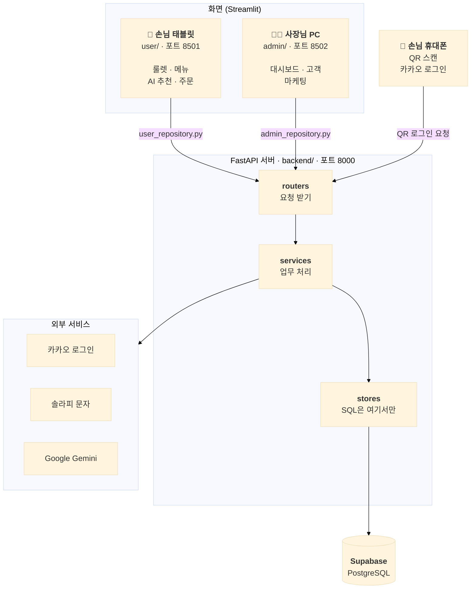

# 🍺 Table Order

**테이블 QR 한 번으로 로그인부터 룰렛·AI 추천·주문까지, 사장님은 데이터로 단골을 만든다**

역전할머니맥주 홍대점 시연용 테이블 오더 서비스입니다. 손님 태블릿 화면, 사장님 관리자 화면, FastAPI 서버를 한 저장소(모노레포)에서 관리합니다.

> 프로젝트: aio-03 · P1 · Team 1

[📚 관련 문서](#-관련-문서) · [🏗 시스템 아키텍처](#-시스템-아키텍처) · [🚀 실행 방법](#-실행-방법) · [🌟 주요 기능](#-주요-기능)

---

## 🚩 목차

1. [프로젝트 소개](#-프로젝트-소개)
2. [팀원](#-팀원)
3. [기획 배경](#-기획-배경)
4. [관련 문서](#-관련-문서)
5. [프로젝트 구성](#-프로젝트-구성)
6. [기술 스택](#-기술-스택)
7. [시스템 아키텍처](#-시스템-아키텍처)
8. [서비스 이용 흐름](#-서비스-이용-흐름)
9. [실행 방법](#-실행-방법)
10. [주요 기능](#-주요-기능)
11. [AI 기능](#-ai-기능)
12. [프로젝트 회고](#-프로젝트-회고)

---

## ✨ 프로젝트 소개

<p align="center">
  
</p>

**Table Order**는 술집 테이블에 놓인 태블릿으로 주문하는 서비스입니다. 손님은 태블릿의 QR을 휴대폰으로 스캔해 카카오로 로그인하고, 행운의 룰렛으로 쿠폰을 받고, AI가 짜 주는 메뉴 조합으로 주문합니다. 사장님은 쌓인 주문·방문 데이터로 매출을 보고, 등급별로 손님을 나눠 재방문 문자를 보냅니다.

> **한 줄 소개**
> 주문 태블릿을 "주문만 받는 기계"에서 "단골을 만드는 도구"로 바꾸는 테이블 오더

| 시스템 | 역할 |
|---|---|
| **손님 화면** (Streamlit, `user/`) | 룰렛·QR 로그인, 메뉴 보기, 장바구니·쿠폰함, AI 추천 조합, 직원 호출 |
| **관리자 화면** (Streamlit, `admin/`) | 대시보드·매출 분석, 메뉴·품절 관리, 룰렛 확률 설정, 고객 등급, 마케팅 문자·AI 챗봇 |
| **API 서버** (FastAPI, `backend/`) | 카카오 QR 로그인, 회원·주문·쿠폰 저장, 통계 계산, 솔라피 문자 발송, 제미나이 호출 |
---

## 👥 팀원

| 이름 | 담당 영역 | GitHub |
|---|---|---|
| 성호 | 팀장 · QR 로그인 · 문자 발송 · 관리자 로그인 · 관리자 AI 챗봇 | [열기 ↗](https://github.com/seongholim-11) |
| 재현 | 손님 AI 추천 질문 · 룰렛 · 쿠폰 · 주문(주문 이력 포함) | [열기 ↗](https://github.com/94JayKim) |
| 수용 | 관리자 대시보드 · 고객 등급(수신거부 포함) | [열기 ↗](https://github.com/power9869) |
| 서준 | 메뉴 · 카테고리 · 추천 가중치 | [열기 ↗](https://github.com/stardroplatte89) |
| 석원 | 관리자 AI 추천 · 직원 호출 · 룰렛 설정 | [열기 ↗](https://github.com/swihm1989-ship-it) |

담당별 상세 작업은 [`docs/todo/`](docs/todo)에 있습니다.

---

## 🧭 기획 배경

테이블 오더는 이미 많은 가게에 들어가 있지만, 대부분 **주문을 받는 데서 끝납니다.** 누가 왔는지, 다시 왔는지, 무엇을 좋아하는지는 남지 않습니다.

```
손님 착석 → 태블릿으로 주문 → 계산 → 끝
                 (누가 먹었는지, 다시 올지 알 수 없음)
```

Table Order는 주문 흐름 안에 **로그인할 이유(룰렛 쿠폰)** 와 **고르기 쉬운 이유(AI 추천)** 를 넣어, 자연스럽게 손님 데이터가 쌓이게 합니다. 사장님은 그 데이터로 다시 손님을 부릅니다.

```
QR 로그인 → 룰렛 쿠폰 → AI 추천 조합 주문 → 방문·주문 기록
     → 사장님 대시보드·고객 등급 → 등급별 재방문 문자 → 다시 방문
```

**목표**
- 태블릿에 로그인창 없이, 손님 휴대폰으로 3분 안에 끝나는 QR 로그인
- 룰렛·쿠폰으로 로그인할 동기 만들기 (회원당 하루 1회)
- 인원·예산·취향을 고르면 세트 조합과 할인가를 바로 보여 주는 AI 추천
- 신규·재방문·단골·휴면 등급과 매출 통계로 사장님의 마케팅 결정 돕기
---

## 📚 관련 문서

| 문서 | 내용 |
|---|---|
| [`AGENTS.md`](AGENTS.md) | 프로젝트 규칙, 실행·테스트 명령, 제품 규칙, Git 규칙 |
| [`docs/README.md`](docs/README.md) | docs 폴더 전체 문서 지도 |
| [`docs/todo/TODO_충돌_오류.md`](docs/todo/TODO_충돌_오류.md) | TODO 구현 중 충돌·오류와 해결 방법 |
| [`docs/가이드/개발_가이드.md`](docs/가이드/개발_가이드.md) | 새 API 추가 순서, 경로·스키마 변경 규칙 |
| [`docs/가이드/배포_체크리스트.md`](docs/가이드/배포_체크리스트.md) | 배포 전 확인할 것 |
| [`docs/가이드/정식_구현_계획.md`](docs/가이드/정식_구현_계획.md) | QR 로그인·솔라피 구현 기준, 카카오/Supabase 설정 |
| [`docs/가이드/코드_둘러보기.md`](docs/가이드/코드_둘러보기.md) | 폴더 지도와 핵심 코드 설명 |
| [`docs/가이드/팀_공지.md`](docs/가이드/팀_공지.md) | 팀원 공지, 어떤 문서를 언제 보는지 |
| [`docs/기능흐름/기능흐름_개발자.md`](docs/기능흐름/기능흐름_개발자.md) | 개발자 관점 기능 흐름 |
| [`docs/기능흐름/기능흐름_손님_관리자.md`](docs/기능흐름/기능흐름_손님_관리자.md) | 손님·사장님 관점 기능 흐름 |
| [`docs/설계/API_설계.md`](docs/설계/API_설계.md) | API 설계 (엔드포인트별 요청·응답·인증) |
| [`docs/설계/DB_설계.md`](docs/설계/DB_설계.md) | DB 설계 (실행용 SQL: `docs/db/fbgrowth_schema.sql`) |
| [`docs/설계/화면_설계.md`](docs/설계/화면_설계.md) | 화면 설계 (손님·관리자 화면 구성과 이동 흐름) |

---

## 📦 프로젝트 구성

```
table-order
├── backend/   → FastAPI 서버 (core / routers / services / stores / seed)
├── user/      → 손님 Streamlit 화면
├── admin/     → 관리자 Streamlit 화면
├── shared/    → 두 화면이 같이 쓰는 API 호출 코드
├── tests/     → 화면·통합 테스트
├── tools/     → 시연 데이터 시드·내보내기 스크립트
└── docs/      → 설계·흐름·TODO 문서
```

화면 코드는 `app.py`(진입점)와 역할별 폴더로 나눕니다. 폴더 이름을 `pages`가 아니라 `views`로 쓰는 이유는 Streamlit이 `pages/`를 자동 멀티페이지로 인식하기 때문입니다.

| 폴더 | 역할 | 백엔드의 대응 계층 |
|---|---|---|
| `views/` | 화면 하나를 조립하는 함수 (`page_*`, `render_*`) | `routers/` |
| `ui/` | 여러 화면이 같이 쓰는 UI 조각·다이얼로그 | - |
| `state/` | `st.session_state` 조작과 계산 (장바구니·로그인·퀴즈 등) | `services/` |
| `shared/api.py`, `*_repository.py` | 서버/예시 데이터 호출 | `stores/` |
---

## 🛠 기술 스택

**Frontend (손님 · 관리자 화면)**
| 기술 | 용도 |
|---|---|
| Python / Streamlit | 손님 태블릿 화면, 관리자 화면 |
| httpx | 화면 → 서버 API 호출 |
| qrcode / Pillow | 로그인 QR 이미지 생성 |

**Backend**
| 기술 | 용도 |
|---|---|
| Python 3.12+ / FastAPI | REST API (손님 `/api/...`, 관리자 `/admin/api/...`) |
| Pydantic Settings | 환경변수 설정 |
| PyJWT | 로그인 회원증(JWT) 발급 |
| uv | 패키지 관리 |
| Pytest | 서버·화면·통합 테스트 |

**Database / Auth**
| 기술 | 용도 |
|---|---|
| Supabase (PostgreSQL) / psycopg | 운영 DB (개발 기본값은 로컬 SQLite) |
| 카카오 로그인 (OAuth) | 손님 QR 로그인 |
| Supabase Auth | 사장님(관리자) 이메일·비밀번호 로그인 (`owners` 등록 계정) |

**외부 API**
| 기술 | 용도 |
|---|---|
| Google Gemini (무료 API) | 관리자 AI 챗봇, AI 문자 후보 |
| 솔라피 (Solapi) | 마케팅 문자 발송 (`SMS_DRY_RUN=true`면 기록만) |
| 서울 열린데이터광장 | 오늘 행사 문구 |
| Open-Meteo | 현재 날씨 (손님 AI 질문·관리자 화면, 실패 시 DB 값) |
---

## 🏗 시스템 아키텍처



- 화면 코드는 서버 API를 직접 부르지 않고 `user/user_repository.py`, `admin/admin_repository.py`만 부릅니다.
- 서버가 꺼져 있으면 화면은 예시 데이터로 동작합니다(`DATA_SOURCE=auto`). 이때 주문·호출은 저장되지 않습니다.
---

## 🔄 서비스 이용 흐름

**손님**
1. 테이블 태블릿(`?table=12`)에서 첫 화면을 엽니다. 로그인 없이 "비회원 주문"도 할 수 있습니다.
2. "📱 로그인" → 휴대폰으로 QR 스캔 → 카카오 로그인
3. 룰렛을 돌려 쿠폰을 받습니다 (회원당 하루 1회).
4. 메뉴를 고르거나 💬 AI 질문으로 추천 조합을 받습니다.
5. 쿠폰함에서 쿠폰을 적용하고 주문합니다.

**사장님**
1. 관리자 화면에서 오늘 매출과 인기 메뉴를 봅니다.
2. 메뉴 품절·가격·추천 가중치, 룰렛 확률을 바꿉니다.
3. 고객 등급을 확인하고, 등급별 문자를 보내 재방문을 이끕니다.
---

## 🚀 실행 방법

```bash
# 서버 (http://127.0.0.1:8000/docs)
cd backend
cp .env.example .env
uv sync
uv run fastapi dev main.py

# 화면 (저장소 루트에서, 서버가 켜져 있어야 QR 로그인·문자 발송이 동작)
uv venv .venv
source .venv/Scripts/activate   # macOS/Linux 는 source .venv/bin/activate
uv pip install -r requirements.txt
streamlit run user/app.py --server.port 8501    # 손님 (?table=12 로 테이블 지정)
streamlit run admin/app.py --server.port 8502   # 관리자
```

- `backend/.env`의 `APP_ENV=dev`면 손님 화면은 모의 회원으로 자동 로그인하고, 관리자 화면은 토큰 입력을 생략합니다(끄려면 `ADMIN_SKIP_TOKEN=0`, 토큰은 `ADMIN_TOKEN`). dev가 아니면 우회는 없습니다. 운영 배포에서는 `dev`로 두지 마세요.
- 관리자 로그인: `SUPABASE_URL`·`SUPABASE_ANON_KEY`가 있으면 로그인 화면이 사장님 이메일·비밀번호 로그인(`POST /api/auth/owner/login`)으로 바뀝니다. 계정은 Supabase Auth에 만든 뒤 `docs/db/fbgrowth_owner_add.sql`로 `owners`에 등록합니다. `ADMIN_TOKEN`은 개발용이라 `APP_ENV=prod`에서 Supabase가 설정되어 있으면 거부됩니다.
- 서버 기본 DB는 로컬 SQLite(`backend/app.db`)이고 `DATABASE_URL`에 Supabase(PostgreSQL) 주소를 넣으면 바뀝니다. 스키마를 바꿨다면 기존 `app.db`를 지우고 서버를 다시 켜세요. 화면은 `API_URL`·`DATA_SOURCE`(dummy=예시 데이터/api/auto) 환경변수로 서버 연결을 정합니다.
- 휴대폰으로 QR 로그인을 시험하려면 `PUBLIC_BASE_URL`을 서버 PC 주소(예: `http://192.168.0.10:8000`)로 두고 `--host 0.0.0.0`으로 실행하세요. 카카오 키가 없으면 모의 로그인 화면이 열립니다.
- 문자는 솔라피로 보내며 `SOLAPI_API_KEY`·`SOLAPI_API_SECRET`·`SOLAPI_SENDER_NUMBER`·`SMS_OPT_OUT_NUMBER`(무료수신거부 번호)가 필요합니다. `SMS_DRY_RUN=true`(기본)면 실제 전송 없이 기록만 남깁니다.
- 문자 발송 테스트 (관리자 토큰 필수, 번호 1건 즉시 발송, 본문 앞에 `[테스트]`가 붙음):
  ```bash
  curl -X POST http://localhost:8000/admin/api/sms/test \
    -H "Authorization: Bearer $ADMIN_TOKEN" -H "Content-Type: application/json" \
    -d '{"phone": "010-1234-5678", "body": "테스트 문자입니다"}'
  # → {"ok": true, "dry_run": true, "type": "SMS", "request_id": "dryrun-...", "to": "01012345678"}
  ```

**테스트**
```bash
cd backend && uv run pytest -q   # 서버
python -m pytest tests -q        # 화면·통합 (저장소 루트에서)
```
---

## 🌟 주요 기능

<p align="center">
  
</p>

### QR 로그인 (손님 휴대폰 ↔ 태블릿)

태블릿에는 아이디·비밀번호 입력창이 없습니다. 태블릿이 QR을 보여 주고, 실제 로그인은 손님 휴대폰에서 합니다.

- **휴대폰으로 카카오 로그인**
  - 태블릿의 QR을 스캔하면 광고성 문자 수신 동의(선택) 화면을 거쳐 카카오 로그인으로 넘어갑니다.
  - 성별·생일·휴대폰 번호는 직접 입력하지 않고 카카오에서 동의한 항목만 받아옵니다.
- **태블릿에 실시간 반영**
  - 태블릿은 `QR 스캔 → 카카오 로그인 → 완료` 단계를 보여 주고, 끝나면 회원 이름과 남은 룰렛 기회를 표시합니다.
  - QR 주소의 값(token)과 태블릿만 아는 값(secret)을 나눠 두어 다른 사람이 로그인 결과를 가로챌 수 없습니다.
- **여러 회원 로그인**
  - 같은 테이블에서 일행이 차례로 로그인할 수 있고, 로그인할 때마다 방문 횟수가 1 늘어납니다.
  - QR은 3분 뒤 만료되며, 이미 이 태블릿에서 로그인한 회원은 다시 로그인할 수 없습니다.

> 카카오 키가 없으면 위 GIF처럼 **모의 카카오 로그인** 화면이 열려 키 없이도 흐름 전체를 시험할 수 있습니다.

<hr />

### 행운의 룰렛 · 쿠폰함

맨 위 GIF처럼 로그인한 회원은 첫 화면에서 룰렛을 돌려 할인·서비스 쿠폰을 받습니다.

- **회원당 하루 1회** (한국 시간 기준). 같은 날 다른 테이블에서도 다시 돌릴 수 없고, 다음 날에는 다시 돌릴 수 있습니다.
- 당첨 결과는 바로 적용하지 않고 **쿠폰함**에 담깁니다. 주문 화면의 쿠폰함에서 사용·취소하고, 주문하면 사용 완료가 됩니다.
- 룰렛 칸 구성과 당첨 확률은 사장님이 관리자 화면 **이벤트**에서 바꿉니다.

<hr />

<p align="center">
  
</p>

### 메뉴 · 장바구니 · 주문

- **카테고리별 메뉴**: 인기메뉴·치킨·안주·탕·맥주·소주·음료 카테고리를 누르면 메뉴 카드가 바뀝니다. 품절 메뉴는 "품절"로 표시되어 담을 수 없습니다.
- **매운맛 단계**: 순한맛/보통맛/아주 매운맛이 있는 메뉴는 카드 안에서 단계를 고릅니다.
- **장바구니**: `−` / `+` / 🗑 로 수량을 바꾸고, 쿠폰 할인과 AI 조합 할인이 줄별로 표시됩니다.
- **주문**: "주문 확인하기"에서 내용과 합계를 확인하고 "주문하기"를 누르면 접수됩니다. 주문 상태(접수·조리중) 기능은 두지 않습니다.
- **직원 호출**: 🔔 버튼으로 물·앞접시 같은 요청을 여러 개 골라 보냅니다.

<hr />

<p align="center">
  
</p>

### AI 추천 조합

- **💬 AI 질문**: 배고픔, 스트레스, 인원, 일행 성별, 음식 종류, 맵기, 방문 목적, 예산 8개 질문에 누르기만 하면 다음 질문으로 넘어갑니다.
- **상황 자동 반영**: 지금 시간대와 날씨(Open-Meteo)가 함께 반영됩니다. 날씨 조회가 실패하면 DB에 저장된 값을 씁니다.
- **추천 결과**: 최대 3개 조합을 순위대로 보여 주고, 구성 메뉴·추천 이유·회원 할인가를 함께 표시합니다. "조합 담기"를 누르면 세트가 장바구니에 들어갑니다.
- 품절 메뉴가 들어간 조합은 후보에서 빠지고, 사장님이 정한 **추천 가중치**가 높은 메뉴가 더 높은 순위를 받습니다.

<hr />

<p align="center">
  
</p>

### 관리자 화면

- **대시보드**: 오늘 주문 수·평균 주문금액·매출, 최근 7일·30일 매출과 증감률, 시간대·요일별 매출, 주문 금액대 분포, 테이블 회전율, 고객 연령대·성별, 인기 메뉴 TOP 10을 봅니다.
- **메뉴 관리 · 추천 가중치**: 카테고리별 메뉴, 가격, 품절, AI 추천에 쓰는 메뉴별 가중치(0~100)를 관리합니다.
- **이벤트**: 룰렛 칸(할인/서비스 메뉴), 할인율, 당첨 확률, 색상을 바꾸고 미리봅니다.
- **고객 등급**: 방문 기록으로 신규·재방문·단골·휴면을 나누고, 등급 기준을 바꿔 미리본 뒤 저장합니다.
- **주문 이력**: 기간·조건별로 지난 주문을 확인합니다.
- **마케팅**: 수신 동의한 회원에게 등급별로 문자를 보냅니다(솔라피). 이번 달 발송량과 잔액, 발송 내역, 수신거부를 함께 관리합니다.
---

## 🤖 AI 기능

AI는 손님 쪽 추천과 사장님 쪽 마케팅 두 곳에서 씁니다. 별도 RAG 없이 **매장 DB 데이터를 근거로** 답하는 것이 원칙입니다.

```
손님 답변(8문항) + 시간대·날씨 + 메뉴·품절·추천 가중치
                         ↓
                 추천 규칙 · 점수 계산
                         ↓
           최대 3개 조합 + 추천 이유 + 할인가

매출·고객 등급·주문 기록 (DB)
                         ↓
                 Google Gemini (무료 API)
                         ↓
         사장님 AI 챗봇 답변 · 등급별 문자 문구 후보
```

- **손님 AI 추천**: 인원·배고픔·예산에 맞춰 안주 수량과 1인 1음료를 맞추고, "매운맛은 뺐어요"처럼 왜 이 조합인지 설명합니다. (위 [AI 추천 조합](#ai-추천-조합) GIF)

<hr />

<p align="center">
  
</p>

### 관리자 AI 챗봇

- 사장님이 "이번 주 매출 어때?", "휴면 손님 다시 오게 하려면?"처럼 물으면 매장 DB의 매출·고객·메뉴 데이터를 근거로 답합니다.
- 이전 대화를 이어서 질문할 수 있고, 새 대화 버튼과 대화 목록으로 대화를 나눠 관리합니다.
- `GEMINI_API_KEY`가 있으면 Gemini가 답하고, 서버나 키가 없으면 규칙 기반 모의 응답으로 대신합니다.

<hr />

<p align="center">
  
</p>

### AI 마케팅 추천 · 손님 응대 제안

- **AI 마케팅 추천**: "✨ AI 추천 받기"를 누르면 지금 데이터에서 할 만한 마케팅을 **AI 문자 추천**(첫 방문 감사·세 번째 방문 유도·단골 감사 혜택·휴면 고객 복귀 등)과 **기타 AI 추천**(메뉴 안내·취향 확인·신메뉴 선공개 등)으로 나눠 보여 줍니다. "🔄 재추천"을 누르면 다른 추천이 나옵니다.
- **손님 응대 제안**: 오늘 주문한 단골·재방문 손님의 방문 횟수와 평소 메뉴 취향을 근거로, 직원이 건넬 멘트를 매장 3D 테이블 지도와 함께 제안합니다.

<hr />

<p align="center">
  
</p>

### AI 문자

- **AI 추천**의 "✉️ AI 문자로 실행"을 누르면 그 추천의 대상 등급, 수신자 목록, 문자 초안이 바로 채워진 문자 작성 화면으로 넘어갑니다. 대상과 문구는 고쳐서 보낼 수 있습니다.
- 오른쪽 휴대폰 미리보기로 실제 문자 모양을 확인하고, 바이트 수에 따라 SMS/LMS와 이번 달 무료 잔여 건수를 보여 줍니다.
- 광고 문자 표기와 무료수신거부 번호를 자동으로 붙이고, 수신 동의한 회원에게만 보냅니다. 예약 발송도 할 수 있습니다.
- `GEMINI_API_KEY`가 없으면 템플릿 문구를 쓰고, `SMS_DRY_RUN=true`(기본)면 실제 전송 없이 기록만 남깁니다.

---

## 💭 프로젝트 회고

| 이름 | 한 일 | 어려웠던 점 | 배운 점 · 느낀 점 |
|---|---|---|---|
| 성호 | 팀장을 맡아 QR 로그인, 문자 발송, 관리자 로그인, 관리자 AI 챗봇을 만들었다. 팀원들이 쉽게 참여하도록 UI와 기본 뼈대 코드도 미리 준비했다. | 개발 경험이 적은 팀원들이 편하게 참여할 수 있도록 뼈대를 어떻게 쉽게 만들지 고민하는 일이 어려웠다. 바이브코딩이라 PR 속도가 빨라 코드를 일일이 검토하기도 어려웠다. | 아이디어를 실체화해 첫 프로젝트로서 만족스러운 결과를 냈다. PR 승인에 AI 테스트와 검증을 활용해 안전하게 merge했고, AI에게 질문하며 서비스 이해도를 높였다. 카카오 로그인, AI 문자 생성과 실제 발송, 사장님에게 가장 유용할 AI 응대 추천이 특히 뿌듯했다. 다시 시작한다면 설계를 더 구체화하고 트러블슈팅을 정리하며, 이후에는 보안과 고도화에 더 신경 쓰고 싶다. |
| 재현 | 손님 AI 추천 질문, 룰렛, 쿠폰, 주문(주문 이력 포함)을 맡았다. | 익숙하지 않은 기술과 예상하지 못한 오류 때문에 어려움을 겪었다. | 배운 기술이 실제 프로젝트에서 서로 어떻게 연결되는지 알게 됐다. 코드 흐름을 이해하고 오류 원인을 찾는 일이 중요하다는 것을 배웠고, AI로 해결 방법을 찾고 직접 고치며 익혔다. GitHub 협업을 통해 소통의 중요성도 배웠다. |
| 수용 | 관리자 대시보드와 고객 등급(수신거부 포함)을 맡았다. | AI를 최소화해 스스로 더 구체적으로 이해하며 참여하고 싶었지만 역량이 부족해 아쉬웠다. | 프로젝트 진행 흐름과 API, DB, 백엔드, 프론트엔드가 어떻게 쓰이는지 개념이 잡혔고 AI 활용법 이해도가 높아졌다. 충돌과 오류를 대부분 AI로 해결하며, 하나의 프로그램을 만들려면 많은 작업과 협업이 필요하다는 것을 알았다. |
| 서준 | 메뉴, 카테고리, 추천 가중치를 맡았다. API 문서화와 DB 설계 일부를 하고, AI로 DB와 FastAPI를 연동했다. | 첫 협업이라 Pull & Rebase의 이유가 헷갈렸고 충돌 해결에 시간이 걸렸다. 프론트에 필요한 데이터를 API로 서빙해야 한다는 것을 몰라 필요한 API를 놓쳤다. 손코딩에 도전했지만 이해도와 속도 차이를 느껴 AI로 돌아왔다. | Streamlit과 React는 서버가 모든 정보를 주는 것이 아니라 API를 호출해 받기도 한다는 것을 알았다. 개발은 할수록 할 일이 끝없이 나온다는 것을 다시 느꼈다. 반복되는 테스트 실패를 보며, 테스트가 서비스 품질을 지키고 에러를 줄이는 데 큰 도움이 된다고 느꼈다. |
| 석원 | 관리자 AI 추천, 직원 호출 관리, 룰렛 설정의 DB 연동을 구현하고 관련 테스트를 진행했다. | 화면, API, DB 간 응답 구조를 맞추고 다른 기능과 겹치는 부분을 조율하는 일이 어려웠다. | 기능 구현뿐 아니라 데이터 흐름을 끝까지 확인하고 테스트로 동작을 검증하는 과정이 중요하다는 것을 느꼈다. |
