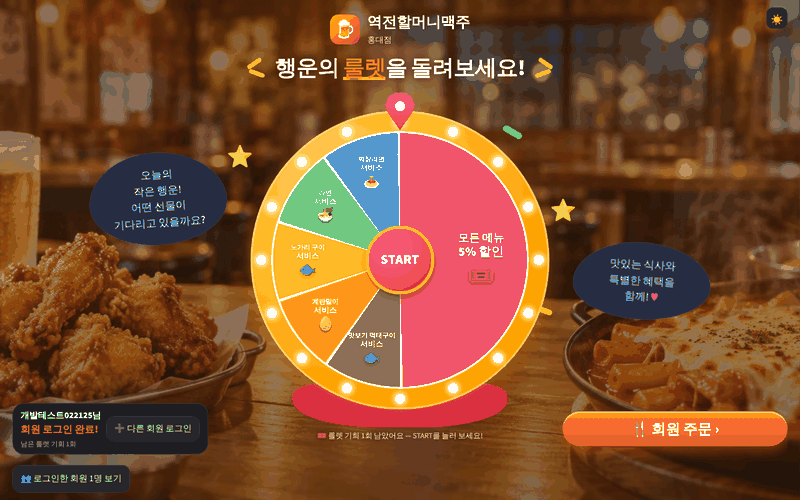
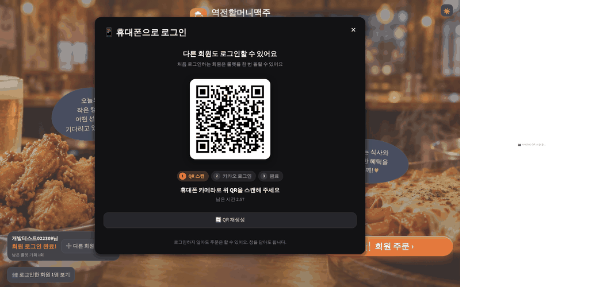
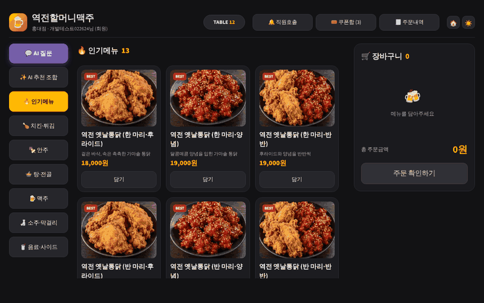
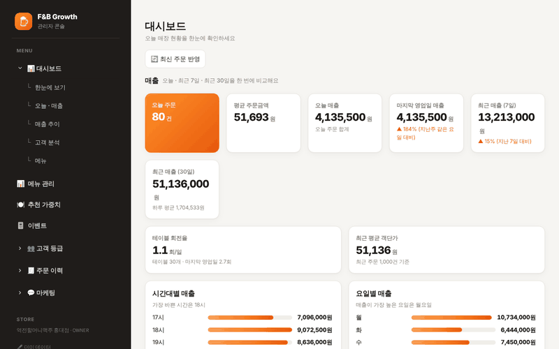
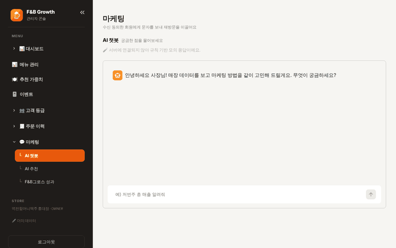
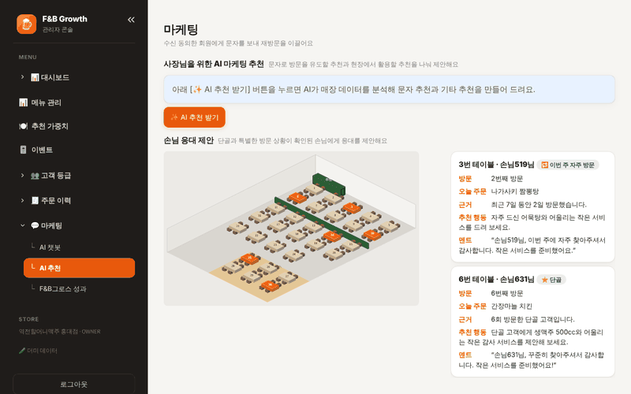
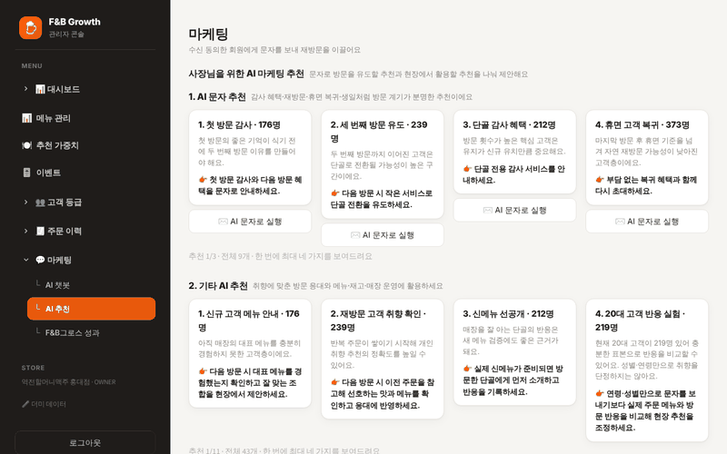
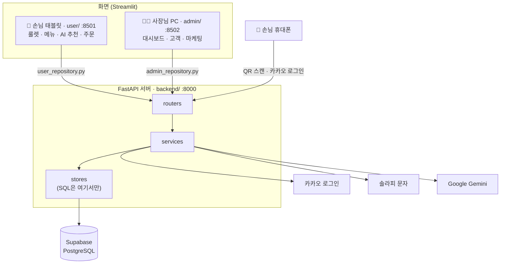

# 🍺 Table Order

**테이블 QR 한 번으로 로그인부터 룰렛·AI 추천·주문까지, 사장님은 데이터로 단골을 만든다**

역전할머니맥주 홍대점 시연용 테이블 오더 서비스입니다. 손님 태블릿 화면, 사장님 관리자 화면, FastAPI 서버를 한 저장소(모노레포)에서 관리합니다.

> 프로젝트: aio-03 · P1 · Team 1

[🌟 주요 기능](#-주요-기능) · [🚀 실행 방법](#-실행-방법) · [🏗 시스템 아키텍처](#-시스템-아키텍처) · [📚 관련 문서](#-관련-문서)

---

## 🚩 목차

1. [프로젝트 소개](#-프로젝트-소개)
2. [팀원](#-팀원)
3. [기획 배경](#-기획-배경)
4. [주요 기능](#-주요-기능)
5. [AI 기능](#-ai-기능)
6. [서비스 이용 흐름](#-서비스-이용-흐름)
7. [기술 스택](#-기술-스택)
8. [시스템 아키텍처](#-시스템-아키텍처)
9. [프로젝트 구성](#-프로젝트-구성)
10. [실행 방법](#-실행-방법)
11. [구현 현황](#-구현-현황)
12. [관련 문서](#-관련-문서)

---

## ✨ 프로젝트 소개

<p align="center">
  
</p>

**Table Order**는 술집 테이블에 놓인 태블릿으로 주문하는 서비스입니다. 손님은 태블릿의 QR을 휴대폰으로 스캔해 카카오로 로그인하고, 행운의 룰렛으로 쿠폰을 받고, AI가 짜 주는 메뉴 조합으로 주문합니다. 사장님은 쌓인 주문·방문 데이터로 매출을 보고, 등급별로 손님을 나눠 재방문 문자를 보냅니다.

> **한 줄 소개**
> 주문 태블릿을 "주문만 받는 기계"에서 "단골을 만드는 도구"로 바꾸는 테이블 오더

| 시스템 | 역할 |
|---|---|
| **손님 화면** (Streamlit, `user/`) | 룰렛·QR 로그인, 메뉴 보기, 장바구니·쿠폰함, AI 추천 조합, 직원 호출 |
| **관리자 화면** (Streamlit, `admin/`) | 대시보드·매출 분석, 메뉴·품절 관리, 룰렛 확률 설정, 고객 등급, 마케팅 문자·AI 챗봇 |
| **API 서버** (FastAPI, `backend/`) | 카카오 QR 로그인, 회원·주문·쿠폰 저장, 통계 계산, 솔라피 문자 발송, 제미나이 호출 |

---

## 👥 팀원

| 이름 | 담당 영역 | GitHub |
|---|---|---|
| 성호 | 팀장 · QR 로그인 · 문자 발송 · 관리자 로그인 · 관리자 AI 챗봇 | [열기 ↗](https://github.com/seongholim-11) |
| 재현 | 손님 AI 추천 질문 · 룰렛 · 쿠폰 · 주문(주문 이력 포함) | [열기 ↗](https://github.com/94JayKim) |
| 수용 | 관리자 대시보드 · 고객 등급(수신거부 포함) | [열기 ↗](https://github.com/power9869) |
| 서준 | 메뉴 · 카테고리 · 추천 가중치 | [열기 ↗](https://github.com/stardroplatte89) |
| 석원 | 관리자 AI 추천 · 직원 호출 · 룰렛 설정 | [열기 ↗](https://github.com/swihm1989-ship-it) |

담당별 상세 작업은 [`docs/todo/`](docs/todo), API 담당 분배는 [`docs/api/FBGrowth_API_담당_분배_3-2-2-2-1.md`](docs/api/FBGrowth_API_담당_분배_3-2-2-2-1.md)에 있습니다.

---

## 🧭 기획 배경

테이블 오더는 이미 많은 가게에 들어가 있지만, 대부분 **주문을 받는 데서 끝납니다.** 누가 왔는지, 다시 왔는지, 무엇을 좋아하는지는 남지 않습니다.

```
손님 착석 → 태블릿으로 주문 → 계산 → 끝
                 (누가 먹었는지, 다시 올지 알 수 없음)
```

Table Order는 주문 흐름 안에 **로그인할 이유(룰렛 쿠폰)** 와 **고르기 쉬운 이유(AI 추천)** 를 넣어, 자연스럽게 손님 데이터가 쌓이게 합니다. 사장님은 그 데이터로 다시 손님을 부릅니다.

```
QR 로그인 → 룰렛 쿠폰 → AI 추천 조합 주문 → 방문·주문 기록
     → 사장님 대시보드·고객 등급 → 등급별 재방문 문자 → 다시 방문
```

**목표**
- 태블릿에 로그인창 없이, 손님 휴대폰으로 3분 안에 끝나는 QR 로그인
- 룰렛·쿠폰으로 로그인할 동기 만들기 (회원당 하루 1회)
- 인원·예산·취향을 고르면 세트 조합과 할인가를 바로 보여 주는 AI 추천
- 신규·재방문·단골·휴면 등급과 매출 통계로 사장님의 마케팅 결정 돕기

---

## 🌟 주요 기능

<p align="center">
  
</p>

### QR 로그인 (손님 휴대폰 ↔ 태블릿)

태블릿에는 아이디·비밀번호 입력창이 없습니다. 태블릿이 QR을 보여 주고, 실제 로그인은 손님 휴대폰에서 합니다.

- **휴대폰으로 카카오 로그인**
  - 태블릿의 QR을 스캔하면 광고성 문자 수신 동의(선택) 화면을 거쳐 카카오 로그인으로 넘어갑니다.
  - 성별·생일·휴대폰 번호는 직접 입력하지 않고 카카오에서 동의한 항목만 받아옵니다.
- **태블릿에 실시간 반영**
  - 태블릿은 `QR 스캔 → 카카오 로그인 → 완료` 단계를 보여 주고, 끝나면 회원 이름과 남은 룰렛 기회를 표시합니다.
  - QR 주소의 값(token)과 태블릿만 아는 값(secret)을 나눠 두어 다른 사람이 로그인 결과를 가로챌 수 없습니다.
- **여러 회원 로그인**
  - 같은 테이블에서 일행이 차례로 로그인할 수 있고, 로그인할 때마다 방문 횟수가 1 늘어납니다.
  - QR은 3분 뒤 만료되며, 이미 이 태블릿에서 로그인한 회원은 다시 로그인할 수 없습니다.

> 카카오 키가 없으면 위 GIF처럼 **모의 카카오 로그인** 화면이 열려 키 없이도 흐름 전체를 시험할 수 있습니다.

<hr />

### 행운의 룰렛 · 쿠폰함

맨 위 GIF처럼 로그인한 회원은 첫 화면에서 룰렛을 돌려 할인·서비스 쿠폰을 받습니다.

- **회원당 하루 1회** (한국 시간 기준). 같은 날 다른 테이블에서도 다시 돌릴 수 없고, 다음 날에는 다시 돌릴 수 있습니다.
- 당첨 결과는 바로 적용하지 않고 **쿠폰함**에 담깁니다. 주문 화면의 쿠폰함에서 사용·취소하고, 주문하면 사용 완료가 됩니다.
- 룰렛 칸 구성과 당첨 확률은 사장님이 관리자 화면 **이벤트**에서 바꿉니다.

<hr />

<p align="center">
  
</p>

### 메뉴 · 장바구니 · 주문

- **카테고리별 메뉴**: 인기메뉴·치킨·안주·탕·맥주·소주·음료 카테고리를 누르면 메뉴 카드가 바뀝니다. 품절 메뉴는 "품절"로 표시되어 담을 수 없습니다.
- **매운맛 단계**: 순한맛/보통맛/아주 매운맛이 있는 메뉴는 카드 안에서 단계를 고릅니다.
- **장바구니**: `−` / `+` / 🗑 로 수량을 바꾸고, 쿠폰 할인과 AI 조합 할인이 줄별로 표시됩니다.
- **주문**: "주문 확인하기"에서 내용과 합계를 확인하고 "주문하기"를 누르면 접수됩니다. 주문 상태(접수·조리중) 기능은 두지 않습니다.
- **직원 호출**: 🔔 버튼으로 물·앞접시 같은 요청을 여러 개 골라 보냅니다.

<hr />

<p align="center">
  
</p>

### AI 추천 조합

- **💬 AI 질문**: 배고픔, 스트레스, 인원, 일행 성별, 음식 종류, 맵기, 방문 목적, 예산 8개 질문에 누르기만 하면 다음 질문으로 넘어갑니다.
- **상황 자동 반영**: 지금 시간대와 날씨가 함께 반영됩니다(날씨는 현재 더미 데이터).
- **추천 결과**: 최대 3개 조합을 순위대로 보여 주고, 구성 메뉴·추천 이유·회원 할인가를 함께 표시합니다. "조합 담기"를 누르면 세트가 장바구니에 들어갑니다.
- 품절 메뉴가 들어간 조합은 후보에서 빠지고, 사장님이 정한 **추천 가중치**가 높은 메뉴가 더 높은 순위를 받습니다.

<hr />

<p align="center">
  
</p>

### 관리자 화면

- **대시보드**: 오늘 주문 수·평균 주문금액·매출, 최근 7일·30일 매출과 증감률, 시간대·요일별 매출, 주문 금액대 분포, 테이블 회전율, 고객 연령대·성별, 인기 메뉴 TOP 10을 봅니다.
- **메뉴 관리 · 추천 가중치**: 카테고리별 메뉴, 가격, 품절, AI 추천에 쓰는 메뉴별 가중치(0~100)를 관리합니다.
- **이벤트**: 룰렛 칸(할인/서비스 메뉴), 할인율, 당첨 확률, 색상을 바꾸고 미리봅니다.
- **고객 등급**: 방문 기록으로 신규·재방문·단골·휴면을 나누고, 등급 기준을 바꿔 미리본 뒤 저장합니다.
- **주문 이력 · 직원 호출**: 지난 주문과 처리 대기 중인 직원 호출을 확인합니다.
- **마케팅**: 수신 동의한 회원에게 등급별로 문자를 보냅니다(솔라피). 이번 달 발송량과 잔액, 발송 내역, 수신거부를 함께 관리합니다.

---

## 🤖 AI 기능

AI는 손님 쪽 추천과 사장님 쪽 마케팅 두 곳에서 씁니다. 별도 RAG 없이 **매장 DB 데이터를 근거로** 답하는 것이 원칙입니다.

```
손님 답변(8문항) + 시간대·날씨 + 메뉴·품절·추천 가중치
                         ↓
                 추천 규칙 · 점수 계산
                         ↓
           최대 3개 조합 + 추천 이유 + 할인가

매출·고객 등급·주문 기록 (DB)
                         ↓
                 Google Gemini (무료 API)
                         ↓
         사장님 AI 챗봇 답변 · 등급별 문자 문구 후보
```

- **손님 AI 추천**: 인원에 맞춰 안주 수량과 1인 1음료를 맞추고, "매운맛은 뺐어요"처럼 왜 이 조합인지 설명합니다. (위 [AI 추천 조합](#ai-추천-조합) GIF)

<hr />

<p align="center">
  
</p>

### 관리자 AI 챗봇

- 사장님이 "이번 주 매출 어때?", "휴면 손님 다시 오게 하려면?"처럼 물으면 매장 DB의 매출·고객·메뉴 데이터를 근거로 답합니다.
- 이전 대화를 이어서 질문할 수 있고, 새 대화 버튼과 대화 목록으로 대화를 나눠 관리합니다.
- `GEMINI_API_KEY`가 있으면 Gemini가 답하고, 서버나 키가 없으면 규칙 기반 모의 응답으로 대신합니다.

<hr />

<p align="center">
  
</p>

### AI 마케팅 추천 · 단골 응대 제안

- **마케팅 추천**: 전체 고객·문자 발송 가능 인원·누적 매출을 요약하고, 휴면 고객 되찾기, 단골 감사 혜택, 신규 고객 재방문, 한가한 시간대 이벤트처럼 지금 데이터에서 할 만한 마케팅을 제안합니다. "재추천"을 누르면 다른 방법을 보여 줍니다.
- **단골 손님 응대 제안**: 오늘 주문한 단골(방문 5회 이상)의 방문 횟수와 평소 메뉴 취향을 근거로, 음식을 전달할 때 직원이 건넬 멘트를 제안합니다.

<hr />

<p align="center">
  
</p>

### AI 문자

- **✨ AI 문자 생성**을 누르면 휴면·단골·주문·날씨·행사 기준으로 대상과 문구를 만든 추천 문자 후보가 나옵니다. 고르면 대상 등급, 수신자 목록, 본문이 바로 채워집니다.
- 오른쪽 휴대폰 미리보기로 실제 문자 모양을 확인하고, 바이트 수에 따라 SMS/LMS와 이번 달 무료 잔여 건수를 보여 줍니다.
- 광고 문자 표기와 무료수신거부 번호를 자동으로 붙이고, 수신 동의한 회원에게만 보냅니다. 예약 발송도 할 수 있습니다.
- `GEMINI_API_KEY`가 없으면 템플릿 문구를 쓰고, `SMS_DRY_RUN=true`(기본)면 실제 전송 없이 기록만 남깁니다.

---

## 🔄 서비스 이용 흐름

**손님**
1. 테이블 태블릿(`?table=12`)에서 첫 화면을 엽니다. 로그인 없이 "비회원 주문"도 할 수 있습니다.
2. "📱 로그인" → 휴대폰으로 QR 스캔 → 카카오 로그인
3. 룰렛을 돌려 쿠폰을 받습니다 (회원당 하루 1회).
4. 메뉴를 고르거나 💬 AI 질문으로 추천 조합을 받습니다.
5. 쿠폰함에서 쿠폰을 적용하고 주문합니다.

**사장님**
1. 관리자 화면에서 오늘 매출과 인기 메뉴를 봅니다.
2. 메뉴 품절·가격·추천 가중치, 룰렛 확률을 바꿉니다.
3. 고객 등급을 확인하고, 등급별 문자를 보내 재방문을 이끕니다.

---

## 🛠 기술 스택

**Frontend (손님 · 관리자 화면)**
| 기술 | 용도 |
|---|---|
| Python / Streamlit | 손님 태블릿 화면, 관리자 화면 |
| httpx | 화면 → 서버 API 호출 |
| qrcode / Pillow | 로그인 QR 이미지 생성 |

**Backend**
| 기술 | 용도 |
|---|---|
| Python 3.12+ / FastAPI | REST API (손님 `/api/...`, 관리자 `/admin/api/...`) |
| Pydantic Settings | 환경변수 설정 |
| PyJWT | 로그인 회원증(JWT) 발급 |
| uv | 패키지 관리 |
| Pytest | 서버·화면·통합 테스트 |

**Database / Auth**
| 기술 | 용도 |
|---|---|
| Supabase (PostgreSQL) / psycopg | 운영 DB (개발 기본값은 로컬 SQLite) |
| 카카오 로그인 (OAuth) | 손님 QR 로그인 |

**외부 API**
| 기술 | 용도 |
|---|---|
| Google Gemini (무료 API) | 관리자 AI 챗봇, AI 문자 후보 |
| 솔라피 (Solapi) | 마케팅 문자 발송 (`SMS_DRY_RUN=true`면 기록만) |
| 서울 열린데이터광장 | 오늘 행사 문구 |

---

## 🏗 시스템 아키텍처



- 화면 코드는 서버 API를 직접 부르지 않고 `user/user_repository.py`, `admin/admin_repository.py`만 부릅니다.
- 서버가 꺼져 있으면 화면은 더미 데이터로 동작합니다(`DATA_SOURCE=auto`). 이때 주문·호출은 저장되지 않습니다.

---

## 📦 프로젝트 구성

```
table-order
├── backend/   → FastAPI 서버 (core / routers / services / stores / dummy / seed)
├── user/      → 손님 Streamlit 화면
├── admin/     → 관리자 Streamlit 화면
├── shared/    → 두 화면이 같이 쓰는 API 호출 코드
├── tests/     → 화면·통합 테스트
├── tools/     → 시연 데이터 시드 스크립트
└── docs/      → 설계·흐름·TODO 문서
```

화면 코드는 `app.py`(진입점)와 역할별 폴더로 나눕니다. 폴더 이름을 `pages`가 아니라 `views`로 쓰는 이유는 Streamlit이 `pages/`를 자동 멀티페이지로 인식하기 때문입니다.

| 폴더 | 역할 | 백엔드의 대응 계층 |
|---|---|---|
| `views/` | 화면 하나를 조립하는 함수 (`page_*`, `render_*`) | `routers/` |
| `ui/` | 여러 화면이 같이 쓰는 UI 조각·다이얼로그 | - |
| `state/` | `st.session_state` 조작과 계산 (장바구니·로그인·퀴즈 등) | `services/` |
| `shared/api.py`, `*_repository.py` | 서버/더미 데이터 호출 | `stores/` |

---

## 🚀 실행 방법

```bash
# 서버 (http://127.0.0.1:8000/docs)
cd backend
cp .env.example .env
uv sync
uv run fastapi dev main.py

# 화면 (저장소 루트에서, 서버가 켜져 있어야 QR 로그인·문자 발송이 동작)
uv venv .venv
source .venv/Scripts/activate   # macOS/Linux 는 source .venv/bin/activate
uv pip install -r requirements.txt
streamlit run user/app.py --server.port 8501    # 손님 (?table=12 로 테이블 지정)
streamlit run admin/app.py --server.port 8502   # 관리자
```

- `backend/.env`의 `APP_ENV=dev`면 손님 화면은 모의 회원으로 자동 로그인하고, 관리자 화면은 토큰 입력을 생략합니다(끄려면 `ADMIN_SKIP_TOKEN=0`, 토큰은 `ADMIN_TOKEN`). 운영 배포에서는 `dev`로 두지 마세요.
- 휴대폰으로 QR 로그인을 시험하려면 `PUBLIC_BASE_URL`을 서버 PC 주소(예: `http://192.168.0.10:8000`)로 두고 `--host 0.0.0.0`으로 실행하세요. 카카오 키가 없으면 모의 로그인 화면이 열립니다.
- 문자는 솔라피로 보내며 `SOLAPI_API_KEY`·`SOLAPI_API_SECRET`·`SOLAPI_SENDER_NUMBER`·`SMS_OPT_OUT_NUMBER`(무료수신거부 번호)가 필요합니다. `SMS_DRY_RUN=true`(기본)면 실제 전송 없이 기록만 남깁니다.
- 문자 발송 테스트 (관리자 토큰 필수, 번호 1건 즉시 발송, 본문 앞에 `[테스트]`가 붙음):
  ```bash
  curl -X POST http://localhost:8000/admin/api/sms/test \
    -H "Authorization: Bearer $ADMIN_TOKEN" -H "Content-Type: application/json" \
    -d '{"phone": "010-1234-5678", "body": "테스트 문자입니다"}'
  # → {"ok": true, "dry_run": true, "type": "SMS", "request_id": "dryrun-...", "to": "01012345678"}
  ```

**테스트**
```bash
cd backend && uv run pytest -q   # 서버
python -m pytest tests -q        # 화면·통합 (저장소 루트에서)
```

---

## 📊 구현 현황

팀원 5명이 기능별로 더미 응답을 실제 DB 구현으로 바꾸는 중입니다.

| 상태 | 기능 |
|---|---|
| ✅ 실제 DB 연동 | QR 로그인·회원, 문자 발송(솔라피), 고객 목록·등급·수신거부, 대시보드 통계, 메뉴 품절 조회, 단골 응대 제안, 손님 메뉴 목록, 룰렛 칸 설정, 관리자 AI 챗봇 |
| 🧪 더미 응답 | 매장 정보, 화면 콘텐츠, 관리자 메뉴 목록·수정, 룰렛 당첨 저장·쿠폰함, 주문 저장·이력, 직원 호출, AI 추천 기록 |

- 아직 더미인 API 목록은 `backend/app/dummy/`의 `DUMMY_ENDPOINTS`, 라우터에서는 `grep -rn "dummy\." backend/app/routers`로 찾습니다.
- 담당별 최신 진행 상태는 [`docs/todo/TODO_*.md`](docs/todo)를 보세요.
- 위 GIF는 손님 화면은 로컬 서버(SQLite), 관리자 화면은 더미 데이터 모드(`DATA_SOURCE=dummy`)로 촬영했습니다. 그래서 AI 챗봇 GIF의 답은 Gemini가 아닌 규칙 기반 모의 응답이고, 문자는 DRY RUN으로 처리됐습니다.

---

## 📚 관련 문서

| 문서 | 내용 |
|---|---|
| [`AGENTS.md`](AGENTS.md) | 프로젝트 규칙, 실행·테스트 명령, 제품 규칙, Git 규칙 |
| [`docs/팀_공지.md`](docs/팀_공지.md) | 팀원 공지, 어떤 문서를 언제 보는지 |
| [`docs/기능흐름_손님_관리자.md`](docs/기능흐름_손님_관리자.md) | 손님·사장님 관점 기능 흐름 |
| [`docs/기능흐름_개발자.md`](docs/기능흐름_개발자.md) | 개발자 관점 기능 흐름 |
| [`docs/코드_둘러보기.md`](docs/코드_둘러보기.md) | 폴더 지도와 핵심 코드 설명 |
| [`docs/개발_가이드.md`](docs/개발_가이드.md) | 새 API 추가 순서, 경로·스키마 변경 규칙 |
| [`docs/DB_설계.md`](docs/DB_설계.md) | DB 설계 (실행용 SQL: `docs/db/fbgrowth_schema.sql`) |
| [`docs/정식_구현_계획.md`](docs/정식_구현_계획.md) | QR 로그인·솔라피 구현 기준, 카카오/Supabase 설정 |
| [`docs/배포_체크리스트.md`](docs/배포_체크리스트.md) | 배포 전 확인할 것 |
| [`docs/TODO_충돌_오류.md`](docs/TODO_충돌_오류.md) | TODO 구현 중 충돌·오류와 해결 방법 |
| [`docs/api/`](docs/api) | API 경로 기준(v7), 담당 분배표 |
