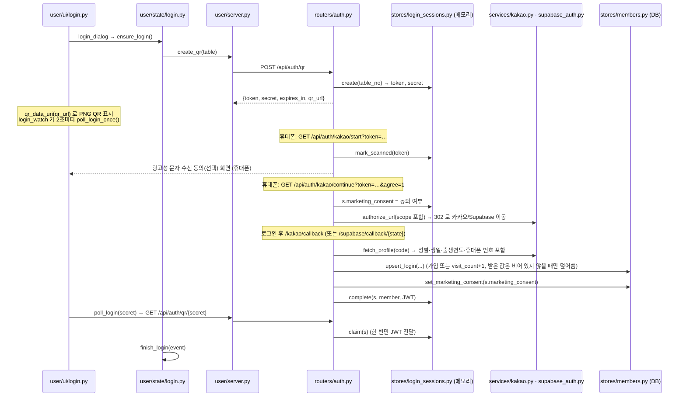
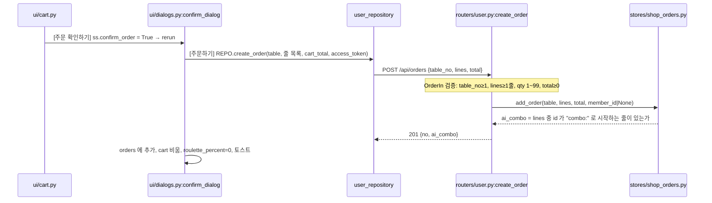

# 핵심 기능 플로우: 개발자 관점

`docs/FLOW_USER_ADMIN.md` 에서 본 손님·사장님 이야기를 **"어느 파일의 어느 함수가 일을 하는가"** 로 다시 따라가는 문서입니다.
폴더 지도와 핵심 코드 설명은 `docs/CODE_TOUR.md`, 새 API 추가 순서와 규칙은 `docs/DEVELOPMENT_GUIDE.md` 에 있고, 여기서는 중복하지 않고 **흐름(누가 → 누구를 호출 → 어디에 저장)** 만 다룹니다.

비유는 이어집니다: **홀(`user/`) → 서빙 직원(`shared/api.py`) → 카운터(`routers/`) → 두뇌(`services/`) → 창고지기(`stores/`) → 장부(SQLite)**.

## 0. 먼저 알아둘 두 가지

### 0-1. 한 번의 요청이 지나가는 길

```
user/views, ui          화면이 버튼을 누른다 (on_click, st.button)
   │  state/*.py        세션 메모(st.session_state)를 바꾸거나 계산한다
   ▼
user_repository.py      "데이터 출입구": dummy / api / auto 중 어디로 보낼지 여기서만 결정
   │
shared/api.py           HTTP 요청 (실패하면 ApiUnavailable / ApiError)
   ▼
backend/app/routers     요청 검사(pydantic) + 인증(Depends) → 서비스/창고 호출
   │  services/         계산·규칙 (등급, 통계, 문자 심사)
   ▼  stores/           SQL (여기에만 존재) → backend/app.db
```

### 0-2. Streamlit 은 "버튼을 누를 때마다 파일을 처음부터 다시 실행"한다

이 점이 평범한 웹 서버와 가장 다릅니다. 그래서 두 가지 습관이 생겼습니다.

- **기억해야 할 것은 `st.session_state` 에 둔다.** 장바구니·로그인 정보·퀴즈 진행이 전부 여기에 있고, 초기 값은 `user/state/session.py:init_state` 가 만듭니다. 탭을 새로고침하면 사라지므로, 보던 화면은 URL 쿼리(`?page=order&cat=best`)로도 남깁니다(`sync_url`).
- **화면 파일(`user/app.py`)은 "지금 어느 화면?"만 정하고**, 실제 그림은 `views/`, 계산은 `state/` 가 맡습니다. 규칙 이름은 서버와 대응됩니다(`views`≈`routers`, `state`≈`services`).

---

## 1. 앱 시작: 데이터를 읽고 화면을 고른다

`user/app.py` 는 실행될 때마다 이 순서로 움직입니다.

1. `ctx.load()` (`user/state/context.py`) → `user_repository.load_content()` 로 **메뉴·카테고리·룰렛·직원호출 항목·AI 질문·규칙**을 한 번에 읽어 `st.session_state["_ctx"]` 에 보관. 이후 다른 모듈은 `ctx.MENU` 처럼 꺼내 씁니다(모듈 변수처럼 보이지만 `__getattr__` 로 세션에서 읽는 것).
2. 읽지 못하면 `ContentUnavailable` → "직원에게 문의해 주세요" 오류 후 `st.stop()`.
3. `init_state()` → `sync_url()` → 테마 CSS → `page` 값에 따라 `render_splash()` 또는 주문 화면 또는 `render_ai_quiz()`.

**데이터 출처 결정** (`user/user_repository.py:get_repository`)

| `DATA_SOURCE` | 저장소 | 읽기 | 쓰기(주문 등) |
|---|---|---|---|
| `dummy` | `DummyRepository` | 코드 안 더미 | 아무것도 안 하고 `None` |
| `api` | `ApiRepository` | 서버 | 서버 (`server.safe_call`) |
| `auto` | `AutoRepository` | 서버가 닿으면 서버, 아니면 더미 | 서버 모드일 때만, 아니면 건너뜀 |

서버 응답은 `st.cache_data(ttl=10)` 로 **10초 캐시**됩니다(`_fetch_content`). 그래서 관리자가 바꾼 품절·가격이 곧 반영되지만 즉시는 아닙니다. `DummyRepository` 의 데이터가 곧 응답 명세이므로, 서버 JSON 은 더미와 같은 모양이어야 합니다.

---

## 2. QR 로그인

### 2-1. 시퀀스와 담당 파일



### 2-2. 꼭 알아둘 설계 포인트

- **token / secret 분리** (`login_sessions.py` 맨 위 설명): token 은 QR 에 들어가 휴대폰이 쓰고, secret 은 태블릿만 갖고 결과 조회에 씁니다. QR 을 찍은 사람이 태블릿의 로그인 결과(JWT)를 가로채지 못하게 하려는 구조입니다.
- **상태는 되돌릴 수 없는 한 방향**: `waiting → scanned → logged_in`, 또는 `expired`(기본 TTL 180초, `login_ttl_seconds`). 스캔된 세션만 `complete` 할 수 있고, `claim` 은 한 번만 값을 줍니다(`claimed` 플래그).
- **CSRF 방어**: 콜백의 `state` 가 우리가 발급한 token 이어야 하고, 상태가 `scanned` 여야 합니다. Supabase 경로는 PKCE verifier 를 서버에만 두고 코드 교환을 한 번만 허용합니다(`s.pkce_verifier` 를 꺼내며 비움).
- **로그인 때 자동 수집하는 정보**: 요청 scope 는 `KAKAO_SCOPES`(기본 `profile_nickname gender birthday birthyear phone_number`). 카카오 콘솔 동의항목에 없는 항목을 넣으면 `KOE205` 가 납니다. Supabase 경로는 Supabase 사용자 정보에 성별·생일·번호가 없어서, 세션의 `provider_token` 으로 카카오 `/v2/user/me` 를 한 번 더 호출해 채웁니다(실패해도 로그인은 계속). 동의하지 않은 항목은 비어 있고, 이후 로그인에서 빈 값이 기존 값을 지우지 않습니다.
- **수신 동의는 휴대폰의 `/kakao/start` 화면에서** 받고(`login_sessions.marketing_consent`), 콜백에서 `members.marketing_consent` 로 저장합니다. 가장 최근 로그인에서 고른 값이 적용됩니다. 태블릿 화면의 "회원 정보 입력" 폼과 `PATCH /api/members/me` 는 없어졌습니다.
- **카카오 키가 없으면 모의 로그인** 화면(`/kakao/mock`)이 열려 로컬에서도 시험할 수 있습니다. 실제 키가 있거나 Supabase 가 켜져 있으면 모의 화면은 404.
- **세션 저장소는 메모리**입니다. 서버를 재시작하거나 프로세스를 여러 개 띄우면 진행 중인 QR 이 사라집니다(Redis 로 교체 예정이라고 파일에 적혀 있음).
- 태블릿은 폴링(2초)을 씁니다. 서버에는 `WS /api/auth/ws/{secret}` 도 구현되어 있지만 현재 화면 코드는 폴링만 사용합니다.
- 서버가 없는 환경에서는 `server.is_online()` 이 false → 로그인 팝업이 "사용할 수 없어요"를 보여 주고 주문은 계속됩니다.

### 2-3. 로그인 이후 세션 상태 (`finish_login`)

`ss.member`, `ss.access_token`(JWT) 저장 → `ss.members` 에 이 태블릿의 로그인 기록 추가 → 처음 보는 회원 id 면 `eligible=True`(룰렛 기회) 로 기록. **"회원당 1회" 판정은 서버가 아니라 이 태블릿 세션의 `granted_ids`** 입니다. 즉 새로고침하면 초기화되고, 다른 태블릿에서는 다시 받을 수 있습니다(서버에서 막으려면 별도 설계 필요).

이후 서버 호출에 쓰이는 토큰: 주문/추천 기록은 `optional_member`(없거나 잘못되면 비회원), 내 정보 조회·수신거부는 `current_member`(없으면 401). JWT 는 `services/tokens.py` 로 발급·검증, 유효시간 `jwt_expire_minutes`(기본 720분).

---

## 3. 룰렛

| 단계 | 코드 |
|---|---|
| 남은 기회 | `state/roulette.py:spins_left` = `eligible and prize is None` 인 회원 수 |
| 당첨 칸 선택 | `pick_prize_index`: 칸의 `weight`(없으면 1)에 비례해 `random.choices`, 합이 0 이면 균등 |
| 돌리기 | `spin_roulette`: 각도 계산(포인터 12시 방향), `ss.roulette` 저장, 기록에 `prize` 기입 |
| 할인 당첨 | `ss.roulette_percent = max(기존, 새 값)` (여러 번 당첨돼도 가장 큰 할인 하나만) |
| 서비스 당첨 | `cart_add(메뉴, "룰렛 서비스", 0, 1)` → 단가 0원 줄이 장바구니에 추가됨 |

- 룰렛 칸 설정은 서버의 `content.roulette_prizes` 이고, 관리자가 `PUT /admin/api/content/roulette_prizes` 로 교체합니다. 서버는 `_check_roulette` 로 **칸 2~8개, 종류별 필수값, weight 0 이상이고 합 > 0** 을 검증합니다(`routers/admin/content.py`).
- 룰렛 결과는 **서버에 저장되지 않습니다.** 서버가 아는 것은 주문 금액(`total`)뿐입니다.
- 애니메이션은 `user/ui/roulette.py`(CSS 회전)가 `ss.roulette` 의 `angle`/`animate` 를 읽어 그립니다.

---

## 4. 메뉴 → 장바구니 → 주문

### 4-1. 장바구니 구조 (`user/state/cart.py`)

`ss.cart` 는 `{키: {id, name, opt, unit, qty, [components, original_unit]}}` 딕셔너리입니다.

- 일반 메뉴 키: `"{메뉴id}|{옵션}"` → 같은 키를 또 담으면 수량만 증가.
- AI 조합 키: `"combo:{조합id}|{구성 서명}|{가격}"` (`recommendations.combo_cart_line`) → 줄에 `components`(구성 메뉴)와 `original_unit`(정가)을 함께 가집니다. **정가를 줄에 남겨 두기 때문에** 할인액(`cart_discount`)을 주문 후에도 계산할 수 있습니다.
- 금액: `cart_subtotal`(단가×수량 합) → `roulette_discount` = 소계×N% 를 **10원 단위로 내림** → `cart_total` = 소계 − 룰렛 할인.
- 품절 메뉴가 포함된 조합은 `add_combo` 가 토스트와 함께 담기를 거절합니다.

### 4-2. 주문 시퀀스



핵심만 정리하면:

- **서버 검증은 형식 검증뿐**입니다. 가격(`unit`, `total`)은 **화면이 보낸 값을 그대로 저장**합니다. 서버가 메뉴 가격표와 대조하지 않으므로, 운영 전에는 서버에서 금액을 다시 계산하는 보강이 필요합니다(`docs/PRODUCTION_PLAN.md` 참고).
- 회원이면 `Authorization: Bearer <JWT>` 가 같이 가고 `optional_member` 가 `member_id` 를 채웁니다. 토큰이 틀려도 오류 없이 **비회원 주문**으로 저장됩니다.
- `lines` 는 JSON 문자열로 `orders.lines` 컬럼에 저장되고 읽을 때 `_order` 가 풀어 줍니다. AI 조합이 있으면 `ai_combo=1` 이 따로 저장되어 적중률 통계의 분자가 됩니다.
- 화면의 `orders`(주문내역 팝업)는 **세션에만** 있는 목록이고, 상태 변화(접수/조리중/서빙완료)는 `time.time()` 경과로 만든 연출입니다. 서버에 주문 상태 필드는 아직 없습니다.
- 서버가 안 닿으면 `server.safe_call` 이 `None` 을 돌려 주문번호는 세션 내 순번(`len(orders)+1`)이 됩니다 — 이때 서버에는 아무것도 저장되지 않습니다.

---

## 5. AI 추천

### 5-1. 두 입구, 하나의 계산기

| 입구 | 위치 | 입력 |
|---|---|---|
| AI 추천 카테고리 | `views/ai.py:render_recommendations` | 인원·예산·맵기·음료 (selectbox) |
| 💬 AI 질문 | `views/ai.py:render_ai_quiz` → `render_quiz_result` | 8문항 답 + 현재 시각 + 날씨 |

둘 다 `user/recommendations.py:recommend_combos(...)` 를 호출하고, 결과 카드는 `render_combo_cards` 가 같이 그립니다. 질문 목록은 서버 콘텐츠(`quiz_questions`)에서 오며, 진행 상태는 `ss.quiz = {step, answers}` (`state/quiz.py`) 입니다. 답을 고르면 `quiz_answer` 가 값을 저장하고 `step` 을 하나 올려 곧바로 다음 질문이 그려집니다.

### 5-2. `recommend_combos` 가 하는 일 (규칙 → 점수 → 상위 3개)

1. **후보**: `rules["pairings"]` 의 안주 묶음 + 고른 음료. 아래는 **조건**이라 하나라도 어기면 후보에서 제외됩니다 — 메뉴 삭제/품절, `set_ok=False`, "맵지 않게"인데 매운 메뉴, **할인 후 가격이 예산 초과**.
2. **수량**: 4명 이상이면 안주 2인분, 매우 배고프면 +1, 음료는 인원수만큼.
3. **가격**: 정가 합계에서 `discount_percent`(규칙, 현재 10) 만큼 할인.
4. **점수**(선호 반영은 "가산"만 하고 조건은 안 깨므로 항상 예산 안에서 결과가 나옴): 인기(BEST) 메뉴 가산, 이미 주문한 카테고리 선호, **이미 시킨 안주와 겹치면 감점**, 관리자 추천 가중치(`weight`−50)×0.2, 종류·방문 목적·스트레스·성별·늦은 시간·날씨 가산, 예산의 80% 근처일수록 가산.
5. **이유 문장**을 `notes` 로 조립해 카드에 보여 줍니다.
6. 점수 내림차순(동점이면 가격, id)으로 **최대 3개** 반환.

자주 건드리는 곳: 새 조합 추가는 `rules["pairings"]`(서버 `seed/content.json` / 관리자 콘텐츠), 가중치 반영 정도는 `WEIGHT_STEP`.

### 5-3. 노출 기록 (적중률의 분모)

`views/ai.py:log_recommendation` 은 결과를 그릴 때마다 `(params, 조합 id 들)` 키를 만들어 `ss.last_rec_key` 와 **같으면 건너뛰고**, 다르면 `REPO.log_recommendation` → `POST /api/recommendations` 로 한 번 저장합니다(selectbox 를 바꿀 때마다 기록이 쌓이는 이유). 서버의 `recommendation_count()` 가 분모, `orders.ai_combo=1` 개수가 분자입니다(`services/stats.py:dashboard` 의 `ai`).

---

## 6. 직원 호출

```
손님  staff_dialog (ui/dialogs.py)  ─ REPO.create_call(table, items) ─▶ POST /api/calls
                                                                   └▶ shop.add_call → calls 테이블 (done=0)
사장님 admin/views/calls.py: render_waiting (fragment, 15초마다) ─▶ GET /admin/api/calls
        [처리 완료] → finish() → POST /admin/api/calls/{id}/done → shop.finish_call (done=1)
```

- 손님 쪽 `POST /api/calls` 는 인증이 없습니다(테이블 번호만 필요). 호출 항목 목록 자체는 `content.staff_calls` 이고, 관리자 "호출 항목 설정" 탭이 `PUT /admin/api/content/staff_calls` 로 교체합니다.
- 관리자 화면은 서버가 준 JSON 을 `AdminRepository.staff_calls()` 에서 pandas 표(`호출 시각`, `처리 완료` 등)로 바꿔 씁니다. 화면 코드는 서버 JSON 을 직접 보지 않습니다.
- 푸시/웹소켓이 아니라 **폴링**입니다. 그래서 호출이 사장님 화면에 뜨기까지 최대 15초 걸립니다.

---

## 7. 관리자 쪽 흐름

### 7-1. 입장과 인증

`admin/app.py` → (개발 편의 설정 `ADMIN_SKIP_TOKEN` 이 켜져 있으면) `repo_mod.connect(default_admin_token())` 로 자동 입장, 아니면 `views/login.py`. 토큰이 맞는지는 `ApiBackend.login` 이 `GET /admin/api/menus` 를 한 번 불러 보고 판단합니다. 서버 쪽 문은 `routers/admin/__init__.py` 에서 라우터 전체에 건 `require_admin` 하나(`Authorization: Bearer <ADMIN_TOKEN>` 비교)입니다. 운영(`APP_ENV=prod`)에서 토큰이 기본값 `change-me` 면 서버가 시작되지 않습니다.

> 배포 시 주의: `ADMIN_SKIP_TOKEN` 기본값이 켜짐(1)이라, 공개 배포라면 반드시 끄고 `ADMIN_TOKEN` 을 바꾸세요.

### 7-2. 데이터가 흐르는 계층 (관리자 화면 한 장 기준)

```
admin/views/xxx.py        표·폼을 그린다 (repo.xxx() 만 호출)
admin/admin_repository.py AdminRepository  서버 JSON → pandas 표 변환, 입력 검증(CategoryError 등)
                          └ backend = ApiBackend (HTTP) 또는 admin_dummy_data.DummyBackend (가짜 서버)
shared/api.py             HTTP
routers/admin/*.py        menus / orders / members / stats / sms / content
```

`ApiBackend` 와 `DummyBackend` 는 **같은 이름·같은 JSON 모양의 메서드**를 가져야 하며, `tests/test_admin_data_source.py` 가 이를 확인합니다.

### 7-3. 메뉴·콘텐츠 수정이 손님에게 닿는 길

1. 관리자 표 편집 → `AdminRepository.save_menu` → `PUT /admin/api/menus/{id}` → `shop.save_menu`(없는 id 면 신규: name·cat·price 필수).
2. 손님 쪽은 `GET /api/menus` 를 `_fetch_content` 가 **최대 10초 캐시**하다가 다음 실행 때 읽어 반영합니다.
3. 카테고리·룰렛·호출 항목은 "콘텐츠" 단위로 **통째 교체**(`PUT /admin/api/content/{이름}`): 이름이 없으면 404, 기존과 타입이 다르거나 비어 있으면 422. 부분 수정이 아니므로 동시에 두 사람이 고치면 나중 저장이 덮어씁니다.

### 7-4. 통계와 고객 등급

- `GET /admin/api/stats` → `services/stats.py:dashboard(orders, members, 추천 노출 수, 오늘, 등급 기준)`. 순수 계산 함수라 DB 없이 테스트하기 쉽습니다. 인기 메뉴는 AI 조합을 **구성 메뉴 단위로 풀어서** 셉니다(`_menu_counts`).
- 등급은 저장값이 아니라 **조회할 때마다 계산**합니다 (`services/grades.py:grade_of`: 휴면(마지막 방문 N일 이상) → 단골(방문 ≥ regular) → 재방문(≥ repeat) → 신규 순서로 검사). 기준 기본값은 `.env` 의 `grade_repeat_visits=2 / grade_regular_visits=5 / grade_dormant_days=60` 이고 쿼리(`?repeat=&regular=&dormant=`)로 미리 바꿔 볼 수 있지만 저장되지는 않습니다.
- `visit_count` 는 **로그인할 때마다 +1** (`members.upsert_login`)이지 주문 횟수가 아닙니다. 같은 날 여러 번 로그인하면 여러 번 늘어나는 점에 주의하세요.
- 대시보드/매출 분석의 일부(`admin/dashboard_stats.py`, `order_filters.py`)는 서버가 아니라 **관리자 화면 쪽에서** 주문 JSON 을 가공합니다.

### 7-5. 마케팅 문자 (`services/sms.py:SmsService`)

```
화면 → POST /admin/api/marketing/sms/preview   미리보기: 문제 목록(problems)과 대상 수
     → POST /admin/api/marketing/sms/send       발송 (같은 심사를 다시 통과해야 함)
```

1. `targets(grades, member_ids)`: 번호 있음 AND `marketing_consent` AND NOT `opted_out` AND 등급이 선택에 포함 AND (지정했다면) 선택한 회원 id.
2. `build(body)`: `(광고){가게이름}\n{본문}\n무료수신거부 {번호}` 를 붙이고, 90바이트(한글 2바이트) 이하면 SMS, 넘으면 LMS.
3. `preview` 의 심사: 본문 비어 있음 / 대상 0명 / 예약이 10분 이내 / **야간 21~08시** / 월 한도 초과 / (DRY RUN 이 아닌데) 솔라피 설정 누락 → 하나라도 있으면 `problems`.
4. `send`: 심사 실패 → `SmsRejected` → 라우터가 `409 {"problems": [...]}`. 통과하면 DRY RUN 은 로그만 남기고, 실제 모드는 솔라피 `send-many/detail` 을 1000건씩 호출하며 묶음마다 `sms_logs` 에 기록(실패한 묶음도 `failed` 로 기록).
5. 예약 취소(`cancel`)는 `scheduled` 상태이고 예약 시각 전일 때만 가능합니다.

오류 응답이 두 가지 모양(`detail: "문장"` / `detail: {problems: [...]}`)인 것은 이 기능 때문이며, 화면은 둘 다 처리합니다(`DEVELOPMENT_GUIDE.md` 5번 항목).

---

## 8. 한눈에 보는 API ↔ 기능 대응표

| 기능 | 호출하는 화면 코드 | 엔드포인트 | 서버 처리 | 저장 위치 |
|---|---|---|---|---|
| 콘텐츠 읽기 | `user_repository._fetch_content` | `GET /api/store`, `/api/menus`, `/api/content` | `shop.menus`, `content.all` | `menus` 테이블, content |
| QR 발급 | `user/server.py:create_qr` | `POST /api/auth/qr` | `login_store.create` | 메모리 |
| 로그인 확인 | `server.poll_login` | `GET /api/auth/qr/{secret}` | `status`/`claim` | 메모리 |
| 로그인 완료 | (휴대폰 브라우저) | `GET /api/auth/kakao/callback` | `members.upsert_login`, JWT 발급 | `members` |
| 내 정보 조회·수신거부 | (화면 호출 없음) | `GET /api/members/me`, `POST /api/members/me/opt-out` | `current_member` | `members` |
| 주문 | `REPO.create_order` | `POST /api/orders` | `shop.add_order` | `orders` |
| 직원 호출 | `REPO.create_call` | `POST /api/calls` | `shop.add_call` | `calls` |
| 추천 노출 | `REPO.log_recommendation` | `POST /api/recommendations` | `shop.add_recommendation` | `recommendation_events` |
| 관리자 메뉴 | `ApiBackend.save_menu` 등 | `GET/PUT/DELETE /admin/api/menus` | `shop.save_menu` | `menus` |
| 관리자 콘텐츠 | `save_roulette_prizes` 등 | `PUT /admin/api/content/{이름}` | `content.set` + 검증 | content |
| 주문·호출 조회/처리 | `orders()`, `finish_call()` | `GET /admin/api/orders`, `/calls`, `POST /calls/{id}/done` | `shop.orders`, `finish_call` | `orders`, `calls` |
| 고객·등급 | `members(rule)` | `GET /admin/api/members` | `grade_of` | `members` |
| 통계 | `stats(rule)` | `GET /admin/api/stats` | `stats.dashboard` | (계산) |
| 문자 | `sms_preview`/`sms_send` 등 | `/admin/api/marketing/sms/*` | `SmsService` | `sms_logs` |

---

## 9. 현재 한계 한눈에 (이어서 개발할 때 알아둘 것)

| 한계 | 어디서 확인 | 영향 |
|---|---|---|
| 주문 금액을 서버가 재계산하지 않음 | `routers/user.py:OrderIn`, `create_order` | 조작된 요청이면 임의 금액 저장 가능 |
| 주문 상태(조리중 등)가 서버에 없음 | `ui/dialogs.py:orders_dialog`, `orders` 스키마 | 손님 화면 상태는 시간 연출 |
| 룰렛 "회원당 1회"가 태블릿 세션 기준 | `state/login.py:finish_login` | 새로고침·다른 태블릿에서 재참여 가능 |
| QR 로그인 세션이 메모리 | `stores/login_sessions.py` | 서버 재시작·다중 프로세스에서 유실 |
| 서버 오프라인 시 주문이 조용히 저장 안 됨 (`auto`) | `AutoRepository.create_order` | 운영은 `DATA_SOURCE=api` 권장 |
| 날씨는 더미 | `ai_quiz_data.WEATHER` | 추천의 날씨 가산이 실제와 무관 |
| 스키마 변경이 기존 `app.db` 에 반영 안 됨 | 각 `stores/*.py` 의 `CREATE TABLE IF NOT EXISTS` | `app.db` 삭제 후 재시작 필요 |
| 관리자 토큰 자동 입장이 기본 켜짐 | `admin_repository.skip_token_login` | 공개 배포 전 `ADMIN_SKIP_TOKEN=0` |

## 10. 흐름별 읽는 순서 추천

1. **주문**: `ui/cart.py` → `state/cart.py` → `ui/dialogs.py:confirm_dialog` → `user_repository.py:create_order` → `routers/user.py:create_order` → `stores/shop_orders.py`
2. **로그인**: `ui/login.py` → `state/login.py` → `user/server.py` → `routers/auth.py` → `stores/login_sessions.py` → `stores/members.py`
3. **AI 추천**: `views/ai.py` → `recommendations.py:recommend_combos` → `recommendation_data.py`(규칙) → `state/cart.py:add_combo`
4. **관리자 한 화면**: `admin/views/calls.py` → `admin_repository.py`(AdminRepository → ApiBackend) → `routers/admin/orders.py` → `stores/shop_calls.py`
5. **통계·문자**: `services/stats.py`, `services/grades.py`, `services/sms.py` (서비스 계층이라 DB 없이 읽어도 이해됨)

테스트로 흐름을 확인하려면: `tests/test_qr_login_e2e.py`(로그인 전 과정), `tests/test_sms_admin_e2e.py`(문자), `user/test_cart.py`·`user/test_recommendations.py`(장바구니·추천 계산).
