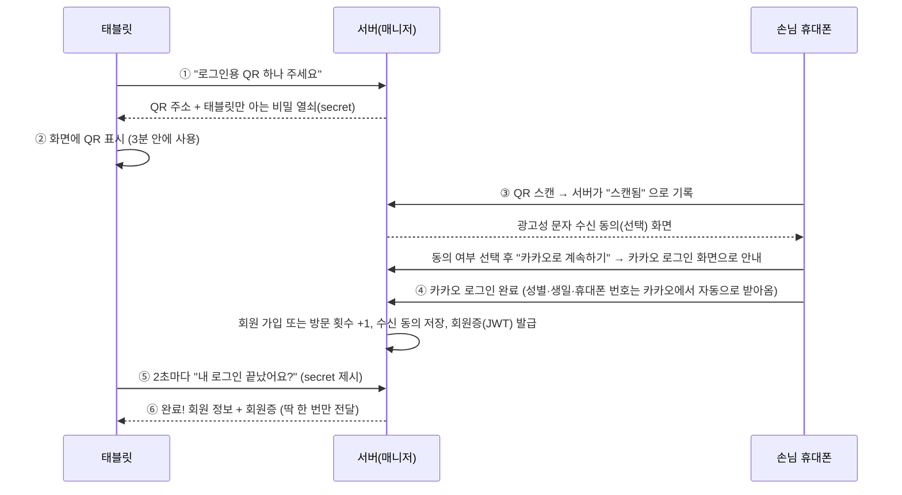

# 핵심 기능 플로우: 손님·사장님 관점

"이 서비스를 실제로 쓰면 무슨 일이 일어나는가?"를 코드 없이 따라가 보는 문서입니다.
같은 흐름을 코드 관점에서 따라가는 문서는 `docs/기능흐름_개발자.md`, 폴더·파일 지도는 `docs/코드_둘러보기.md` 를 보세요.
비유는 `코드_둘러보기.md` 와 이어집니다: **손님 태블릿 = 홀, 사장님 PC = 사무실, 서버 = 주방·창고·장부를 관리하는 매니저**.

## 0. 한눈에 보기: 하루 영업 이야기

```
 [손님 태블릿]                        [매니저(서버)]                    [사장님 PC]
  ① 첫 화면(룰렛·로그인)
  ② 메뉴 보기 / AI 추천
  ③ 장바구니 → 주문 ─────────────▶  장부에 주문 기록 ────────────▶  ⑤ 주문 이력·대시보드
  ④ 직원 호출 ───────────────────▶  장부에 호출 기록
                                      ◀──────── ⑥ 메뉴·품절·룰렛 확률 수정
                                      ◀──────── ⑦ 등급별 마케팅 문자 발송
```

| 번호 | 기능 | 누가 | 한 줄 설명 |
|---|---|---|---|
| ① | QR 로그인 + 룰렛 | 손님 | 카카오로 로그인하면 룰렛을 돌려(회원당 하루 1번) 할인·서비스 쿠폰을 받는다 |
| ② | 메뉴 보기, AI 추천 | 손님 | 카테고리별 메뉴, 질문에 답하면 세트 조합을 추천해 준다 |
| ③ | 주문 | 손님 | 장바구니에 담고 "주문하기"를 누르면 접수된다 |
| ④ | 직원 호출 | 손님 | 물·앞접시 같은 요청을 직원에게 알린다 |
| ⑤ | 대시보드·주문 이력 | 사장님 | 오늘 몇 건, 어떤 메뉴가 인기인지 본다 |
| ⑥ | 메뉴·이벤트 관리 | 사장님 | 품절 표시, 가격, 룰렛 칸과 당첨 확률을 바꾼다 |
| ⑦ | 마케팅 문자 | 사장님 | 단골·휴면 같은 등급별로 쿠폰 문자를 보낸다 |

> **현재 구현 범위 (2026-10-18)**: 서버는 QR 로그인·고객 목록·수신거부·문자 발송과 손님 메뉴 목록(`GET /api/menus`)을 DB와 연동합니다. 나머지(주문 저장·룰렛·쿠폰 등)는 더미 응답 또는 미구현 상태입니다. 메뉴 API 테스트는 아직 실행되지 않았습니다. 이 문서는 팀원이 구현을 마쳤을 때의 **목표 동작**입니다. 자세한 구현 현황은 `AGENTS.md`의 "더미 상태"를 보세요.

---

## 1. 손님 이야기

### 1-1. 첫 화면: 입구에서 룰렛 돌리기

손님이 테이블의 태블릿(또는 QR로 연 주소 `?table=12`)을 열면 **스플래시 화면**이 보입니다. 테이블 번호는 주소의 `table=` 값으로 정해지고, 없으면 12번입니다.

이 화면에서 선택지는 두 가지입니다.

- **로그인하지 않고 "비회원 주문"** → 바로 메뉴 화면으로 갑니다. 주문에 아무 제한이 없습니다.
- **"📱 로그인"** → 회원이 되면 룰렛을 돌릴 수 있습니다.

> 비유: 식당 입구에서 "단골 카드 만드시면 뽑기 한 번 해 드려요" 하는 것과 같습니다. 카드가 없어도 자리에는 앉을 수 있습니다.

### 1-2. QR 로그인: 태블릿에는 로그인창이 없다

태블릿 화면에서 아이디·비밀번호를 치게 하면 불편하고 위험합니다. 그래서 **태블릿은 QR만 보여 주고, 실제 로그인은 손님 휴대폰에서** 합니다.



이미 이 태블릿에서 로그인한 회원이 다시 로그인하려 하면 거절됩니다. 휴대폰에는 "이미 로그인하셨어요", 태블릿에는 "이미 이 태블릿에서 로그인한 회원이에요. 다른 회원이 로그인해 주세요."가 뜨고, 방문 횟수도 늘지 않습니다.

팝업에는 단계가 표시됩니다: **QR 스캔 → 카카오 로그인 → 완료**. 손님 휴대폰에서는 카카오로 넘어가기 전에 **광고성 문자 수신 동의(선택)** 를 한 번 묻습니다. 3분 안에 끝내지 않으면 "만료됨"이 뜨고 "🔄 QR 새로고침" 버튼이 나옵니다. 서버가 꺼져 있으면 "로그인을 사용할 수 없어요"라고 안내하고, 로그인 없이 주문은 계속 할 수 있습니다.

> 비유: 번호표를 뽑아 들고(태블릿의 secret) 있다가, 손님이 카운터(휴대폰)에서 접수를 마치면 내 번호가 호출되는 방식입니다. 남이 내 번호표를 가로챌 수 없도록 **QR에 든 값(token)과 태블릿만 아는 값(secret)을 나눠** 두었습니다.

성별·생일(출생연도)·휴대폰 번호는 손님이 직접 입력하지 않고, 카카오 로그인 때 손님이 동의한 항목만 자동으로 받아옵니다. **광고 문자 수신 동의**는 로그인 직전 휴대폰 화면에서 받으며, 동의한 손님(번호가 있는 경우)만 나중에 마케팅 문자를 받습니다. 체크하지 않고 로그인해도 이전에 한 동의는 그대로 유지됩니다(철회는 수신거부로). 수신거부는 문자 하단 안내 번호나 사장님 화면에서 처리합니다.

### 1-3. 룰렛과 쿠폰함: 회원당 하루 1번, 확률은 사장님이 정한다

- 회원당 **하루 1번**(한국 시간 기준)입니다. 같은 날 다른 테이블에서도 다시 돌릴 수 없고, 다음 날에는 다시 돌릴 수 있습니다. 같은 태블릿에서 **다른 회원이 로그인하면** 그 회원은 한 번 돌릴 수 있고, 아래쪽에 "로그인한 회원" 기록이 쌓입니다.
- 결과는 두 종류입니다. **할인**(주문 전체 N% 할인) 또는 **서비스**(메뉴 1개 무료). 당첨되면 바로 적용되지 않고 **쿠폰함에 담깁니다.**
- 주문 화면 위쪽 **"🎟️ 쿠폰함"** 버튼(안 쓴 쿠폰 수가 함께 보임)을 누르면 이 테이블에 로그인한 회원들의 쿠폰이 보입니다. **"사용"** 을 누르면 장바구니에 적용되고(할인은 한 번에 하나, 서비스는 0원 줄로 추가), **"취소"** 로 되돌릴 수 있습니다. 주문하면 사용 처리되어 다시 쓸 수 없습니다.
- 칸마다 "확률 가중치"가 있어 클수록 잘 나옵니다. 사장님이 이벤트 화면에서 바꿀 수 있습니다(→ 3-3).

### 1-4. 메뉴 화면: 한 화면에 세 구역

```
┌ 상단: 가게 이름 · 테이블 번호 · [🔔 직원호출] [🧾 주문내역] [🛒 장바구니] ┐
├ 왼쪽        ├ 가운데            ├ 오른쪽 ────────────┤
│ 💬 AI 질문   │ 메뉴 카드 목록     │ 장바구니              │
│ 카테고리 버튼 │ (담기 / 품절)      │ 합계 · 주문 확인하기   │
└────────────┴──────────────────┴────────────────────┘
```

- 카테고리를 누르면 해당 메뉴가 나옵니다. 처음 보이는 카테고리는 인기 메뉴(BEST)입니다.
- **품절**인 메뉴는 "담기" 대신 "품절"이 표시되어 누를 수 없습니다.
- 매운맛 단계가 있는 메뉴(순한맛/보통맛/아주 매움)는 한 카드에서 단계를 고릅니다.
- 새로고침해도 보던 카테고리가 유지됩니다(주소에 기억해 둠).

### 1-5. AI 추천: 취향을 말하면 세트를 짜 준다

두 가지 길이 있고, 결과는 같은 "추천 조합 카드"입니다.

1. **AI 추천 카테고리**: 인원·예산·맵기·음료를 고르면 즉시 최대 3개 조합이 나옵니다.
2. **💬 AI 질문**: 8개 질문(배고픔, 스트레스, 인원, 일행 성별, 음식 종류, 맵기, 방문 목적, 예산)에 눌러서 답하면 바로 다음 질문으로 넘어가고, 마지막에 결과가 나옵니다. 지금 **시간대와 날씨도 자동으로 반영**됩니다(날씨는 지금은 더미 데이터).

각 카드에는 구성 메뉴, **추천 이유**("매콤한 취향을 반영했어요" 등), 정가 대신 **조합 할인가**(현재 10% 할인, `discount_percent` 규칙)가 보입니다. "담기"를 누르면 세트 한 줄이 장바구니에 들어갑니다.

> 비유: 직원이 "오늘 몇 분이세요? 맵게 드세요?" 묻고 **"이 안주 둘에 맥주 묶으면 10% 싸게 드릴게요"** 하고 세트를 짜 주는 것과 같습니다. 이미 시킨 안주와 겹치지 않게 골라 주는 점도 같습니다. 품절 메뉴가 들어간 조합은 아예 후보에서 빠집니다.

사장님이 정한 **추천 가중치**(메뉴별 0~100, 기본 50)가 높은 메뉴가 들어간 조합이 더 높은 순위를 받습니다(→ 3-3).

### 1-6. 주문: 장바구니에서 접수까지

1. "담기"로 장바구니에 넣고 `−`/`+`/🗑 로 수량을 고칩니다.
2. 쿠폰 할인과 AI 조합 할인은 장바구니에 **줄별로 표시**됩니다("✨ AI 조합으로 ○원 할인", "🎟️ 쿠폰 N% 할인"). 쿠폰은 위쪽 "🎟️ 쿠폰함"에서 "사용"을 눌러 적용합니다.
3. **"주문 확인하기"** → 주문 내용과 합계가 나오는 확인창 → **"주문하기"**.
4. "주문이 접수되었습니다 (주문번호 #N)" 토스트가 뜨고 장바구니가 비며, 적용한 쿠폰은 **이번 주문에 쓰였으므로 사용 완료**가 됩니다.

회원으로 주문하면 주문에 회원 정보가 붙어 사장님 화면에서 "누가 주문했는지"를 알 수 있습니다. 비회원 주문도 똑같이 접수됩니다.

> 참고: 🧾 **주문내역**에는 주문 상태(접수·조리중 같은 표시)가 없습니다. 주문 상태 기능은 두지 않기로 했습니다. 주문을 취소하는 기능도 없어서 확인창에 "직원에게 문의해 주세요"라고 적혀 있습니다.

### 1-7. 직원 호출

🔔 버튼 → 필요한 항목(물, 앞접시 등)을 여러 개 고르기 → "호출하기". "직원이 곧 도착합니다" 토스트가 뜹니다. 호출 항목 목록은 서버 콘텐츠(`staff_calls`)에서 오며, 사장님이 보는 호출 확인 화면은 지금 없습니다(기록만 저장).

---

## 2. 서버가 꺼져 있으면? (데모 모드)

화면은 서버에 닿지 않아도 **연습용 가짜 데이터(더미)** 로 돌아갑니다.

| 상황 | 화면 동작 |
|---|---|
| 서버 연결됨 | 구현이 끝난 기능은 실제 DB를 쓰고, 아직 더미인 기능은 고정된 가짜 응답을 받음(저장 안 됨) |
| 서버 꺼짐 (`DATA_SOURCE=auto`) | 더미로 화면은 보이지만 **주문·호출은 저장되지 않음**(조용히 건너뜀), QR 로그인은 사용 불가 |
| `DATA_SOURCE=api` 인데 서버 꺼짐 | "서버에 연결할 수 없습니다. 직원에게 문의해 주세요" 오류 안내 |

즉 발표·시연용으로는 편하지만, **실제 영업에서 서버가 꺼지면 주문이 사라질 수 있다**는 뜻입니다. 운영 때는 `api` 모드로 못 박는 편이 안전합니다.

---

## 3. 사장님 이야기

사장님은 별도 PC·브라우저에서 **관리자 페이지**를 엽니다. 입장하려면 관리자 토큰(비밀번호 역할)이 필요하고(현재는 개발 편의상 토큰 입력을 생략하는 임시 설정이 켜져 있음), 사이드바에서 메뉴를 고릅니다(대시보드·메뉴 관리·추천 가중치·이벤트·고객 등급·주문 이력·마케팅).

> 비유: 사무실 문에는 출입증 검사가 있고, 들어가면 장부·창고 열쇠가 모두 있습니다. 서버도 관리자 요청마다 출입증(토큰)을 다시 검사하므로, 화면 주소만 알아서는 데이터를 건드릴 수 없습니다.

### 3-1. 대시보드: 오늘 장사 요약

오늘 주문 수, 평균 주문 금액, 신규·재방문 고객 수, 연령대·성별 분포, 인기 메뉴 TOP 10, **AI 추천 적중률**(추천 조합이 들어간 주문 수 ÷ 추천이 손님에게 보인 횟수)을 한 번에 봅니다. 매출 분석(시간대·요일별 매출, 테이블 회전율, AI 주문 객단가 비교)도 여기에 있습니다.

적중률의 "분모"는 손님이 AI 추천 결과를 **볼 때마다** 서버에 기록되는 노출 횟수입니다. 같은 조건의 결과는 한 번만 기록됩니다.

### 3-2. 주문 이력

- **주문 이력**: 기간·테이블·AI 조합 여부·금액 범위로 걸러서 봅니다. 주문마다 어떤 메뉴를 몇 개, 누가(회원 닉네임) 시켰는지 나옵니다.

### 3-3. 가게를 바꾸는 화면들

| 화면 | 사장님이 하는 일 | 손님 화면에 미치는 영향 |
|---|---|---|
| 메뉴 관리 | 카테고리·메뉴 추가/수정/삭제, 가격·설명·**품절 표시** | 손님 화면에 **최대 10초 안에** 반영(데이터를 10초 캐시) |
| 추천 가중치 | 메뉴별 0~100 점수(기본 50) | 점수가 높은 메뉴가 들어간 AI 조합이 더 위로 올라감 |
| 이벤트 | 룰렛 칸 수(2~8개), 문구, 할인율/서비스 메뉴, **확률 가중치** | 다음 룰렛부터 새 확률로 당첨 |

룰렛 확률은 "내 칸 가중치 ÷ 전체 가중치 합"입니다. 예: 칸이 5개이고 모두 1이면 각 20%, 한 칸을 3으로 올리면 3/7≈43%, 0으로 두면 그 칸은 절대 안 나옵니다.

### 3-4. 고객 등급과 마케팅 문자

손님이 로그인할 때마다 회원의 **방문 횟수**가 1씩 늘고 마지막 방문일이 갱신됩니다. 이걸로 등급이 자동 계산됩니다(기준은 서버 설정이며 화면에서 미리 바꿔 볼 수 있음).

| 등급 | 기본 기준 |
|---|---|
| 휴면 | 마지막 방문이 **60일 이상** 지남 (다른 조건보다 우선) |
| 단골 | 방문 **5회 이상** |
| 재방문 | 방문 **2~4회** |
| 신규 | 그 외 (처음 방문) |

마케팅 화면(AI 챗봇·AI 추천·AI 문자 세 메뉴 중 'AI 문자')에서는 등급을 고르고 문구를 쓰면 문자를 보냅니다. 문자는 솔라피로 발송합니다. 서버가 **보내도 되는지 먼저 심사**합니다.

- 받을 수 있는 사람: 휴대폰 번호가 있고, **수신 동의**했고, **수신거부 안 한** 회원만.
- 문자 맨 앞에 `(광고)가게이름`, 맨 뒤에 `무료수신거부 번호`가 **자동으로 붙습니다**.
- **밤 9시~아침 8시**에는 광고 문자를 보낼 수 없습니다(법적 제한).
- 예약은 지금부터 10분 이후만 가능. 이번 달 무료 한도(SMS 50건, LMS 10건)를 넘으면 거절.
- 기본값은 **DRY RUN**(실제 전송 없이 기록만)이라, 설정 전에는 문자가 나가지 않습니다.
- 거절되면 이유를 목록으로 한꺼번에 알려 줍니다. 보내기 전 "미리보기"로 대상 수·바이트·종류(SMS/LMS)를 확인합니다.

> 비유: 우체국 창구입니다. 보내려는 편지를 창구 직원(서버)이 먼저 검사해서, 수신 동의 없는 사람·야간 발송·한도 초과는 "접수 안 됩니다"하고 돌려보냅니다.

---

## 4. 자주 하는 질문

| 질문 | 답 |
|---|---|
| 품절 처리했는데 손님 화면에 안 바뀌어요 | 최대 10초 걸립니다. 그래도 안 바뀌면 손님이 새 동작(담기 등)을 해야 화면이 다시 읽힙니다 |
| 룰렛을 또 돌리고 싶어요 | 같은 회원은 그날 다시 불가(다른 테이블도 마찬가지)이고 다음 날 가능합니다. 다른 회원이 로그인하면 그 회원은 돌릴 수 있습니다 |
| 비회원 주문도 통계에 잡히나요? | 주문 수·매출·인기 메뉴에는 잡힙니다. 고객 등급·연령 통계에는 회원만 잡힙니다 |
| 문자가 안 나가요 | 수신 동의·번호 유무, 야간(21~08시), 월 한도, DRY RUN 설정을 차례로 확인하세요 |
