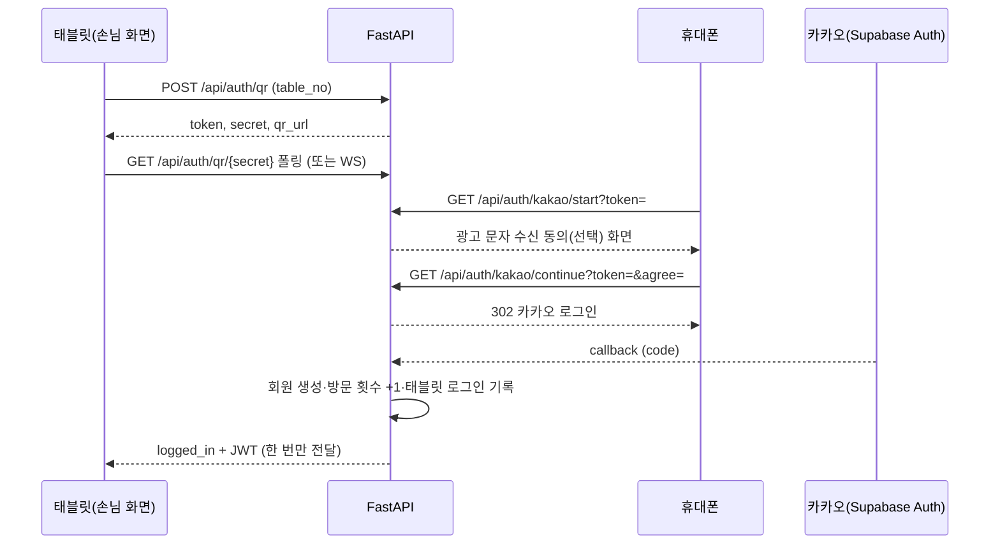

# F&BGrowth API 설계

> **문서 목적**: 프로젝트 평가용 API 설계 최종본입니다. 엔드포인트별 메서드·경로·요청·응답·인증·상태를 정리했습니다.
> **근거**: 2026-10-21 `main`/`dev`의 FastAPI 코드(`backend/app/routers/`)와 앱이 생성하는 OpenAPI(`/docs`)를 대조해 작성했습니다. API의 기준은 이 문서입니다.
> **표기**: `구현` = 라우터와 저장소(DB)까지 연결됨. `[확인 필요]` = 코드에서 확인하지 못한 내용. 응답 필드는 라우터가 직접 만드는 것만 적었고, 저장소가 만드는 세부 필드는 "객체/목록"으로 줄였습니다.
> 관련 문서: [DB 설계](DB_설계.md) · [화면 설계](화면_설계.md)

## 1. 개요

| 항목 | 내용 |
|---|---|
| 서버 | FastAPI (`backend/main.py` → `app/factory.py`), 문서 UI는 `http://127.0.0.1:8000/docs` |
| 손님 API 접두사 | `/api/...` |
| 관리자 API 접두사 | `/admin/api/...` (모든 경로에 관리자 인증 필요) |
| 데이터 형식 | JSON(UTF-8). 시각은 UTC ISO 문자열이며 화면에서 KST로 변환 |
| 상태 확인 | `GET /health` → `{"status":"ok"}` |
| DB | `DATABASE_URL`이 Postgres면 Supabase, 없으면 로컬 SQLite |
| 외부 연동 | 카카오 로그인(직접 또는 Supabase Auth), 솔라피(문자), 제미나이(AI 추천·챗봇·문자 후보), Open-Meteo(날씨) |

### 1.1 인증 방식

| 구분 | 방식 | 코드 |
|---|---|---|
| 공개 | 인증 없음 | - |
| 손님(선택) | `Authorization: Bearer <손님 JWT>`가 있으면 회원으로 처리, 없거나 잘못되면 비회원 | `optional_member` |
| 손님(필수) | 유효한 손님 JWT 필요, 없으면 `401` | `current_member` |
| 관리자 | 사장님 로그인 토큰(Supabase Auth, `owners` 등록 계정) 또는 개발용 `ADMIN_TOKEN`. `APP_ENV=prod`이고 Supabase가 설정되면 `ADMIN_TOKEN`은 거부. 실패 시 `401` | `require_admin` |

손님 JWT는 QR 로그인 완료 때 발급되며(`services/tokens.py`), 유효기간은 `JWT_EXPIRE_MINUTES` 설정을 따릅니다.

### 1.2 URL·메서드 규칙

- 경로는 리소스(명사, 복수형) 중심입니다: `/menus`, `/categories`, `/orders`, `/coupons`, `/staff-calls`. 하위 리소스는 경로로 잇습니다: `/tables/{table_no}/orders`, `/marketing/chat/sessions/{session_id}/messages`.
- 메서드 의미: `GET` 조회(부작용 없음), `POST` 생성(주문·호출·로그·룰렛 참여·문자 발송), `PUT` 전체 또는 지정한 필드 저장(같은 요청을 반복해도 결과가 같음: 메뉴 저장, 룰렛 칸 교체, 등급 기준), `PATCH` 일부 수정(카테고리), `DELETE` 삭제(성공 시 `204`).
- 리소스로 표현하기 어려운 동작은 동사 하위 경로를 씁니다: `…/logs/{id}/cancel`, `/calls/{id}/done`, `/members/{id}/opt-out`, `/sms/test`.
- 손님 API는 `/api/...`(일부는 `/api/v1/...` 별칭), 관리자 API는 `/admin/api/...`입니다.

### 1.3 공통 응답

| 상태 | 의미 |
|---|---|
| 200 / 201 / 204 | 성공 / 생성 / 본문 없음 |
| 401 | 인증 필요 |
| 403 | 권한 없음(이 태블릿에 로그인한 회원이 아님) |
| 404 | 대상 없음 |
| 409 | 규칙 위반(룰렛 하루 1회, 쿠폰 사용 불가, 카테고리에 메뉴 남음, 문자 발송 조건 불충족 등) |
| 422 | 입력값 검증 실패 |
| 502 / 503 | 외부 서비스(제미나이·솔라피 등) 실패 / 설정 없음 |

오류 본문 형식과 처리 규칙은 [10. 오류 응답 규칙](#10-오류-응답-규칙), 요청·응답 모델은 [8. 요청·응답 모델](#8-요청응답-모델)에 있습니다.

## 2. 전체 목록 요약

OpenAPI 기준 HTTP 엔드포인트는 총 89개(경로+메서드 조합, 별칭 경로 포함)이고 WebSocket이 1개 더 있습니다.

| 영역 | 개수 | 인증 |
|---|---|---|
| 서버 상태 `/health` | 1 | 공개 |
| QR·사장님 로그인 `/api/auth` | 8 (+ WebSocket 1) | 공개 |
| 손님 `/api` (개발용 1 포함) | 30 | 공개 / 손님 JWT(선택·필수) |
| 관리자 `/admin/api` | 50 | 관리자 |

## 3. QR·사장님 로그인 `/api/auth`

손님은 태블릿에 뜬 QR을 휴대폰으로 읽어 카카오 로그인을 합니다. 태블릿은 폴링 또는 WebSocket으로 결과를 받습니다.



| 메서드 | 경로 | 설명 | 요청 | 응답 | 인증 | 상태 |
|---|---|---|---|---|---|---|
| POST | `/api/auth/qr` | 테이블 로그인 QR 발급 | body `{table_no, previous_secret?, logged_in_member_ids?[]}` | `{token, secret, expires_in, qr_url}` | 공개 | 구현 |
| GET | `/api/auth/qr/{secret}` | 로그인 진행 상태 폴링. 완료되면 JWT·회원 정보를 한 번만 전달 | path `secret` | `{event:"status", status, remaining}` 또는 완료 이벤트 | 공개 | 구현 |
| WS | `/api/auth/ws/{secret}` | 진행 상황 실시간 수신(scanned / logged_in / expired) | - | JSON 이벤트 | 공개 | 구현 |
| GET | `/api/auth/kakao/start` | QR을 연 휴대폰이 호출. 수신 동의 화면(HTML) | query `token` | HTML (404 유효하지 않음, 410 만료) | 공개 | 구현 |
| GET | `/api/auth/kakao/continue` | 동의 기록 후 카카오로 302 이동 | query `token`, `agree` | 302 | 공개 | 구현 |
| GET | `/api/auth/kakao/callback` | 카카오 직접 연동 콜백 | query `state, code, error` | HTML | 공개 | 구현 |
| GET | `/api/auth/supabase/callback/{state}` | Supabase Auth 경유 콜백 | path `state`, query `code, error` | HTML | 공개 | 구현 |
| GET | `/api/auth/owner/config` | 관리자 로그인 화면이 이메일 로그인을 보여줄지 | - | `{enabled}` | 공개 | 구현 |
| POST | `/api/auth/owner/login` | 사장님 이메일·비밀번호 로그인 | body `{email, password}` | `{access_token, email}` (401 실패, 403 미등록, 503 Supabase 미설정) | 공개 | 구현 |

로그인 상태값: `waiting` → `scanned` → `logged_in` (또는 `rejected` 중복 로그인 / `expired`). 같은 태블릿에서 이미 로그인한 회원이 다시 로그인하면 `rejected`입니다.

## 4. 손님 API `/api`

### 4.1 매장·콘텐츠·메뉴 (공개)

| 메서드 | 경로 | 설명 | 응답 | 상태 |
|---|---|---|---|---|
| GET | `/api/store`, `/api/v1/store` | 매장 정보(이름·지점·슬로건·테이블 수) | 객체 | 구현 |
| GET | `/api/menus` | 메뉴 전체(품절 포함) | 메뉴 목록 | 구현 |
| GET | `/api/categories` | 손님용 카테고리 | 목록 | 구현 |
| GET | `/api/content` | 카테고리·질문·날씨·추천 규칙 묶음 | `{categories, quiz_questions, weather, rules}` | 구현 |
| GET | `/api/content/{name}` | 단일 콘텐츠. `name` = `quiz_questions`/`weather`/`rules`/`categories` (그 외 404) | 해당 값 | 구현 |
| GET | `/api/v1/ai/questions` | AI 질문·선택지 | 질문 목록 | 구현 |
| GET | `/api/v1/ai/recommendation-rules` | 추천 규칙(할인율·짝·음료 구성) | 객체 | 구현 |
| GET | `/api/v1/weather/current` | 오늘 날씨(Open-Meteo, 실패 시 DB의 마지막 값) | `{types, current, text?}` | 구현 |
| GET | `/api/v1/roulette/prizes` | 룰렛 칸 구성 | 목록 | 구현 |
| GET | `/api/v1/staff-call-items` | 직원 호출 항목 | 목록(정렬순) | 구현 |

### 4.2 회원·태블릿 로그인 (손님 JWT 필수)

| 메서드 | 경로 | 설명 | 응답 | 상태 |
|---|---|---|---|---|
| GET | `/api/members/me` | 내 정보(새로고침 후 로그인 복원) | `{id, nickname, phone, birth_year, gender, marketing_consent, opted_out, visit_count}` | 구현 |
| POST | `/api/members/me/opt-out` | 내 광고 문자 수신거부 | 위와 같은 회원 객체 | 구현 |
| GET | `/api/tables/{table_no}/logins` | 이 태블릿에 로그인한 회원들(룰렛 사용 여부 포함). 해당 태블릿 회원이 아니면 403 | 목록 | 구현 |

### 4.3 룰렛·쿠폰 (손님 JWT 필수)

룰렛은 회원당 하루 1회(KST)이며, 당첨은 즉시 적용하지 않고 쿠폰함에 쿠폰으로 발급합니다.

| 메서드 | 경로 | 설명 | 요청 | 응답 | 상태 |
|---|---|---|---|---|---|
| GET | `/api/v1/roulette/status?table_no=` | 이 태블릿의 회원별 룰렛 상태·남은 기회 | query `table_no` | `{members, spins_left, remaining}` | 구현 |
| POST | `/api/v1/roulette/plays` | 서버가 가중치로 칸을 정해 당첨 기록 + 쿠폰 발급 | `{table_no, member_id?}` | 201 `{index, prize, coupon}` / 409 오늘 이미 참여 / 503 칸 없음 | 구현 |
| PUT | `/api/tables/{table_no}/logins/prize` | 클라이언트가 정한 당첨 결과 기록 + 쿠폰 발급 | `{member_id, prize, kind?, emoji?, percent?, item_id?, prize_id?}` | `{ok, coupon}` / 404·409·422 | 구현 |
| GET | `/api/v1/coupons`, `/api/coupons` | 내 쿠폰(안 쓴 쿠폰 먼저) | - | 목록 | 구현 |
| GET | `/api/tables/{table_no}/coupons` | 이 태블릿 회원들의 쿠폰함 | - | 목록 | 구현 |

### 4.4 주문·직원 호출·AI 추천

| 메서드 | 경로 | 설명 | 요청 | 응답 | 인증 | 상태 |
|---|---|---|---|---|---|---|
| POST | `/api/orders`, `/api/v1/orders` | 주문 생성(쿠폰 사용 포함) | `{table_no, lines[{id,name,opt,unit,qty,components?,original_unit?}], total, coupon_ids?[], recommendation_event_id?}` | 201 `{no, ai_combo, used_coupon_ids}` / 409 쿠폰 사용 불가 | 선택 | 구현 |
| GET | `/api/v1/tables/{table_no}/orders` | 테이블 누적 주문(로그인 시각 이후만 합산) | - | `{orders, total}` | 공개 | 구현 |
| POST | `/api/calls`, `/api/v1/staff-calls` | 직원 호출 | `{table_no, items[]}` | 201 `{id}` | 공개 | 구현 |
| POST | `/api/recommendations`, `/api/v1/ai/recommendations` | 추천 조합 노출 기록(적중률 분모) | `{table_no, params, combo_ids[]}` | 201 `{id}` | 선택 | 구현 |
| POST | `/api/v1/ai/recommendations/generate` | 제미나이가 DB 메뉴·주문·규칙으로 조합 추천. 서버가 가격·품절·예산을 검증 | `{table_no, params, lines[]}` | 조합 목록(출처 포함) / 503 | 선택 | 구현 |

### 4.5 개발용

| 메서드 | 경로 | 설명 | 상태 |
|---|---|---|---|
| POST | `/api/dev/db-test` | DB 쓰기·읽기 확인(`DEV_TEST_BUTTON` 설정이 꺼져 있으면 404) | 구현 |

## 5. 관리자 API `/admin/api` (모두 관리자 인증)

### 5.1 메뉴·카테고리·주문·직원 호출

| 메서드 | 경로 | 설명 | 요청 | 응답 | 상태 |
|---|---|---|---|---|---|
| GET | `/menus` | 카테고리 + 메뉴 목록 | - | `{categories, menus}` | 구현 |
| PUT | `/menus/{menu_id}` | 메뉴 등록·수정(전달한 필드만 저장). body가 배열이면 일괄 저장·삭제 | `{name?, cat?, price?, desc?, image_url?, soldout?, spicy?(0~3), weight?(0~100), set_ok?, is_event?, emoji?, tags?}` (신규는 name·cat·price 필수) | 저장된 메뉴 / 422·404 | 구현 |
| DELETE | `/menus/{menu_id}` | 메뉴 삭제 | - | 204 / 404 | 구현 |
| GET | `/categories` | 카테고리 목록(메뉴 개수 포함) | - | 목록 | 구현 |
| POST | `/categories` | 카테고리 추가 | `{id?, name, icon?, colors[2]}` | 201 객체 / 409·422 | 구현 |
| PATCH | `/categories/{category_id}` | 카테고리 수정 | 일부 필드 | 객체 / 404 | 구현 |
| DELETE | `/categories/{category_id}` | 삭제(메뉴가 남아 있으면 409) | - | 204 | 구현 |
| GET | `/orders?member_id=` | 주문 이력(최신순, 회원 닉네임 포함) | query `member_id?` | 목록 | 구현 |
| GET | `/calls` | 직원 호출 목록(최신순) | - | 목록 | 구현 |
| POST | `/calls/{call_id}/done` | 호출 처리 완료(반복 호출해도 같은 결과) | - | 호출 객체 / 404 | 구현 |
| PUT | `/owner/roulette/prizes` | 룰렛 칸 전체 교체 | 배열 `[{label, short, emoji?, color(#RRGGBB), kind(discount/free), percent?, item_id?, weight}]`. 칸 2~8개, 확률 정수·합계 100, 서비스 메뉴 존재 검사 | 저장된 목록 / 422 | 구현 |

참고: 손님 쪽 `PUT /api/v1/owner/roulette/prizes`도 같은 로직의 별칭이며 관리자 인증이 필요합니다.

### 5.2 고객·등급·알림

| 메서드 | 경로 | 설명 | 요청 | 응답 | 상태 |
|---|---|---|---|---|---|
| GET | `/members`, `/customers` | 고객 목록 + 등급. 등급 기준을 쿼리로 미리 적용(저장 안 됨) | query `repeat(≥2), regular(≥3), dormant(≥1)` | `{rule, members[]}` (단골 기준 ≤ 재방문 기준이면 422) | 구현 |
| GET | `/customers/grades` | 등급별 인원 | 위와 같은 쿼리 | 등급별 집계 | 구현 |
| GET | `/customers/grades/rules` | 현재 등급 기준 | - | `{repeat, regular, dormant}` | 구현 |
| PUT | `/customers/grades/rules` | 등급 기준 저장(`app_settings.grade_rule`) | `{repeat, regular, dormant}` | 저장된 기준 | 구현 |
| POST | `/members/{member_id}/opt-out`, `/customers/{member_id}/opt-out` | 회원 수신거부 등록 | - | `{ok:true}` / 404 | 구현 |
| GET | `/alerts` | 품절·재입고 등 운영 알림 | - | 알림 객체 | 구현 |

### 5.3 통계 (대시보드)

모든 통계는 등급 기준 쿼리(`repeat`, `regular`, `dormant`)를 받으며 저장하지 않습니다. 주문이 없으면 `empty: true`를 돌려줍니다.

| 메서드 | 경로 | 반환 |
|---|---|---|
| GET | `/stats` | 대시보드 종합(오늘 주문·평균 주문금액·신규/재방문·인기 메뉴·연령/성별·AI 추천) |
| GET | `/stats/sales` | `today_orders`, `avg_order_amount` |
| GET | `/stats/menus/ranking` | `popular_menus` |
| GET | `/stats/customers` | 신규/재방문 고객, 연령대, 성별 |
| GET | `/stats/ai-recommendations` | AI 추천 노출 수·적중률 |
| GET | `/stats/insights` | 아래 세부 통계 묶음(한 번에 조회) |
| GET | `/stats/sales/hourly` | 시간대별 매출, 피크 시간 |
| GET | `/stats/sales/weekday` | 요일별 매출, 피크 요일 |
| GET | `/stats/sales/trends` | 일별 매출·최근 7일·마지막 영업일·전주 대비 증감 |
| GET | `/stats/sales/tickets` | 객단가·금액대 분포·AI/일반·회원/비회원 객단가 |
| GET | `/stats/tables` | 테이블 회전율, 주문 많은 테이블 TOP |

### 5.4 마케팅 (문자·AI 추천·챗봇·성과)

| 메서드 | 경로 | 설명 | 요청 | 응답 | 상태 |
|---|---|---|---|---|---|
| GET | `/marketing/sms/usage` | 월 문자 사용량·한도 | - | 객체 | 구현 |
| GET | `/marketing/sms/balance` | 솔라피 잔액·포인트 | - | 객체(조회 불가 시 사유) | 구현 |
| POST | `/marketing/sms/preview` | 대상 수·비용·발송 가능 여부 미리보기 | `{grades[], member_ids?[], body, scheduled_at?}` | 객체 / 422 | 구현 |
| POST | `/marketing/sms/send` | 즉시·예약 발송(`SMS_DRY_RUN=true`면 기록만) | 위와 같음 | 객체 / 409 `{problems}` | 구현 |
| POST | `/marketing/sms/candidates` | AI 문자 후보 여러 개 | - | 후보 목록(키워드·수신 등급·문구·출처) | 구현 |
| GET | `/marketing/sms/logs` | 발송·예약 기록 | - | 목록 | 구현 |
| POST | `/marketing/sms/logs/{log_id}/cancel` | 예약 취소 | - | 객체 / 404·409 | 구현 |
| POST | `/sms/test` | 번호 1건 테스트 발송 | `{phone, body}` | 객체 / 409 | 구현 |
| GET | `/marketing/external-context` | 오늘 날씨·지역 행사 문구(하루 한 번 저장) | - | 객체 | 구현 |
| GET | `/marketing/opportunities` | AI 마케팅 추천 카드(문자 추천·기타 추천). 규칙 엔진이 고르고 제미나이가 문구를 다듬음 | query `round`(4개씩 순환), `refresh` | `{groups:{sms,guide}, external, ...}` | 구현 |
| GET | `/marketing/growth-performance` | AI 도입 전후 월환산 성과 | - | 객체 | 구현 |
| GET | `/marketing/regular-preferences` | 오늘 주문한 단골·생일·기념일 고객의 응대 제안 | - | `{preferences[]}` (각 카드에 `checked`) | 구현 |
| PUT | `/marketing/tip-checks` | 응대 제안 카드 확인/되돌리기 | `{member_id, order_id, checked}` | 같은 값 | 구현 |
| GET | `/marketing/live-activity` | 새 로그인·주문 여부(화면 폴링용) | - | 객체 | 구현 |
| POST | `/marketing/chat/sessions` | 챗봇 대화방 생성(첫 인사 포함) | - | 201 대화방 | 구현 |
| GET | `/marketing/chat/sessions` | 내 대화방 목록 | - | 목록 | 구현 |
| GET | `/marketing/chat/sessions/{session_id}` | 대화방 + 메시지 | - | 객체 / 404 | 구현 |
| DELETE | `/marketing/chat/sessions/{session_id}` | 대화방 삭제 | - | 204 / 404 | 구현 |
| POST | `/marketing/chat/sessions/{session_id}/messages` | 질문 전송 → 제미나이 답변 저장 | `{content(1~1000자)}` | 201 `{messages:[질문, 답변]}` / 502 | 구현 |

챗봇 대화방의 주인은 로그인한 사장님이고, 개발 토큰으로 들어오면 `CHAT_OWNER_ID` 설정을 씁니다(없으면 503).

### 5.5 시스템

| 메서드 | 경로 | 설명 | 상태 |
|---|---|---|---|
| GET | `/system/db` | DB 연결·필수 테이블 존재 점검(연결 주소·비밀번호는 응답에 넣지 않음) | 구현 |

## 6. 화면 ↔ API 대응

| 화면 | 주로 쓰는 API |
|---|---|
| 손님 시작(룰렛·로그인) | `GET /api/store`, `GET /api/v1/roulette/prizes`, `POST /api/auth/qr`, `GET /api/auth/qr/{secret}`, `GET /api/tables/{n}/logins`, `POST /api/v1/roulette/plays` |
| 손님 주문 | `GET /api/categories`, `GET /api/menus`, `POST /api/orders`, `GET /api/v1/tables/{n}/orders` |
| 쿠폰함 | `GET /api/tables/{n}/coupons`, `POST /api/orders`(`coupon_ids`) |
| 직원 호출 | `GET /api/v1/staff-call-items`, `POST /api/calls` |
| AI 질문·추천 | `GET /api/v1/ai/questions`, `GET /api/v1/weather/current`, `POST /api/v1/ai/recommendations/generate`, `POST /api/recommendations` |
| 관리자 로그인 | `GET /api/auth/owner/config`, `POST /api/auth/owner/login` |
| 대시보드 | `GET /admin/api/stats`, `/stats/insights` 등 |
| 메뉴 관리·추천 가중치·이벤트 | `/admin/api/menus`, `/categories`, `/owner/roulette/prizes` |
| 고객 등급·주문 이력 | `/customers`, `/customers/grades/rules`, `/orders` |
| 마케팅 | `/marketing/*` |

## 7. 경로 별칭과 제공 범위

- 관리자 API는 모두 `/admin/api/...`입니다. 손님 API 중 일부는 `/api/v1/...` 별칭을 함께 제공합니다(매장, 주문, 직원 호출, 쿠폰, 추천 노출 기록).
- 주문 상태 API는 제공하지 않습니다(제품 규칙: 주문 상태 기능 없음).
- 주문 상세 조회, 개인 취향 조회, 대안 재추천, 추천 만족도 저장, 알림 확인 처리, 메뉴군·날씨별 통계는 제공하지 않습니다.
- 메뉴 가중치는 별도 일괄 API 없이 `PUT /admin/api/menus/{id}`(배열 가능)로 저장합니다.

## 8. 요청·응답 모델

요청 본문은 라우터 파일의 Pydantic 모델(`BaseModel`)로 검증하며, 틀리면 FastAPI가 `422`를 돌려줍니다. "필수"는 기본값이 없는 필드입니다. 응답은 `response_model` 없이 저장소/서비스가 만든 JSON을 그대로 돌려주므로(코드에 응답 모델 선언 없음), 아래 응답 모델은 실제 응답을 기준으로 적은 것입니다.

### 8.1 요청 모델

**`QrRequest`** — `POST /api/auth/qr` (`routers/auth.py`)

| 필드 | 타입 | 필수 | 제약 | 예시 |
|---|---|---|---|---|
| `table_no` | int | O | ≥ 1 | `12` |
| `previous_secret` | string \| null | | QR 재생성 때 정리할 이전 세션 | `"9VQAWC_…"` |
| `logged_in_member_ids` | int[] | | 기본 `[]`. 이미 로그인한 회원(중복 로그인 차단) | `[1, 2]` |

**`OwnerLoginIn`** — `POST /api/auth/owner/login`

| 필드 | 타입 | 필수 | 제약 | 예시 |
|---|---|---|---|---|
| `email` | string | O | 3자 이상 | `"owner@example.com"` |
| `password` | string | O | 1자 이상 | `"********"` |

**`OrderIn`** — `POST /api/orders`, `/api/v1/orders` (중첩: `lines` → `OrderLine`)

| 필드 | 타입 | 필수 | 제약 | 예시 |
|---|---|---|---|---|
| `table_no` | int | O | ≥ 1 | `1` |
| `lines` | `OrderLine[]` | O | 1개 이상 | 아래 |
| `total` | int | O | ≥ 0 (할인 반영 후 금액) | `10000` |
| `coupon_ids` | int[] | | 기본 `[]`. 이 주문에 쓰는 쿠폰 | `[1]` |
| `recommendation_event_id` | int \| null | | AI 추천 적중률 계산용 | `7` |

**`OrderLine`** (`OrderIn.lines[]`)

| 필드 | 타입 | 필수 | 제약 | 예시 |
|---|---|---|---|---|
| `id` | string | O | 메뉴 id. 조합 줄은 조합 id | `"c1"` |
| `name` | string | O | 주문 시점 이름 | `"역전 옛날통닭"` |
| `opt` | string | | 기본 `""`. 옵션 문구 | `"후라이드"` |
| `unit` | int | O | ≥ 0. 단가 | `18000` |
| `qty` | int | O | 1~99 | `2` |
| `components` | object[] \| null | | AI 조합일 때 구성 메뉴 `[{id, name, opt, qty}]` | `[{"id":"a4","name":"계란말이","qty":1}]` |
| `original_unit` | int \| null | | 조합 할인 전 단가 | `22000` |

**`PlayIn`** — `POST /api/v1/roulette/plays` (`routers/roulette.py`)

| 필드 | 타입 | 필수 | 제약 | 예시 |
|---|---|---|---|---|
| `table_no` | int | O | ≥ 1 | `1` |
| `member_id` | int \| null | | 생략하면 토큰의 회원 | `1` |

**`PrizeIn`** — `PUT /api/tables/{table_no}/logins/prize`

| 필드 | 타입 | 필수 | 제약 | 예시 |
|---|---|---|---|---|
| `member_id` | int | O | | `1` |
| `prize` | string | O | 1~50자. 당첨 안내문 | `"계란말이 서비스"` |
| `kind` | string \| null | | `discount` 또는 `free`. 보내면 쿠폰 발급 | `"free"` |
| `emoji` | string | | 기본 `🎁`, 최대 8자 | `"🥚"` |
| `percent` | int \| null | | 1~100. `kind=discount`이면 필수 | `10` |
| `item_id` | string \| null | | 최대 40자. `kind=free`이면 필수, 존재하는 서비스 메뉴여야 함 | `"a4"` |
| `prize_id` | int \| null | | 룰렛 칸 id | `3` |

**`CallIn`** — `POST /api/calls`, `/api/v1/staff-calls`

| 필드 | 타입 | 필수 | 제약 | 예시 |
|---|---|---|---|---|
| `table_no` | int | O | ≥ 1 | `1` |
| `items` | string[] | O | 1개 이상 | `["물","앞접시"]` |

**`RecommendationIn` / `RecommendationGenerateIn`** — `POST /api/v1/ai/recommendations`, `/generate`

| 필드 | 타입 | 필수 | 설명 | 예시 |
|---|---|---|---|---|
| `table_no` | int | O | ≥ 1 | `1` |
| `params` | object | | 퀴즈 답변 `{people, budget, spicy, hunger, stress, kind, intent, gender}` | `{"people":"2","spicy":"1"}` |
| `combo_ids` | string[] | | (노출 기록) 보여 준 조합 id | `["combo-1"]` |
| `lines` | object[] | | (generate) 현재 장바구니 줄 | `[]` |

**`MenuIn`** — `PUT /admin/api/menus/{menu_id}` (단일 객체 또는 `MenuIn[]` 일괄)

모든 필드가 선택입니다. 새 메뉴를 만들 때는 `name`·`cat`·`price`가 필요합니다. 일괄 저장은 각 항목에 `id`가 있어야 하고 중복 id는 422입니다.

| 필드 | 타입 | 제약 | 예시 |
|---|---|---|---|
| `id` | string | 일괄 저장 때 필수 | `"new1"` |
| `delete` | bool | `true`면 삭제(일괄 저장용) | `true` |
| `name` | string | 1~80자 | `"오늘의 안주"` |
| `cat` | string | 카테고리 id(가상 카테고리 `ai`·`best` 불가) | `"anju"` |
| `price` | int | ≥ 0 | `5000` |
| `desc` | string | | `"겉바속촉"` |
| `image_url` | string | | `""` |
| `soldout` | bool | | `false` |
| `spicy` | int | 0~3 | `1` |
| `weight` | int | 0~100 (추천 가중치) | `50` |
| `set_ok` | bool | AI 세트 포함 가능 | `true` |
| `is_event` | bool | 이벤트 서비스 메뉴 후보 | `false` |
| `emoji` | string | | `"🍢"` |
| `tags` | string[] | | `["BEST"]` |

**`CategoryIn` / `CategoryPatch`** — `POST`, `PATCH /admin/api/categories`

| 필드 | 타입 | 필수 | 제약 | 예시 |
|---|---|---|---|---|
| `id` | string \| null | | 생략하면 서버가 만듦 (Patch에는 없음) | `"event"` |
| `name` | string | O (Patch는 선택) | 1~80자, 중복 불가 | `"신메뉴"` |
| `icon` | string | | 기본 `🍽️`, 최대 20자 | `"🍽️"` |
| `colors` | string[2] | | 정확히 2개(그라데이션 시작·끝). 기본 `["#a29bfe","#4b3f9e"]` | `["#a29bfe","#4b3f9e"]` |

**`RoulettePrizeIn`** — `PUT /admin/api/owner/roulette/prizes` (본문은 이 객체의 **배열**, 2~8칸)

| 필드 | 타입 | 필수 | 제약 | 예시 |
|---|---|---|---|---|
| `label` | string | O | 1자 이상. 칸에 보이는 문구(HTML 줄바꿈 가능) | `"10%<br><b>할인</b>"` |
| `short` | string | O | 1자 이상. 당첨 안내문 | `"10% 할인"` |
| `emoji` | string | | 기본 `🎁` | `"🎉"` |
| `color` | string | O | `#RRGGBB` | `"#ff9f1a"` |
| `kind` | string | O | `discount` \| `free` | `"discount"` |
| `percent` | int \| null | | `discount`면 1~100 필수·`item_id` 금지 | `10` |
| `item_id` | string \| null | | `free`면 필수·`percent` 금지 | `null` |
| `weight` | float | | ≥ 0, 기본 1. 확률은 1% 단위 정수이고 전체 합계 100% | `10` |

**`SmsIn` / `SmsTestIn`** — `POST /admin/api/marketing/sms/preview`, `/send`, `/sms/test`

| 필드 | 타입 | 필수 | 제약 | 예시 |
|---|---|---|---|---|
| `grades` | string[] | O | 1개 이상. `신규`·`재방문`·`단골`·`휴면` 중에서 | `["단골"]` |
| `member_ids` | int[] \| null | | 주면 등급 대상 중 이 회원들로 좁힘 | `[3, 5]` |
| `body` | string | O | 광고 문구 본문(머리말·수신거부 문구는 서버가 붙임) | `"이번 주 서비스 안내"` |
| `scheduled_at` | datetime \| null | | 예약 시각. 시간대 없으면 KST | `"2026-10-22T11:00:00"` |
| `phone` | string | O (`SmsTestIn`) | 테스트 수신 번호 | `"01012345678"` |

**기타 모델**

| 모델 | 사용처 | 필드 |
|---|---|---|
| `GradeRule` | `PUT /admin/api/customers/grades/rules` | `repeat` int ≥2, `regular` int ≥3 (단 `regular > repeat`), `dormant` int ≥1. 정수만, 모르는 키 금지(`extra=forbid`) |
| `TipCheck` | `PUT /admin/api/marketing/tip-checks` | `member_id` int(O), `order_id` int(O), `checked` bool(기본 `true`) |
| `MessageIn` | `POST …/chat/sessions/{id}/messages` | `content` string 1~1000자(O) |

### 8.2 응답 모델 (대표)

**`MemberOut`** — `GET /api/members/me`

| 필드 | 타입 | null 가능 | 설명 |
|---|---|---|---|
| `id` | int | | 회원 id |
| `nickname` | string | | 카카오 닉네임 |
| `phone` | string | O | 휴대폰 번호 |
| `birth_year` | int | O | 출생연도 |
| `gender` | `male`\|`female` | O | |
| `marketing_consent` | bool | | 광고 문자 수신 동의 |
| `opted_out` | bool | | 수신거부 |
| `visit_count` | int | | 로그인할 때마다 +1 |

**`OrderOut`** — `POST /api/orders` 201: `{no: int(주문번호), ai_combo: bool, used_coupon_ids: int[]}`

**`PlayOut`** — `POST /api/v1/roulette/plays` 201 (중첩: `prize`, `coupon`)

| 필드 | 타입 | 설명 |
|---|---|---|
| `index` | int | 서버가 고른 칸의 순번(0부터) |
| `prize` | `PrizeOut` | `{label, short, emoji, color, kind, weight, item_id?/percent?}` |
| `coupon` | `CouponOut` | 발급된 쿠폰 |

**`CouponOut`** — `GET /api/v1/coupons` 항목

| 필드 | 타입 | 설명 |
|---|---|---|
| `id`, `member_id`, `table_no` | int | |
| `kind` | `discount`\|`free` | |
| `label`, `emoji` | string | 안내문·이모지(칸이 바뀌어도 유지) |
| `percent` | int \| null | 할인 쿠폰일 때 |
| `item_id` | string \| null | 서비스 쿠폰의 무료 메뉴 id |
| `issued_at` | ISO 시각 | |
| `used_at`, `used_order_id` | ISO 시각 \| int \| null | `null`이면 사용 가능 |

**`TableOrdersOut`** — `GET /api/v1/tables/{n}/orders` (중첩: `orders[].lines[]`)

| 필드 | 타입 | 설명 |
|---|---|---|
| `orders` | `OrderDetail[]` | `{id, table_no, member_id, total, roulette_discount_percent, ai_combo, recommendation_event_id, ts, nickname, lines[{id, name, opt, unit, qty}]}` |
| `total` | int | 로그인 시각 이후 주문 합계 |

**`MenuOut`** — `GET /api/menus`, `/admin/api/menus` 항목: `{id, cat, name, desc, price, emoji, tags[], soldout, spicy, weight, set_ok, is_event, image_url}`

**`CategoryOut`** — `{id, name, icon, colors[2]}` (관리자 목록은 메뉴 개수 포함)

**`StatsOut`** — `GET /admin/api/stats` (중첩: `age_groups`, `ai`)

| 필드 | 타입 | 설명 |
|---|---|---|
| `today_orders`, `avg_order_amount` | int | 오늘 주문 수, 평균 주문금액 |
| `new_customers`, `returning_customers` | int | |
| `age_groups` | object | `{"20대 미만":0,"20대":0,"30대":0,"40대":0,"50대 이상":0}` |
| `genders` | object | 성별별 인원 |
| `popular_menus`, `popular_food`, `popular_drinks` | object[] | `{name, qty}` |
| `ai` | object | `{recommendations, ai_orders, hit_rate(null 가능), definition}` |

**`SmsPreviewOut`** — `POST /admin/api/marketing/sms/preview`: `{type(SMS|LMS), bytes, content, targets, remaining, notices[], problems[], ok, dry_run, scheduled_at}`

## 9. 대표 요청·응답 예시

아래 응답은 테스트 서버(모의 카카오 로그인, 빈 SQLite)를 실제로 호출해 얻은 값입니다. 손님 요청에는 `Authorization: Bearer <손님 JWT>`, 관리자 요청에는 `Authorization: Bearer <관리자 토큰>`을 붙입니다.

### 9.1 QR 발급 (공개)

```http
POST /api/auth/qr
Content-Type: application/json

{"table_no": 1}
```
```json
200 {"token": "SWoQ2CFkc5308lnP-8SGPw", "secret": "9VQAWC_5jwtIgKOuSivVTZ9zNODhwYzu",
     "expires_in": 180, "qr_url": "http://t/api/auth/kakao/start?token=SWoQ2CFkc5308lnP-8SGPw"}
```

### 9.2 주문 생성 (손님 JWT 선택)

```http
POST /api/v1/orders
Authorization: Bearer <손님 JWT>

{"table_no": 1,
 "lines": [{"id": "c1", "name": "역전 옛날통닭", "opt": "", "unit": 5000, "qty": 2}],
 "total": 10000, "coupon_ids": []}
```
```json
201 {"no": 1, "ai_combo": false, "used_coupon_ids": []}
```

없는 쿠폰이나 이미 쓴 쿠폰을 보내면 `409 {"detail": "사용할 수 없는 쿠폰이에요."}`, 입력이 틀리면 `422`(§10.2)입니다.

### 9.3 룰렛 돌리기 (손님 JWT 필수)

```http
POST /api/v1/roulette/plays
Authorization: Bearer <손님 JWT>

{"table_no": 1}
```
```json
201 {"index": 2,
     "prize": {"label": "계란말이<br><b>서비스</b>", "short": "계란말이 서비스", "emoji": "🥚",
               "color": "#ff9f1a", "kind": "free", "weight": 10.0, "item_id": "a4"},
     "coupon": {"id": 1, "member_id": 1, "table_no": 1, "kind": "free", "label": "계란말이 서비스",
                "emoji": "🥚", "percent": null, "item_id": "a4",
                "issued_at": "2026-10-21T23:35:51+00:00", "used_at": null, "used_order_id": null}}
```

같은 날 다시 돌리면 `409 {"detail": "오늘은 이미 룰렛을 돌렸습니다."}`, 토큰이 없으면 `401 {"detail": "로그인이 필요합니다."}`입니다.

### 9.4 메뉴 등록 (관리자)

```http
PUT /admin/api/menus/new1
Authorization: Bearer <관리자 토큰>

{"name": "테스트", "cat": "anju", "price": 5000}
```
```json
200 {"id": "new1", "cat": "anju", "name": "테스트", "desc": "", "price": 5000, "emoji": "🍽️",
     "tags": [], "soldout": false, "spicy": 0, "weight": 50, "set_ok": false, "is_event": false, "image_url": ""}
```

### 9.5 문자 미리보기 (관리자)

```http
POST /admin/api/marketing/sms/preview

{"grades": ["신규"], "body": "안녕하세요"}
```
```json
200 {"type": "SMS", "bytes": 57, "content": "(광고)역전할머니맥주\n안녕하세요\n무료수신거부 080-000-0000",
     "targets": 0, "remaining": 50, "notices": [],
     "problems": ["발송 대상이 없습니다. (휴대폰 번호 입력 + 수신 동의 + 수신거부 아님)"],
     "ok": false, "dry_run": true, "scheduled_at": null}
```

`ok:false`여도 미리보기 자체는 200입니다. 실제 발송(`/send`)에서 같은 문제가 있으면 `409 {"detail": {"problems": [...]}}`입니다.

## 10. 오류 응답 규칙

### 10.1 형식

모든 오류는 JSON `{"detail": …}`이고 HTTP 상태 코드가 오류 종류를 나타냅니다. 서버가 따로 만든 별도의 에러 코드 필드는 없으며, 상태 코드가 에러 코드 역할을 합니다. 화면(`shared/`)은 `detail`을 읽어 사용자 문구로 보여 줍니다.

| `detail` 모양 | 언제 | 예시 |
|---|---|---|
| 문자열 | 라우터가 `HTTPException`으로 낸 업무 오류 | `{"detail": "카테고리를 찾을 수 없습니다."}` |
| 객체 `{problems: string[]}` | 문자 발송 전제 조건 위반(여러 사유) | `{"detail": {"problems": ["발송 대상이 없습니다. …"]}}` |
| 배열 | 요청 본문·쿼리·경로 검증 실패(FastAPI 기본 422) | 아래 10.2 |

### 10.2 422 상세 (입력 검증)

`detail` 배열의 각 항목은 `type`(검증 종류), `loc`(오류 위치 `["body","table_no"]`), `msg`(영문 설명), `input`(보낸 값), `ctx`(제약값)입니다. 어느 필드가 왜 틀렸는지 필드별로 알려 줍니다.

```http
POST /api/v1/orders

{"table_no": 0, "lines": [], "total": -1}
```
```json
422 {"detail": [
  {"type": "greater_than_equal", "loc": ["body", "table_no"], "msg": "Input should be greater than or equal to 1", "input": 0, "ctx": {"ge": 1}},
  {"type": "too_short", "loc": ["body", "lines"], "msg": "List should have at least 1 item after validation, not 0", "input": [], "ctx": {"field_type": "List", "min_length": 1, "actual_length": 0}},
  {"type": "greater_than_equal", "loc": ["body", "total"], "msg": "Input should be greater than or equal to 0", "input": -1, "ctx": {"ge": 0}}]}
```

업무 규칙 위반으로 라우터가 직접 낸 422는 문자열입니다. 예: `{"detail": "단골 기준은 재방문 기준보다 커야 합니다."}`, `{"detail": "등급은 ['신규', '재방문', '단골', '휴면'] 중에서 고르세요."}`.

### 10.3 4xx — 요청·인증 오류 (호출한 쪽이 고쳐서 다시 보냄)

| 상태 | 의미 | 대표 `detail` | 호출한 쪽의 처리 |
|---|---|---|---|
| 400 | 카카오 로그인 취소(휴대폰에 보이는 HTML 안내 페이지) | `로그인이 취소되었어요` | QR을 다시 스캔 |
| 401 | 인증 없음·만료·잘못된 토큰 | 손님: `로그인이 필요합니다.` / 관리자: `관리자 인증이 필요합니다.` | 다시 로그인(손님은 QR, 관리자는 사장님 로그인) |
| 403 | 인증은 됐지만 권한 없음 | `이 태블릿에서 로그인한 회원이 아닙니다.`, 미등록 사장님 계정 | 해당 태블릿에서 로그인 |
| 404 | 없는 리소스 | `카테고리를 찾을 수 없습니다.`, `메뉴를 찾을 수 없습니다.`, `없는 회원입니다.`, `없는 발송 기록입니다.`, `없는 로그인 세션입니다.`, 없는 경로는 `Not Found` | id·경로 확인 |
| 405 | 경로는 있으나 메서드가 다름 | `Method Not Allowed` | 메서드 확인 |
| 409 | 현재 상태와 충돌하는 요청(규칙 위반) | `오늘은 이미 룰렛을 돌렸습니다.`, `사용할 수 없는 쿠폰이에요.`, `메뉴 N개가 남아 있어요. …`, `가상 카테고리는 삭제할 수 없습니다.`, 문자 `{problems}` | 상태를 새로 조회한 뒤 판단. 같은 요청을 그대로 재시도하지 않음 |
| 410 | QR 로그인 시작 시점에 QR이 만료됨(HTML 안내 페이지) | 만료 안내 | 태블릿에서 QR 재발급 |
| 422 | 입력값 검증 실패 | §10.2 | 값을 고쳐 다시 보냄 |

### 10.4 5xx — 서버·외부 서비스 오류 (호출한 쪽 잘못이 아님)

| 상태 | 의미 | 대표 `detail` | 처리 |
|---|---|---|---|
| 500 | 처리되지 않은 서버 오류 | 본문 `Internal Server Error`(JSON 아님). 내부 정보(SQL·키)를 응답에 싣지 않음 | 잠시 후 재시도. 계속되면 서버 로그 확인 |
| 502 | 외부 서비스(제미나이·카카오 등) 응답 실패 | 챗봇은 제미나이 오류 문구 `{"detail": "…"}`, 카카오 로그인은 `카카오 로그인에 실패했어요` HTML 페이지 | 잠시 후 재시도. 손님 추천은 규칙 기반으로 대체 |
| 503 | 필요한 설정이 없어 기능을 쓸 수 없음 | `GEMINI_API_KEY가 설정되지 않았습니다.`, `CHAT_OWNER_ID 설정이 필요합니다.`, `사장님 로그인은 Supabase 설정(…)이 필요합니다.`, 룰렛 칸 없음 | 환경 변수 설정 후 사용 |

처리 원칙:

- 4xx는 호출한 쪽이 고칠 수 있는 오류이므로 `detail`을 사용자 문구로 그대로 보여 주고, 5xx는 자동으로 같은 요청을 반복하지 않습니다.
- 멱등한 요청(`GET`, `PUT`, `DELETE`, 직원 호출 완료 `POST …/done`)은 재시도해도 안전합니다. 주문 `POST`와 직원 호출 `POST`는 재시도하면 중복 생성되므로 자동 재시도하지 않습니다.
- 비밀 키·DB 주소·비밀번호는 오류 문구에 넣지 않습니다(`/admin/api/system/db`도 연결 주소를 숨깁니다).
- 외부 서비스 실패는 화면 기능 전체를 막지 않고, 손님 화면은 로그인 없이 주문, 규칙 기반 추천으로 계속 동작합니다.

### 10.5 요청별 확인 표

| 상황 | 요청 | 응답 |
|---|---|---|
| 없는 리소스 | `DELETE /admin/api/menus/zzz` | `404 {"detail": "메뉴를 찾을 수 없습니다."}` |
| 잘못된 입력 | `POST /api/v1/staff-calls` (`table_no` 누락) | `422 {"detail": [{"type": "missing", "loc": ["body","table_no"], "msg": "Field required", …}]}` |
| 인증 실패(손님) | `GET /api/members/me` (토큰 없음) | `401 {"detail": "로그인이 필요합니다."}` |
| 인증 실패(관리자) | `GET /admin/api/menus` (토큰 없음·틀림) | `401 {"detail": "관리자 인증이 필요합니다."}` |
| 규칙 위반 | `POST /api/v1/roulette/plays` (두 번째) | `409 {"detail": "오늘은 이미 룰렛을 돌렸습니다."}` |
| 설정 없음 | `POST /api/v1/ai/recommendations/generate` (키 없음) | `503 {"detail": "GEMINI_API_KEY가 설정되지 않았습니다."}` |

## 11. 확인 필요

- 응답 객체의 세부 필드(메뉴·쿠폰·통계·마케팅 추천 카드)는 저장소/서비스 코드가 만듭니다. §8.2는 대표 응답만 적었고, 정확한 모양은 서버를 켜고 `/docs`에서 확인하세요.
- 오류 본문에는 별도의 에러 코드 문자열 필드가 없습니다(상태 코드 + `detail`). 에러 코드를 별도 필드로 표준화하는 것은 코드 변경이 필요해 이 문서에는 반영하지 않았습니다.
- 500 응답의 상세 본문과 502 응답의 `detail` 문구는 서버 코드의 예외 처리에 따라 다를 수 있어 모든 경우를 확인하지는 못했습니다.
- 서버·화면 테스트 결과는 PR 본문에 기록합니다.
