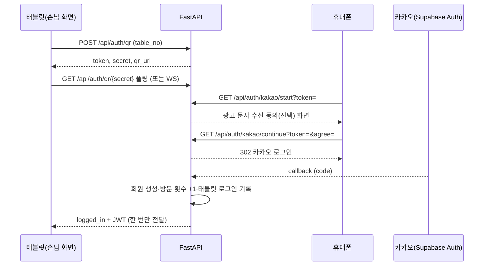

# F&BGrowth API 설계

> **문서 목적**: 프로젝트 평가용 API 설계 최종본입니다. 엔드포인트별 메서드·경로·요청·응답·인증·상태를 정리했습니다.
> **근거**: 2026-10-21 `main`/`dev`의 FastAPI 코드(`backend/app/routers/`)와 앱이 생성하는 OpenAPI(`/docs`)를 대조해 작성했습니다. API의 기준은 이 문서입니다.
> **표기**: `구현` = 라우터와 저장소(DB)까지 연결됨. `[확인 필요]` = 코드에서 확인하지 못한 내용. 응답 필드는 라우터가 직접 만드는 것만 적었고, 저장소가 만드는 세부 필드는 "객체/목록"으로 줄였습니다.
> 관련 문서: [DB 설계](DB_설계.md) · [화면 설계](화면_설계.md)

## 1. 개요

| 항목 | 내용 |
|---|---|
| 서버 | FastAPI (`backend/main.py` → `app/factory.py`), 문서 UI는 `http://127.0.0.1:8000/docs` |
| 손님 API 접두사 | `/api/...` |
| 관리자 API 접두사 | `/admin/api/...` (모든 경로에 관리자 인증 필요) |
| 데이터 형식 | JSON(UTF-8). 시각은 UTC ISO 문자열이며 화면에서 KST로 변환 |
| 상태 확인 | `GET /health` → `{"status":"ok"}` |
| DB | `DATABASE_URL`이 Postgres면 Supabase, 없으면 로컬 SQLite |
| 외부 연동 | 카카오 로그인(직접 또는 Supabase Auth), 솔라피(문자), 제미나이(AI 추천·챗봇·문자 후보), Open-Meteo(날씨) |

### 1.1 인증 방식

| 구분 | 방식 | 코드 |
|---|---|---|
| 공개 | 인증 없음 | - |
| 손님(선택) | `Authorization: Bearer <손님 JWT>`가 있으면 회원으로 처리, 없거나 잘못되면 비회원 | `optional_member` |
| 손님(필수) | 유효한 손님 JWT 필요, 없으면 `401` | `current_member` |
| 관리자 | 사장님 로그인 토큰(Supabase Auth, `owners` 등록 계정) 또는 개발용 `ADMIN_TOKEN`. `APP_ENV=prod`이고 Supabase가 설정되면 `ADMIN_TOKEN`은 거부. 실패 시 `401` | `require_admin` |

손님 JWT는 QR 로그인 완료 때 발급되며(`services/tokens.py`), 유효기간은 `JWT_EXPIRE_MINUTES` 설정을 따릅니다.

### 1.2 공통 응답

| 상태 | 의미 |
|---|---|
| 200 / 201 / 204 | 성공 / 생성 / 본문 없음 |
| 401 | 인증 필요(`관리자 인증이 필요합니다.`, `로그인이 필요합니다.`) |
| 403 | 이 태블릿에 로그인한 회원이 아님 |
| 404 | 대상 없음 |
| 409 | 규칙 위반(룰렛 하루 1회, 쿠폰 사용 불가, 카테고리에 메뉴 남음, 문자 발송 조건 불충족 등) |
| 422 | 입력값 검증 실패 |
| 502 / 503 | 외부 서비스(제미나이·솔라피 등) 실패 / 설정 없음 |

오류 본문은 `{"detail": "문장"}` 또는 문자 발송처럼 `{"detail": {"problems": [...]}}` 두 가지입니다.

## 2. 전체 목록 요약

OpenAPI 기준 HTTP 엔드포인트는 총 89개(경로+메서드 조합, 별칭 경로 포함)이고 WebSocket이 1개 더 있습니다.

| 영역 | 개수 | 인증 |
|---|---|---|
| 서버 상태 `/health` | 1 | 공개 |
| QR·사장님 로그인 `/api/auth` | 8 (+ WebSocket 1) | 공개 |
| 손님 `/api` (개발용 1 포함) | 30 | 공개 / 손님 JWT(선택·필수) |
| 관리자 `/admin/api` | 50 | 관리자 |

## 3. QR·사장님 로그인 `/api/auth`

손님은 태블릿에 뜬 QR을 휴대폰으로 읽어 카카오 로그인을 합니다. 태블릿은 폴링 또는 WebSocket으로 결과를 받습니다.

| 메서드 | 경로 | 설명 | 요청 | 응답 | 인증 | 상태 |
|---|---|---|---|---|---|---|
| POST | `/api/auth/qr` | 테이블 로그인 QR 발급 | body `{table_no, previous_secret?, logged_in_member_ids?[]}` | `{token, secret, expires_in, qr_url}` | 공개 | 구현 |
| GET | `/api/auth/qr/{secret}` | 로그인 진행 상태 폴링. 완료되면 JWT·회원 정보를 한 번만 전달 | path `secret` | `{event:"status", status, remaining}` 또는 완료 이벤트 | 공개 | 구현 |
| WS | `/api/auth/ws/{secret}` | 진행 상황 실시간 수신(scanned / logged_in / expired) | - | JSON 이벤트 | 공개 | 구현 |
| GET | `/api/auth/kakao/start` | QR을 연 휴대폰이 호출. 수신 동의 화면(HTML) | query `token` | HTML (404 유효하지 않음, 410 만료) | 공개 | 구현 |
| GET | `/api/auth/kakao/continue` | 동의 기록 후 카카오로 302 이동 | query `token`, `agree` | 302 | 공개 | 구현 |
| GET | `/api/auth/kakao/callback` | 카카오 직접 연동 콜백 | query `state, code, error` | HTML | 공개 | 구현 |
| GET | `/api/auth/supabase/callback/{state}` | Supabase Auth 경유 콜백 | path `state`, query `code, error` | HTML | 공개 | 구현 |
| GET | `/api/auth/owner/config` | 관리자 로그인 화면이 이메일 로그인을 보여줄지 | - | `{enabled}` | 공개 | 구현 |
| POST | `/api/auth/owner/login` | 사장님 이메일·비밀번호 로그인 | body `{email, password}` | `{access_token, email}` (401 실패, 403 미등록, 503 Supabase 미설정) | 공개 | 구현 |

로그인 상태값: `waiting` → `scanned` → `logged_in` (또는 `rejected` 중복 로그인 / `expired`). 같은 태블릿에서 이미 로그인한 회원이 다시 로그인하면 `rejected`입니다.

## 4. 손님 API `/api`

### 4.1 매장·콘텐츠·메뉴 (공개)

| 메서드 | 경로 | 설명 | 응답 | 상태 |
|---|---|---|---|---|
| GET | `/api/store`, `/api/v1/store` | 매장 정보(이름·지점·슬로건·테이블 수) | 객체 | 구현 |
| GET | `/api/menus` | 메뉴 전체(품절 포함) | 메뉴 목록 | 구현 |
| GET | `/api/categories` | 손님용 카테고리 | 목록 | 구현 |
| GET | `/api/content` | 카테고리·질문·날씨·추천 규칙 묶음 | `{categories, quiz_questions, weather, rules}` | 구현 |
| GET | `/api/content/{name}` | 단일 콘텐츠. `name` = `quiz_questions`/`weather`/`rules`/`categories` (그 외 404) | 해당 값 | 구현 |
| GET | `/api/v1/ai/questions` | AI 질문·선택지 | 질문 목록 | 구현 |
| GET | `/api/v1/ai/recommendation-rules` | 추천 규칙(할인율·짝·음료 구성) | 객체 | 구현 |
| GET | `/api/v1/weather/current` | 오늘 날씨(Open-Meteo, 실패 시 DB의 마지막 값) | `{types, current, text?}` | 구현 |
| GET | `/api/v1/roulette/prizes` | 룰렛 칸 구성 | 목록 | 구현 |
| GET | `/api/v1/staff-call-items` | 직원 호출 항목 | 목록(정렬순) | 구현 |

### 4.2 회원·태블릿 로그인 (손님 JWT 필수)

| 메서드 | 경로 | 설명 | 응답 | 상태 |
|---|---|---|---|---|
| GET | `/api/members/me` | 내 정보(새로고침 후 로그인 복원) | `{id, nickname, phone, birth_year, gender, marketing_consent, opted_out, visit_count}` | 구현 |
| POST | `/api/members/me/opt-out` | 내 광고 문자 수신거부 | 위와 같은 회원 객체 | 구현 |
| GET | `/api/tables/{table_no}/logins` | 이 태블릿에 로그인한 회원들(룰렛 사용 여부 포함). 해당 태블릿 회원이 아니면 403 | 목록 | 구현 |

### 4.3 룰렛·쿠폰 (손님 JWT 필수)

룰렛은 회원당 하루 1회(KST)이며, 당첨은 즉시 적용하지 않고 쿠폰함에 쿠폰으로 발급합니다.

| 메서드 | 경로 | 설명 | 요청 | 응답 | 상태 |
|---|---|---|---|---|---|
| GET | `/api/v1/roulette/status?table_no=` | 이 태블릿의 회원별 룰렛 상태·남은 기회 | query `table_no` | `{members, spins_left, remaining}` | 구현 |
| POST | `/api/v1/roulette/plays` | 서버가 가중치로 칸을 정해 당첨 기록 + 쿠폰 발급 | `{table_no, member_id?}` | 201 `{index, prize, coupon}` / 409 오늘 이미 참여 / 503 칸 없음 | 구현 |
| PUT | `/api/tables/{table_no}/logins/prize` | 클라이언트가 정한 당첨 결과 기록 + 쿠폰 발급 | `{member_id, prize, kind?, emoji?, percent?, item_id?, prize_id?}` | `{ok, coupon}` / 404·409·422 | 구현 |
| GET | `/api/v1/coupons`, `/api/coupons` | 내 쿠폰(안 쓴 쿠폰 먼저) | - | 목록 | 구현 |
| GET | `/api/tables/{table_no}/coupons` | 이 태블릿 회원들의 쿠폰함 | - | 목록 | 구현 |

### 4.4 주문·직원 호출·AI 추천

| 메서드 | 경로 | 설명 | 요청 | 응답 | 인증 | 상태 |
|---|---|---|---|---|---|---|
| POST | `/api/orders`, `/api/v1/orders` | 주문 생성(쿠폰 사용 포함) | `{table_no, lines[{id,name,opt,unit,qty,components?,original_unit?}], total, coupon_ids?[], recommendation_event_id?}` | 201 `{no, ai_combo, used_coupon_ids}` / 409 쿠폰 사용 불가 | 선택 | 구현 |
| GET | `/api/v1/tables/{table_no}/orders` | 테이블 누적 주문(로그인 시각 이후만 합산) | - | `{orders, total}` | 공개 | 구현 |
| POST | `/api/calls`, `/api/v1/staff-calls` | 직원 호출 | `{table_no, items[]}` | 201 `{id}` | 공개 | 구현 |
| POST | `/api/recommendations`, `/api/v1/ai/recommendations` | 추천 조합 노출 기록(적중률 분모) | `{table_no, params, combo_ids[]}` | 201 `{id}` | 선택 | 구현 |
| POST | `/api/v1/ai/recommendations/generate` | 제미나이가 DB 메뉴·주문·규칙으로 조합 추천. 서버가 가격·품절·예산을 검증 | `{table_no, params, lines[]}` | 조합 목록(출처 포함) / 503 | 선택 | 구현 |

### 4.5 개발용

| 메서드 | 경로 | 설명 | 상태 |
|---|---|---|---|
| POST | `/api/dev/db-test` | DB 쓰기·읽기 확인(`DEV_TEST_BUTTON` 설정이 꺼져 있으면 404) | 구현 |

## 5. 관리자 API `/admin/api` (모두 관리자 인증)

### 5.1 메뉴·카테고리·주문·직원 호출

| 메서드 | 경로 | 설명 | 요청 | 응답 | 상태 |
|---|---|---|---|---|---|
| GET | `/menus` | 카테고리 + 메뉴 목록 | - | `{categories, menus}` | 구현 |
| PUT | `/menus/{menu_id}` | 메뉴 등록·수정(전달한 필드만 저장). body가 배열이면 일괄 저장·삭제 | `{name?, cat?, price?, desc?, image_url?, soldout?, spicy?(0~3), weight?(0~100), set_ok?, is_event?, emoji?, tags?}` (신규는 name·cat·price 필수) | 저장된 메뉴 / 422·404 | 구현 |
| DELETE | `/menus/{menu_id}` | 메뉴 삭제 | - | 204 / 404 | 구현 |
| GET | `/categories` | 카테고리 목록(메뉴 개수 포함) | - | 목록 | 구현 |
| POST | `/categories` | 카테고리 추가 | `{id?, name, icon?, colors[2]}` | 201 객체 / 409·422 | 구현 |
| PATCH | `/categories/{category_id}` | 카테고리 수정 | 일부 필드 | 객체 / 404 | 구현 |
| DELETE | `/categories/{category_id}` | 삭제(메뉴가 남아 있으면 409) | - | 204 | 구현 |
| GET | `/orders?member_id=` | 주문 이력(최신순, 회원 닉네임 포함) | query `member_id?` | 목록 | 구현 |
| GET | `/calls` | 직원 호출 목록(최신순) | - | 목록 | 구현 |
| POST | `/calls/{call_id}/done` | 호출 처리 완료(반복 호출해도 같은 결과) | - | 호출 객체 / 404 | 구현 |
| PUT | `/owner/roulette/prizes` | 룰렛 칸 전체 교체 | 배열 `[{label, short, emoji?, color(#RRGGBB), kind(discount/free), percent?, item_id?, weight}]`. 칸 2~8개, 확률 정수·합계 100, 서비스 메뉴 존재 검사 | 저장된 목록 / 422 | 구현 |

참고: 손님 쪽 `PUT /api/v1/owner/roulette/prizes`도 같은 로직의 별칭이며 관리자 인증이 필요합니다.

### 5.2 고객·등급·알림

| 메서드 | 경로 | 설명 | 요청 | 응답 | 상태 |
|---|---|---|---|---|---|
| GET | `/members`, `/customers` | 고객 목록 + 등급. 등급 기준을 쿼리로 미리 적용(저장 안 됨) | query `repeat(≥2), regular(≥3), dormant(≥1)` | `{rule, members[]}` (단골 기준 ≤ 재방문 기준이면 422) | 구현 |
| GET | `/customers/grades` | 등급별 인원 | 위와 같은 쿼리 | 등급별 집계 | 구현 |
| GET | `/customers/grades/rules` | 현재 등급 기준 | - | `{repeat, regular, dormant}` | 구현 |
| PUT | `/customers/grades/rules` | 등급 기준 저장(`app_settings.grade_rule`) | `{repeat, regular, dormant}` | 저장된 기준 | 구현 |
| POST | `/members/{member_id}/opt-out`, `/customers/{member_id}/opt-out` | 회원 수신거부 등록 | - | `{ok:true}` / 404 | 구현 |
| GET | `/alerts` | 품절·재입고 등 운영 알림 | - | 알림 객체 | 구현 |

### 5.3 통계 (대시보드)

모든 통계는 등급 기준 쿼리(`repeat`, `regular`, `dormant`)를 받으며 저장하지 않습니다. 주문이 없으면 `empty: true`를 돌려줍니다.

| 메서드 | 경로 | 반환 |
|---|---|---|
| GET | `/stats` | 대시보드 종합(오늘 주문·평균 주문금액·신규/재방문·인기 메뉴·연령/성별·AI 추천) |
| GET | `/stats/sales` | `today_orders`, `avg_order_amount` |
| GET | `/stats/menus/ranking` | `popular_menus` |
| GET | `/stats/customers` | 신규/재방문 고객, 연령대, 성별 |
| GET | `/stats/ai-recommendations` | AI 추천 노출 수·적중률 |
| GET | `/stats/insights` | 아래 세부 통계 묶음(한 번에 조회) |
| GET | `/stats/sales/hourly` | 시간대별 매출, 피크 시간 |
| GET | `/stats/sales/weekday` | 요일별 매출, 피크 요일 |
| GET | `/stats/sales/trends` | 일별 매출·최근 7일·마지막 영업일·전주 대비 증감 |
| GET | `/stats/sales/tickets` | 객단가·금액대 분포·AI/일반·회원/비회원 객단가 |
| GET | `/stats/tables` | 테이블 회전율, 주문 많은 테이블 TOP |

### 5.4 마케팅 (문자·AI 추천·챗봇·성과)

| 메서드 | 경로 | 설명 | 요청 | 응답 | 상태 |
|---|---|---|---|---|---|
| GET | `/marketing/sms/usage` | 월 문자 사용량·한도 | - | 객체 | 구현 |
| GET | `/marketing/sms/balance` | 솔라피 잔액·포인트 | - | 객체(조회 불가 시 사유) | 구현 |
| POST | `/marketing/sms/preview` | 대상 수·비용·발송 가능 여부 미리보기 | `{grades[], member_ids?[], body, scheduled_at?}` | 객체 / 422 | 구현 |
| POST | `/marketing/sms/send` | 즉시·예약 발송(`SMS_DRY_RUN=true`면 기록만) | 위와 같음 | 객체 / 409 `{problems}` | 구현 |
| POST | `/marketing/sms/candidates` | AI 문자 후보 여러 개 | - | 후보 목록(키워드·수신 등급·문구·출처) | 구현 |
| GET | `/marketing/sms/logs` | 발송·예약 기록 | - | 목록 | 구현 |
| POST | `/marketing/sms/logs/{log_id}/cancel` | 예약 취소 | - | 객체 / 404·409 | 구현 |
| POST | `/sms/test` | 번호 1건 테스트 발송 | `{phone, body}` | 객체 / 409 | 구현 |
| GET | `/marketing/external-context` | 오늘 날씨·지역 행사 문구(하루 한 번 저장) | - | 객체 | 구현 |
| GET | `/marketing/opportunities` | AI 마케팅 추천 카드(문자 추천·기타 추천). 규칙 엔진이 고르고 제미나이가 문구를 다듬음 | query `round`(4개씩 순환), `refresh` | `{groups:{sms,guide}, external, ...}` | 구현 |
| GET | `/marketing/growth-performance` | AI 도입 전후 월환산 성과 | - | 객체 | 구현 |
| GET | `/marketing/regular-preferences` | 오늘 주문한 단골·생일·기념일 고객의 응대 제안 | - | `{preferences[]}` (각 카드에 `checked`) | 구현 |
| PUT | `/marketing/tip-checks` | 응대 제안 카드 확인/되돌리기 | `{member_id, order_id, checked}` | 같은 값 | 구현 |
| GET | `/marketing/live-activity` | 새 로그인·주문 여부(화면 폴링용) | - | 객체 | 구현 |
| POST | `/marketing/chat/sessions` | 챗봇 대화방 생성(첫 인사 포함) | - | 201 대화방 | 구현 |
| GET | `/marketing/chat/sessions` | 내 대화방 목록 | - | 목록 | 구현 |
| GET | `/marketing/chat/sessions/{session_id}` | 대화방 + 메시지 | - | 객체 / 404 | 구현 |
| DELETE | `/marketing/chat/sessions/{session_id}` | 대화방 삭제 | - | 204 / 404 | 구현 |
| POST | `/marketing/chat/sessions/{session_id}/messages` | 질문 전송 → 제미나이 답변 저장 | `{content(1~1000자)}` | 201 `{messages:[질문, 답변]}` / 502 | 구현 |

챗봇 대화방의 주인은 로그인한 사장님이고, 개발 토큰으로 들어오면 `CHAT_OWNER_ID` 설정을 씁니다(없으면 503).

### 5.5 시스템

| 메서드 | 경로 | 설명 | 상태 |
|---|---|---|---|
| GET | `/system/db` | DB 연결·필수 테이블 존재 점검(연결 주소·비밀번호는 응답에 넣지 않음) | 구현 |

## 6. 화면 ↔ API 대응

| 화면 | 주로 쓰는 API |
|---|---|
| 손님 시작(룰렛·로그인) | `GET /api/store`, `GET /api/v1/roulette/prizes`, `POST /api/auth/qr`, `GET /api/auth/qr/{secret}`, `GET /api/tables/{n}/logins`, `POST /api/v1/roulette/plays` |
| 손님 주문 | `GET /api/categories`, `GET /api/menus`, `POST /api/orders`, `GET /api/v1/tables/{n}/orders` |
| 쿠폰함 | `GET /api/tables/{n}/coupons`, `POST /api/orders`(`coupon_ids`) |
| 직원 호출 | `GET /api/v1/staff-call-items`, `POST /api/calls` |
| AI 질문·추천 | `GET /api/v1/ai/questions`, `GET /api/v1/weather/current`, `POST /api/v1/ai/recommendations/generate`, `POST /api/recommendations` |
| 관리자 로그인 | `GET /api/auth/owner/config`, `POST /api/auth/owner/login` |
| 대시보드 | `GET /admin/api/stats`, `/stats/insights` 등 |
| 메뉴 관리·추천 가중치·이벤트 | `/admin/api/menus`, `/categories`, `/owner/roulette/prizes` |
| 고객 등급·주문 이력 | `/customers`, `/customers/grades/rules`, `/orders` |
| 마케팅 | `/marketing/*` |

## 7. 경로 별칭과 제공 범위

- 관리자 API는 모두 `/admin/api/...`입니다. 손님 API 중 일부는 `/api/v1/...` 별칭을 함께 제공합니다(매장, 주문, 직원 호출, 쿠폰, 추천 노출 기록).
- 주문 상태 API는 제공하지 않습니다(제품 규칙: 주문 상태 기능 없음).
- 주문 상세 조회, 개인 취향 조회, 대안 재추천, 추천 만족도 저장, 알림 확인 처리, 메뉴군·날씨별 통계는 제공하지 않습니다.
- 메뉴 가중치는 별도 일괄 API 없이 `PUT /admin/api/menus/{id}`(배열 가능)로 저장합니다.

## 8. 확인 필요

- 응답 객체의 세부 필드(메뉴·쿠폰·통계·마케팅 추천 카드)는 저장소/서비스 코드가 만들며 이 문서에서는 요약했습니다. 정확한 모양은 서버를 켜고 `/docs`에서 확인하세요.
- 서버·화면 테스트 결과는 PR 본문에 기록합니다.
