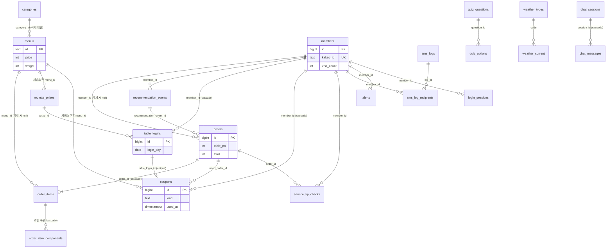

# F&BGrowth DB 설계 (Supabase / Postgres)

> **문서 목적**: 프로젝트 평가용 DB 설계 최종본입니다. 테이블 정의·관계(ERD)·제약조건·뷰/함수·보안(RLS)·API 대응을 한 곳에 정리했습니다.
> 실행용 SQL은 [`docs/db/fbgrowth_schema.sql`](../db/fbgrowth_schema.sql)이고, 운영 Supabase `table-order` 프로젝트의 실제 상태(2026-10-21 조회: 서비스 테이블 28개 + 개발용 `test` 1개, 뷰 2개, RLS 전부 켜짐)와 일치함을 확인했습니다.
> 관련 문서: [API 설계](API_설계.md) · [화면 설계](화면_설계.md)
> 근거 표시: 이 문서의 모든 내용은 위 SQL과 `backend/app/` 코드에서 확인한 것입니다. 확인하지 못한 것은 **[확인 필요]** 로 표시했습니다.

## 한 단락 요약

테이블 28개, 뷰 2개, 함수 2개(`set_updated_at`, `member_grade`)로 이뤄진 Postgres 스키마입니다. 매장·메뉴, 회원·QR 로그인·룰렛, 주문·직원 호출, AI 추천 콘텐츠, 관리자(알림·문자·챗봇)를 다룹니다. FastAPI 서버가 서비스 롤로 접속하므로 RLS를 우회하고, 모든 테이블에 RLS를 켜서 브라우저·anon 키 접근을 막으며 손님 화면용 공개 콘텐츠 10개만 anon 읽기를 허용합니다. 정수 ID는 `bigint identity`, 메뉴·카테고리 ID는 문자열(`c1`, `chicken`)이고, 시각은 `timestamptz`(UTC 저장, 화면에서 KST 변환)입니다.

**배포 상태(2026-10-21 확인)**: Supabase `table-order` 프로젝트에 서비스 테이블 28개, 뷰 2개가 적용되어 있고 RLS가 전부 켜져 있습니다. 서버(`backend/app/stores/`)는 `DATABASE_URL`이 Postgres면 이 스키마에 접속하며, 비어 있을 때만 로컬 SQLite(`backend/app.db`)를 개발·테스트용으로 씁니다(`stores/db.py`).

개발 흐름 확인용 `test` 테이블은 서비스 테이블이 아니며(위 28개에 포함하지 않음) `docs/db/fbgrowth_test_table.sql`로 만듭니다. 각자의 TODO 0번 단계에서 쓰기·읽기 확인에 씁니다.

## 목차

1. [결정 사항](#결정-사항)
2. [테이블 목록과 목적](#테이블-목록과-목적)
3. [관계(ERD)](#관계erd)
4. [제약조건·인덱스·트리거](#제약조건인덱스트리거)
5. [뷰·함수](#뷰함수)
6. [보안(RLS)](#보안rls)
7. [API ↔ 테이블 대응](#api--테이블-대응)
8. [남은 과제](#남은-과제)
9. [SQL 파일 안내](#sql-파일-안내)

## 결정 사항

설계 기준입니다. 새 코드를 짤 때 이 항목과 어긋나지 않게 합니다.

| 항목 | 결정 | 스키마·코드에 미치는 영향 |
|---|---|---|
| 주문 상태 | 기능·UI 제거. `orders`에 상태 컬럼 없음 | 주문 상태 화면·API 없음 |
| 방문 횟수 | 로그인할 때마다 `members.visit_count` +1 | 주문 횟수와 별개. 등급 판정(`member_grade`)이 이 값을 씀 |
| 챗봇 | 제미나이(Gemini) 무료 API, RAG 없음, DB 데이터 기반 답변 | 벡터 테이블·임베딩 없음. 서버가 매출·메뉴 등을 조회해 프롬프트에 넣고, 대화는 `chat_sessions`/`chat_messages`에 저장 |
| 관리자 인증 | Supabase Auth 이메일/비밀번호 + `owners` 등록 계정 | `owners.user_id`가 `auth.users`와 연결. 개발용 `ADMIN_TOKEN`은 `APP_ENV=prod`이고 Supabase가 설정되면 거부 |
| 문자 발송 | 솔라피(Solapi) | `sms_logs`는 공급자와 무관한 구조. 발송 코드는 `backend/app/services/sms.py` |
| 메뉴·카테고리 ID | 문자열 유지 | 시드·화면 코드가 문자열 ID를 씀. 새 메뉴 ID는 서버가 `m` + 난수로 생성 |
| 룰렛 횟수 | 회원당 하루 1회(KST). 같은 날 다른 테이블에서는 돌릴 수 없고 다른 날은 가능 | `table_logins`에 `unique(member_id, login_day) where played_at is not null` 부분 유니크 인덱스. 로그인 시 오늘 이미 돌렸으면 `roulette_eligible=false` |
| 쿠폰함 | 룰렛 당첨은 바로 적용하지 않고 쿠폰함(`coupons`)에 넣고, 손님이 쿠폰함에서 '사용'하면 장바구니에 적용, 주문이 접수되면 `used_at` 기록 | 룰렛 한 번에 쿠폰 한 장(`table_login_id` unique). 한 테이블에 앉은 회원들의 쿠폰이 한 쿠폰함에 보임. 유효기간은 정책 미정(`expires_at` null = 없음) |
| 테이블 누적 주문 | 해당 테이블의 주문 중 `orders.created_at`이 그 테이블의 현재 로그인 기록(`table_logins`) 가장 이른 `logged_in_at` 이후인 것만 합산 | 별도 테이블 세션 테이블을 만들지 않음. 같은 테이블에 새 손님이 로그인하면 `table_logins`가 새로 쌓이는 시점부터 다시 센다 |
| 룰렛 칸 개수(2~8)·가중치 합 > 0 | SQL 제약이 아니라 서버에서 검증 | 여러 행에 걸친 규칙이라서 |
| `staff_calls.done_at` | 관리자 직원 호출 처리 시각 기록 | `POST /admin/api/calls/{id}/done`이 채움 |
| 전화번호 | 평문 저장 | 정식 운영 전에 암호화·보관 기간 결정 필요 |

## 테이블 목록과 목적

### 매장·메뉴

| 테이블 | 목적 | 핵심 컬럼 |
|---|---|---|
| `store_info` | 매장 정보(1행만 허용) | name, branch, slogan, tables(전체 테이블 수) |
| `categories` | 메뉴 카테고리 | id, name, icon, color_from/to, is_virtual(`ai`·`best`는 메뉴를 직접 넣지 않음), sort_order |
| `menus` | 메뉴 | id, category_id, name, price, tags[], is_soldout, spicy, weight(추천 가중치), set_ok, is_event(이벤트 서비스 메뉴 후보), image_url |

### 회원·로그인·룰렛

| 테이블 | 목적 | 핵심 컬럼 |
|---|---|---|
| `members` | 카카오 로그인 회원 | kakao_id, auth_user_id, nickname, phone, gender, birth_year, marketing_consent, opted_out, visit_count, last_visit_at |
| `login_sessions` | QR 로그인 진행 상태(서버 미사용, 위 참고). JWT는 저장하지 않음 | token, secret, table_no, status(`waiting/scanned/logged_in/rejected/expired`), blocked_member_ids[], marketing_consent, expires_at |
| `roulette_prizes` | 룰렛 칸 구성 | label, short_text, kind(`discount`/`free`), percent, menu_id(서비스 메뉴), weight, sort_order |
| `table_logins` | 테이블 로그인 이력 + 룰렛 참여·당첨 | table_no, member_id, login_day(하루 1회 규칙), roulette_eligible, prize_id, prize_text(문구 사본), played_at |
| `coupons` | 쿠폰함: 룰렛 당첨 쿠폰과 사용 여부 | member_id, table_login_id(unique), table_no, kind(`discount`/`free`), label, percent, menu_id, issued_at, expires_at, used_at, used_order_id |

### 주문·직원 호출

| 테이블 | 목적 | 핵심 컬럼 |
|---|---|---|
| `orders` | 주문 헤더 | table_no, member_id, total, roulette_discount_percent, ai_combo, recommendation_event_id |
| `order_items` | 주문 줄 | order_id, menu_id, kind(`menu/combo/roulette_service`), name, unit_price, original_unit_price, qty |
| `order_item_components` | AI 조합 줄의 구성 메뉴(인기 메뉴 집계용) | order_item_id, menu_id, name, qty |
| `staff_call_items` | 직원 호출 요청 항목(물·수저 등) | label(20자 이하·중복 불가), sort_order |
| `staff_calls` | 직원 호출 기록 | table_no, items[], created_at, done_at |
| `service_tip_checks` | 손님 응대 제안 카드의 '확인' 기록(행이 있으면 확인) | member_id, order_id(기본키 묶음), checked_at |

### AI 추천 콘텐츠

| 테이블 | 목적 | 핵심 컬럼 |
|---|---|---|
| `quiz_questions` / `quiz_options` | 추천 질문과 보기 | 질문 id(hunger·stress·people·gender·kind·spicy·intent·budget), 보기 value·label·emoji |
| `weather_types` / `weather_current` | 날씨 코드 정의 / 현재 날씨 1행 | 코드·라벨·아이콘 |
| `recommendation_rules` | 복잡한 추천 규칙 | key, value(jsonb): discount_percent, pairings, drinks, pair_meta |
| `recommendation_events` | 추천 기록(적중률 집계) | table_no, member_id, answers(jsonb), hour, weather_code, combo_ids[] |

### 관리자

| 테이블 | 목적 | 핵심 컬럼 |
|---|---|---|
| `owners` | 관리자(Supabase Auth 연결, 후순위) | user_id(auth.users), role=OWNER |
| `app_settings` | 설정 key-value | key, value(jsonb): `grade_rule`, `sms_limits` |
| `alerts` | 운영 알림 | kind(`dormant/soldout/other`), title, member_id, menu_id, acknowledged_at |
| `sms_logs` / `sms_log_recipients` | 문자 발송·예약 기록 / 수신 회원 | month, type(SMS/LMS), content, target_count, status(`sent/dry_run/failed/scheduled/canceled`), scheduled_at |
| `external_context` | 오늘 날씨·지역 행사 문구(AI 문자 후보용) | day, weather_text, event_text |
| `chat_sessions` / `chat_messages` | 챗봇 대화 | owner_id, title / session_id, role, content |

서버가 현재 읽고 쓰지 않는 테이블이 3개 있습니다. `login_sessions`(QR 로그인 세션은 서버 메모리 `LoginSessionStore`가 관리하며, 서버를 여러 개 띄울 때를 대비한 스키마), `alerts`(`GET /admin/api/alerts`가 주문·재고에서 계산해 응답), `sms_log_recipients`(문자 수신자 기록용 스키마). 나머지 25개는 서버가 사용합니다.

## 관계(ERD)

주요 테이블만 그린 관계도입니다(컬럼은 위 표 참고). `||--o{` 는 "1 대 0..N", 괄호는 삭제 규칙입니다.

`auth.users`(Supabase 내장)와 이어지는 곳: `owners.user_id`(1:1), `chat_sessions.owner_id`(1:N), `members.auth_user_id`(선택, 1:1). 독립 테이블(FK 없음): `store_info`, `app_settings`, `external_context`, `recommendation_rules`, `staff_call_items`, `staff_calls`.

## 제약조건·인덱스·트리거

| 대상 | 규칙 | 목적 |
|---|---|---|
| `store_info` | `id = 1` CHECK, `tables >= 1` | 매장 1개만 허용 |
| `weather_current` | `id = 1` CHECK | 현재 날씨 1행 |
| `menus` | `price >= 0`, `spicy 0~3`, `weight 0~100`, `category_id` FK(`on delete restrict`) | 메뉴가 있는 카테고리는 삭제 불가 |
| `menus` 트리거 `menus_virtual_check` | `is_virtual` 카테고리(`ai`·`best`)에는 메뉴 삽입/이동 거부 | 가상 카테고리 보호 |
| `members` | `kakao_id` UNIQUE, `gender in (male,female)`, `visit_count` 기본 0 | 카카오 회원 식별 |
| `login_sessions` | `token`·`secret` UNIQUE, `status` 5종 CHECK | QR 로그인 상태 머신 |
| `roulette_prizes` | `kind=discount → percent 필수·menu_id null`, `kind=free → menu_id 필수·percent null`, 색상 `#RRGGBB` | 칸 종류별 필수값 |
| `table_logins` | `unique(table_no, member_id, login_day)` | 같은 날 같은 테이블 중복 로그인 방지 |
| `table_logins_one_play_per_day` | `unique(member_id, login_day) where played_at is not null` (부분 유니크) | **룰렛 회원당 하루 1회(KST)** |
| `coupons` | `table_login_id` UNIQUE, `kind` CHECK, 종류별 percent 규칙, `used_at null = 사용 가능` | 룰렛 한 번에 쿠폰 한 장 |
| `orders` / `order_items` | `total >= 0`, `qty 1~99`, `kind in (menu,combo,roulette_service)` | 주문 값 검증. 이름·단가는 주문 시점 사본 저장 |
| `staff_call_items` | `label` UNIQUE, 길이 1~20 | 직원 호출 항목 |
| `sms_logs` | `type in (SMS,LMS)`, `status in (sent,dry_run,failed,scheduled,canceled)` | 문자 기록 상태 |
| `alerts` | `kind in (dormant,soldout,other)`, 부분 인덱스(미확인만) | 알림 목록 조회 속도 |
| `owners` | `role = 'OWNER'` CHECK | 관리자는 사장님 한 종류 |
| 주요 인덱스 | `orders(created_at desc)`, `orders(table_no, created_at desc)`, `orders(member_id, created_at desc)`, `menus(category_id, sort_order)`, `members(last_visit_at)`, `coupons(member_id, used_at)` 등 | 통계·목록 조회 |
| `set_updated_at()` 트리거 | `menus`, `chat_sessions`의 `updated_at` 자동 갱신 | 변경 시각 |

서버에서 검증하는 규칙(SQL 제약이 아님): 룰렛 칸 2~8개·확률 합계 100%(`routers/admin/owner.py`), 단골 기준 > 재방문 기준(`routers/admin/members.py`).

## 뷰·함수

| 이름 | 내용 |
|---|---|
| `member_grade(...)` | 휴면(마지막 방문 N일 이상) → 단골 → 재방문 → 신규 순으로 판정. 서버 `services/grades.py`와 같은 규칙 |
| `v_members_graded` | 회원 + 등급 + 문자 발송 가능 여부(동의·수신거부 아님·번호 있음). 기준은 `app_settings.grade_rule` |
| `v_sms_usage` | 월·종류별 사용량(발송·테스트·예약만 집계, 취소·실패 제외) |

고객 등급 기준은 `app_settings`의 `grade_rule` 한 행(재방문·단골 방문 횟수, 휴면 일수)에 저장합니다. `GET·PUT /admin/api/customers/grades/rules`로 조회·저장하고, 고객 목록·통계·문자 대상은 저장된 기준을 읽습니다. 조회 우선순위는 **쿼리 미리보기 > DB 저장값 > 환경 변수 > 코드 기본값**이며 미리보기는 DB를 바꾸지 않습니다. 휴면 기본값은 30일입니다(`member_grade` 함수와 `grade_rule` 시드).

## 보안(RLS)

- 28개 서비스 테이블 모두 `row level security`를 켰습니다. FastAPI 서버가 서비스 롤로 접속하므로 RLS를 우회하고, 브라우저·anon 키로는 접근할 수 없습니다.
- 예외로 손님 화면용 공개 콘텐츠 10개(`store_info`, `categories`, `menus`, `roulette_prizes`, `staff_call_items`, `quiz_questions`, `quiz_options`, `weather_types`, `weather_current`, `recommendation_rules`)만 `anon`/`authenticated` 읽기를 허용합니다.
- `chat_sessions`/`chat_messages`는 `owner_id = auth.uid()`인 본인 것만 접근하는 정책이 있습니다.
- 전화번호는 평문 저장입니다(열린 사항 참고).

## API ↔ 테이블 대응

실제 경로와 요청·응답은 [API 설계](API_설계.md)를 보세요. 아래 표는 각 API가 읽고 쓰는 테이블입니다. "집계"는 별도 테이블 없이 `orders`·`members` 등에서 계산한다는 뜻입니다.

### 손님 API (`/api`)

| 기능 | API | 테이블 |
|---|---|---|
| 매장 정보 | `GET /store` | `store_info` |
| 메뉴·카테고리 | `GET /menus`, `GET /categories`, `GET /content/categories` | `menus`, `categories` |
| 룰렛 칸 | `GET /v1/roulette/prizes` | `roulette_prizes` |
| 룰렛 상태·돌리기 | `GET /v1/roulette/status`, `POST /v1/roulette/plays`, `PUT /tables/{n}/logins/prize` | `table_logins`, `roulette_prizes`, `coupons`(당첨 시 발급) |
| 쿠폰함 | `GET /coupons`, `GET /tables/{n}/coupons` | `coupons` |
| QR 로그인 | `POST /auth/qr`, `GET /auth/qr/{secret}`, `/auth/kakao/*`, `/auth/supabase/callback/*` | `login_sessions`, `members`(방문 횟수 +1), `table_logins` |
| 내 정보·수신거부 | `GET /members/me`, `POST /members/me/opt-out` | `members` |
| 태블릿 로그인 기록 | `GET /tables/{n}/logins` | `table_logins`, `members` |
| 주문 | `POST /orders` | `orders`, `order_items`, `order_item_components`, `coupons`(`used_at`, `used_order_id`) |
| 테이블 누적 주문 | `GET /v1/tables/{n}/orders` | `orders`, `order_items`, `table_logins` |
| 직원 호출 | `GET /v1/staff-call-items`, `POST /calls` | `staff_call_items`, `staff_calls` |
| AI 질문·규칙·날씨 | `GET /v1/ai/questions`, `/v1/ai/recommendation-rules`, `/v1/weather/current` | `quiz_questions`, `quiz_options`, `recommendation_rules`, `weather_current`, `weather_types`, `external_context` |
| AI 추천 | `POST /v1/ai/recommendations/generate`, `POST /recommendations` | `recommendation_events`(+ `menus`, `orders` 조회) |

### 관리자 API (`/admin/api`)

| 기능 | API | 테이블 |
|---|---|---|
| 대시보드 통계 | `GET /stats`, `/stats/*` | 집계: `orders`, `order_items`, `order_item_components`, `members`, `recommendation_events`, `store_info` |
| 알림 | `GET /alerts` | 집계: `menus`, `order_items` (품절·재입고) |
| 메뉴 | `GET /menus`, `PUT·DELETE /menus/{id}` | `menus` |
| 카테고리 | `GET·POST /categories`, `PATCH·DELETE /categories/{id}` | `categories` |
| 추천 가중치 | `PUT /menus/{id}` (`weight`) | `menus.weight` |
| 룰렛 설정 | `PUT /owner/roulette/prizes` | `roulette_prizes` |
| 고객·등급 | `GET /members`, `/customers/*`, `PUT /customers/grades/rules` | `v_members_graded`, `members`, `app_settings.grade_rule` |
| 수신거부 | `POST /members/{id}/opt-out` | `members.opted_out` |
| 주문 이력 | `GET /orders` | `orders`, `order_items`, `members` |
| 직원 호출 | `GET /calls`, `POST /calls/{id}/done` | `staff_calls` |
| 문자 | `/marketing/sms/*`, `POST /sms/test` | `sms_logs`, `sms_log_recipients`, `v_sms_usage`, `v_members_graded`, `app_settings.sms_limits` |
| 외부 정보 | `GET /marketing/external-context` | `external_context` |
| AI 마케팅 추천·성과 | `GET /marketing/opportunities`, `/marketing/growth-performance` | 집계: `orders`, `members`, `menus` |
| 응대 제안 | `GET /marketing/regular-preferences`, `PUT /marketing/tip-checks` | `orders`, `order_items`, `members`, `service_tip_checks` |
| 챗봇 | `/marketing/chat/sessions*` | `chat_sessions`, `chat_messages` |
| 로그인 | `POST /api/auth/owner/login` | `owners` (+ Supabase Auth) |
| DB 점검 | `GET /system/db` | 전체 테이블 존재 확인 |

## 남은 과제

1. **쿠폰 유효기간**: 정책이 정해지지 않아 `coupons.expires_at`은 null(기한 없음)입니다.
2. **개인정보**: 전화번호는 평문 저장입니다. 암호화와 보관 기간 정책이 필요합니다.
3. **서버 쿼리 검증 범위**: 서버·화면 자동 테스트는 로컬 SQLite 기준으로 실행됩니다. Supabase(Postgres)에서의 전체 쿼리 실행은 [확인 필요]입니다.

## SQL 파일 안내

모두 `docs/db/`에 있고 Supabase SQL Editor에서 실행합니다(여러 번 실행해도 안전하게 작성됨).

| 파일 | 용도 |
|---|---|
| `fbgrowth_schema.sql` | 전체 스키마(테이블·뷰·함수·RLS·기본 설정) |
| `fbgrowth_seed.sql` | 기본 데이터(메뉴 60·카테고리 8·퀴즈 8·룰렛 5칸·추천 규칙·직원 호출 8·매장 정보) |
| `fbgrowth_menus_is_event.sql` | 기존 DB에 `menus.is_event` 컬럼 추가 |
| `fbgrowth_service_tip_checks.sql` | 기존 DB에 `service_tip_checks` 추가(서버가 처음 쓸 때 자동 생성하기도 함) |
| `sooyong_grade_rules_30_days.sql` | 휴면 기본값 30일로 통일 |
| `fbgrowth_owner_add.sql` | 사장님 계정을 `owners`에 등록 |
| `fbgrowth_sample_data.sql` / `_cleanup.sql` | 시연용 샘플 데이터 넣기 / 지우기 |
| `fbgrowth_test_table.sql` | 개발 흐름 확인용 `test` 테이블 |
