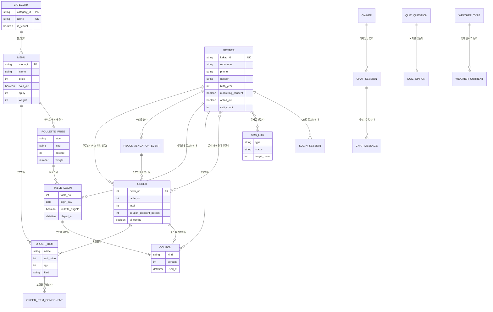
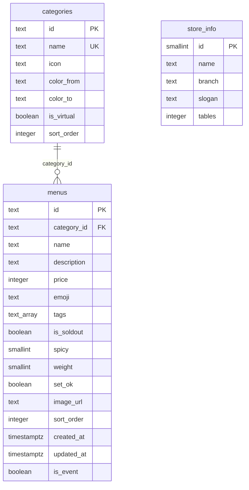
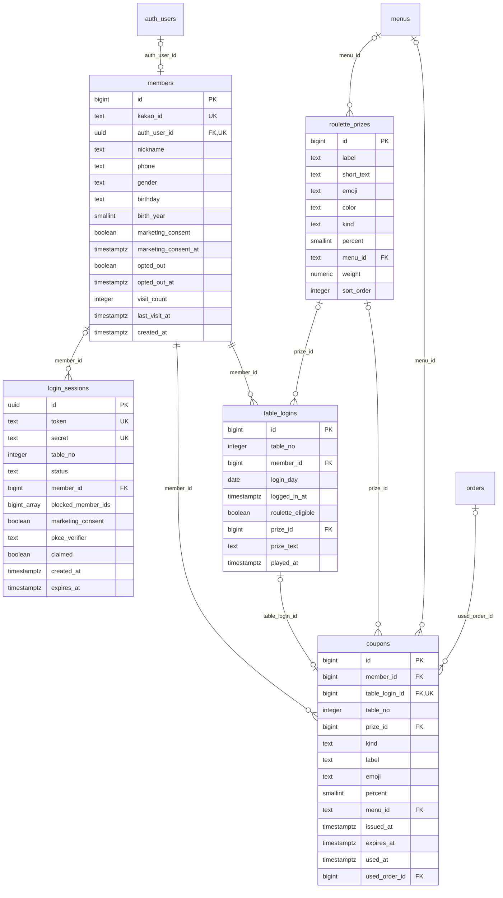
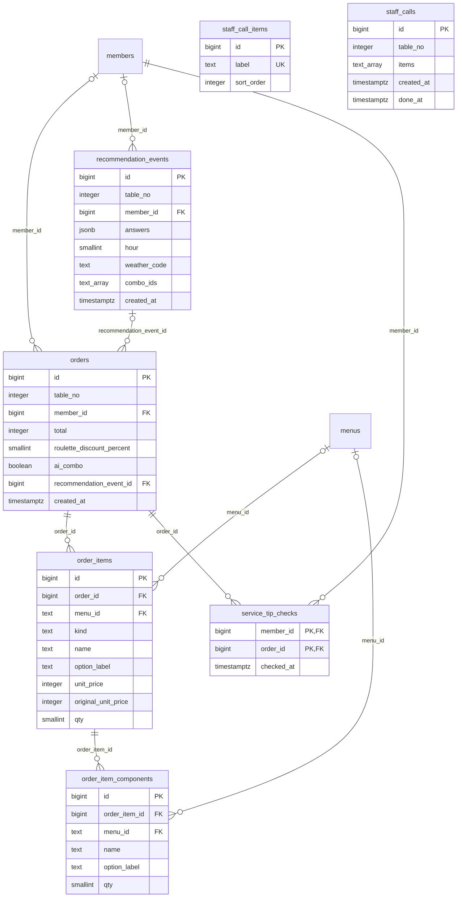
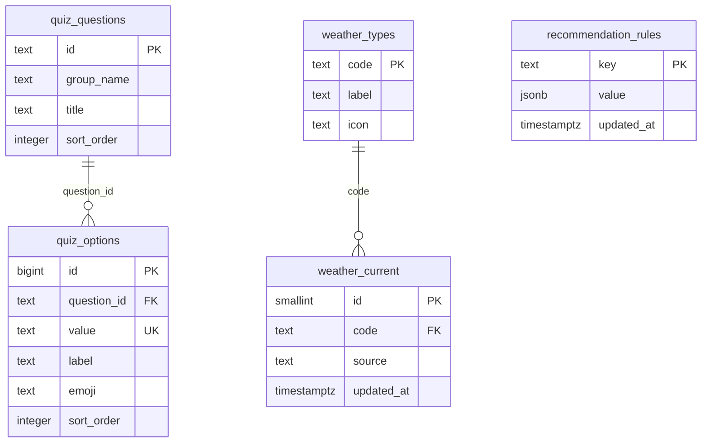
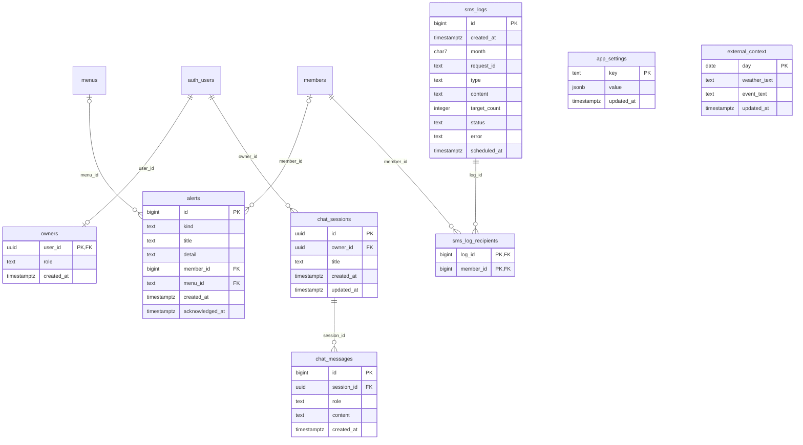

# F&BGrowth DB 설계 (Supabase / Postgres)

> **문서 목적**: 프로젝트 평가용 DB 설계 최종본입니다. 테이블 정의·관계(ERD)·제약조건·뷰/함수·보안(RLS)·API 대응을 한 곳에 정리했습니다.
> 실행용 SQL은 [`docs/db/fbgrowth_schema.sql`](../db/fbgrowth_schema.sql)이고, 운영 Supabase `table-order` 프로젝트의 실제 상태(2026-10-21 조회: 서비스 테이블 28개 + 개발용 `test` 1개, 뷰 2개, RLS 전부 켜짐)와 일치함을 확인했습니다.
> 관련 문서: [API 설계](API_설계.md) · [화면 설계](화면_설계.md)
> 근거 표시: 이 문서의 모든 내용은 위 SQL과 `backend/app/` 코드에서 확인한 것입니다. 확인하지 못한 것은 **[확인 필요]** 로 표시했습니다.

## 한 단락 요약

테이블 28개, 뷰 2개, 함수 2개(`set_updated_at`, `member_grade`)로 이뤄진 Postgres 스키마입니다. 매장·메뉴, 회원·QR 로그인·룰렛, 주문·직원 호출, AI 추천 콘텐츠, 관리자(알림·문자·챗봇)를 다룹니다. FastAPI 서버가 서비스 롤로 접속하므로 RLS를 우회하고, 모든 테이블에 RLS를 켜서 브라우저·anon 키 접근을 막으며 손님 화면용 공개 콘텐츠 10개만 anon 읽기를 허용합니다. 정수 ID는 `bigint identity`, 메뉴·카테고리 ID는 문자열(`c1`, `chicken`)이고, 시각은 `timestamptz`(UTC 저장, 화면에서 KST 변환)입니다.

**배포 상태(2026-10-21 확인)**: Supabase `table-order` 프로젝트에 서비스 테이블 28개, 뷰 2개가 적용되어 있고 RLS가 전부 켜져 있습니다. 서버(`backend/app/stores/`)는 `DATABASE_URL`이 Postgres면 이 스키마에 접속하며, 비어 있을 때만 로컬 SQLite(`backend/app.db`)를 개발·테스트용으로 씁니다(`stores/db.py`).

개발 흐름 확인용 `test` 테이블은 서비스 테이블이 아니며(위 28개에 포함하지 않음) `docs/db/fbgrowth_test_table.sql`로 만듭니다. 각자의 TODO 0번 단계에서 쓰기·읽기 확인에 씁니다.

## 목차

1. [결정 사항](#결정-사항)
2. [테이블 목록과 목적](#테이블-목록과-목적)
3. [ERD](#erd) (논리 ERD · 물리 ERD · FK 목록 · 일치 확인)
4. [컬럼 사전](#컬럼-사전)
5. [제약조건·인덱스·트리거](#제약조건인덱스트리거)
6. [뷰·함수](#뷰함수)
7. [보안(RLS)](#보안rls)
8. [정규화(3NF) 검토](#정규화3nf-검토)
9. [API ↔ 테이블 대응](#api--테이블-대응)
10. [남은 과제](#남은-과제)
11. [SQL 파일 안내](#sql-파일-안내)

## 결정 사항

설계 기준입니다. 새 코드를 짤 때 이 항목과 어긋나지 않게 합니다.

| 항목 | 결정 | 스키마·코드에 미치는 영향 |
|---|---|---|
| 주문 상태 | 기능·UI 제거. `orders`에 상태 컬럼 없음 | 주문 상태 화면·API 없음 |
| 방문 횟수 | 로그인할 때마다 `members.visit_count` +1 | 주문 횟수와 별개. 등급 판정(`member_grade`)이 이 값을 씀 |
| 챗봇 | 제미나이(Gemini) 무료 API, RAG 없음, DB 데이터 기반 답변 | 벡터 테이블·임베딩 없음. 서버가 매출·메뉴 등을 조회해 프롬프트에 넣고, 대화는 `chat_sessions`/`chat_messages`에 저장 |
| 관리자 인증 | Supabase Auth 이메일/비밀번호 + `owners` 등록 계정 | `owners.user_id`가 `auth.users`와 연결. 개발용 `ADMIN_TOKEN`은 `APP_ENV=prod`이고 Supabase가 설정되면 거부 |
| 문자 발송 | 솔라피(Solapi) | `sms_logs`는 공급자와 무관한 구조. 발송 코드는 `backend/app/services/sms.py` |
| 메뉴·카테고리 ID | 문자열 유지 | 시드·화면 코드가 문자열 ID를 씀. 새 메뉴 ID는 서버가 `m` + 난수로 생성 |
| 룰렛 횟수 | 회원당 하루 1회(KST). 같은 날 다른 테이블에서는 돌릴 수 없고 다른 날은 가능 | `table_logins`에 `unique(member_id, login_day) where played_at is not null` 부분 유니크 인덱스. 로그인 시 오늘 이미 돌렸으면 `roulette_eligible=false` |
| 쿠폰함 | 룰렛 당첨은 바로 적용하지 않고 쿠폰함(`coupons`)에 넣고, 손님이 쿠폰함에서 '사용'하면 장바구니에 적용, 주문이 접수되면 `used_at` 기록 | 룰렛 한 번에 쿠폰 한 장(`table_login_id` unique). 한 테이블에 앉은 회원들의 쿠폰이 한 쿠폰함에 보임. 유효기간은 정책 미정(`expires_at` null = 없음) |
| 테이블 누적 주문 | 해당 테이블의 주문 중 `orders.created_at`이 그 테이블의 현재 로그인 기록(`table_logins`) 가장 이른 `logged_in_at` 이후인 것만 합산 | 별도 테이블 세션 테이블을 만들지 않음. 같은 테이블에 새 손님이 로그인하면 `table_logins`가 새로 쌓이는 시점부터 다시 센다 |
| 룰렛 칸 개수(2~8)·가중치 합 > 0 | SQL 제약이 아니라 서버에서 검증 | 여러 행에 걸친 규칙이라서 |
| `staff_calls.done_at` | 관리자 직원 호출 처리 시각 기록 | `POST /admin/api/calls/{id}/done`이 채움 |
| 전화번호 | 평문 저장 | 정식 운영 전에 암호화·보관 기간 결정 필요 |

## 테이블 목록과 목적

### 매장·메뉴

| 테이블 | 목적 | 핵심 컬럼 |
|---|---|---|
| `store_info` | 매장 정보(1행만 허용) | name, branch, slogan, tables(전체 테이블 수) |
| `categories` | 메뉴 카테고리 | id, name, icon, color_from/to, is_virtual(`ai`·`best`는 메뉴를 직접 넣지 않음), sort_order |
| `menus` | 메뉴 | id, category_id, name, price, tags[], is_soldout, spicy, weight(추천 가중치), set_ok, is_event(이벤트 서비스 메뉴 후보), image_url |

### 회원·로그인·룰렛

| 테이블 | 목적 | 핵심 컬럼 |
|---|---|---|
| `members` | 카카오 로그인 회원 | kakao_id, auth_user_id, nickname, phone, gender, birth_year, marketing_consent, opted_out, visit_count, last_visit_at |
| `login_sessions` | QR 로그인 진행 상태(서버 미사용, 위 참고). JWT는 저장하지 않음 | token, secret, table_no, status(`waiting/scanned/logged_in/rejected/expired`), blocked_member_ids[], marketing_consent, expires_at |
| `roulette_prizes` | 룰렛 칸 구성 | label, short_text, kind(`discount`/`free`), percent, menu_id(서비스 메뉴), weight, sort_order |
| `table_logins` | 테이블 로그인 이력 + 룰렛 참여·당첨 | table_no, member_id, login_day(하루 1회 규칙), roulette_eligible, prize_id, prize_text(문구 사본), played_at |
| `coupons` | 쿠폰함: 룰렛 당첨 쿠폰과 사용 여부 | member_id, table_login_id(unique), table_no, kind(`discount`/`free`), label, percent, menu_id, issued_at, expires_at, used_at, used_order_id |

### 주문·직원 호출

| 테이블 | 목적 | 핵심 컬럼 |
|---|---|---|
| `orders` | 주문 헤더 | table_no, member_id, total, roulette_discount_percent, ai_combo, recommendation_event_id |
| `order_items` | 주문 줄 | order_id, menu_id, kind(`menu/combo/roulette_service`), name, unit_price, original_unit_price, qty |
| `order_item_components` | AI 조합 줄의 구성 메뉴(인기 메뉴 집계용) | order_item_id, menu_id, name, qty |
| `staff_call_items` | 직원 호출 요청 항목(물·수저 등) | label(20자 이하·중복 불가), sort_order |
| `staff_calls` | 직원 호출 기록 | table_no, items[], created_at, done_at |
| `service_tip_checks` | 손님 응대 제안 카드의 '확인' 기록(행이 있으면 확인) | member_id, order_id(기본키 묶음), checked_at |

### AI 추천 콘텐츠

| 테이블 | 목적 | 핵심 컬럼 |
|---|---|---|
| `quiz_questions` / `quiz_options` | 추천 질문과 보기 | 질문 id(hunger·stress·people·gender·kind·spicy·intent·budget), 보기 value·label·emoji |
| `weather_types` / `weather_current` | 날씨 코드 정의 / 현재 날씨 1행 | 코드·라벨·아이콘 |
| `recommendation_rules` | 복잡한 추천 규칙 | key, value(jsonb): discount_percent, pairings, drinks, pair_meta |
| `recommendation_events` | 추천 기록(적중률 집계) | table_no, member_id, answers(jsonb), hour, weather_code, combo_ids[] |

### 관리자

| 테이블 | 목적 | 핵심 컬럼 |
|---|---|---|
| `owners` | 관리자(Supabase Auth 연결, 후순위) | user_id(auth.users), role=OWNER |
| `app_settings` | 설정 key-value | key, value(jsonb): `grade_rule`, `sms_limits` |
| `alerts` | 운영 알림 | kind(`dormant/soldout/other`), title, member_id, menu_id, acknowledged_at |
| `sms_logs` / `sms_log_recipients` | 문자 발송·예약 기록 / 수신 회원 | month, type(SMS/LMS), content, target_count, status(`sent/dry_run/failed/scheduled/canceled`), scheduled_at |
| `external_context` | 오늘 날씨·지역 행사 문구(AI 문자 후보용) | day, weather_text, event_text |
| `chat_sessions` / `chat_messages` | 챗봇 대화 | owner_id, title / session_id, role, content |

서버가 현재 읽고 쓰지 않는 테이블이 3개 있습니다. `login_sessions`(QR 로그인 세션은 서버 메모리 `LoginSessionStore`가 관리하며, 서버를 여러 개 띄울 때를 대비한 스키마), `alerts`(`GET /admin/api/alerts`가 주문·재고에서 계산해 응답), `sms_log_recipients`(문자 수신자 기록용 스키마). 나머지 25개는 서버가 사용합니다.

## ERD

ERD는 두 단계로 그렸습니다. **논리 ERD**는 "무엇을 저장하고 서로 어떤 관계인가"를(엔티티·핵심 속성·관계·카디널리티), **물리 ERD**는 실제 테이블·컬럼·타입·키를 나타냅니다.

### 논리 ERD

엔티티는 업무 용어이고, 속성은 업무상 의미 있는 것만 적었습니다(자동 번호·시각 같은 기술 컬럼은 생략). `||--o{`는 "1 대 0..N", `||--o|`는 "1 대 0..1", `}o--o{`는 "N 대 M"(물리에서 연결 테이블로 풉니다)입니다.

독립 엔티티(다른 엔티티와 선으로 이어지지 않음): 매장 `STORE_INFO`(1행), 직원 호출 `STAFF_CALL`·`STAFF_CALL_ITEM`, 설정 `APP_SETTING`, 추천 규칙 `RECOMMENDATION_RULE`, 오늘의 외부 정보 `EXTERNAL_CONTEXT`, 운영 알림 `ALERT`(회원·메뉴를 선택적으로 참조).

#### 논리 관계의 카디널리티 결정

| 관계 | 결정 | 이유 | 물리 반영 |
|---|---|---|---|
| 카테고리 : 메뉴 | 1 : N | 메뉴는 카테고리 하나에 속함 | `menus.category_id` FK, 삭제 restrict |
| 회원 : 주문 | 1 : N (회원 선택) | 비회원도 주문 가능 | `orders.member_id` null 허용 |
| 주문 : 주문 줄 | 1 : N (1개 이상) | 줄 없는 주문은 의미 없음 | `order_items.order_id` FK cascade |
| 주문 줄 : 조합 구성 | 1 : N | AI 조합은 여러 메뉴로 구성 | `order_item_components.order_item_id` |
| 룰렛 참여(테이블 로그인) : 쿠폰 | 1 : 0..1 | 한 번 돌려 한 장만 받음 | `coupons.table_login_id` UNIQUE |
| 추천 노출 : 주문 | 1 : N | 같은 노출에서 여러 번 주문할 수 있음 | `orders.recommendation_event_id` 유일 제약 없음 |
| 회원 : 주문 (응대 제안 확인) | N : M | 한 손님의 여러 주문, 한 주문을 한 번만 확인 | 연결 테이블 `service_tip_checks` 복합 PK |
| 문자 기록 : 회원 (수신) | N : M | 한 발송이 여러 회원, 한 회원이 여러 발송 | 연결 테이블 `sms_log_recipients` 복합 PK |
| 쿠폰 : 주문 | N : 0..1 | 한 주문에 쿠폰 여러 장 사용 가능, 미사용 쿠폰은 주문 없음 | `coupons.used_order_id` null 허용 |

### 물리 ERD

실제 테이블·컬럼·키를 그린 것입니다(운영 DB와 `fbgrowth_schema.sql` 기준). `PK` 기본 키, `FK` 외래 키, `UK` 유일 키입니다. 선 왼쪽 끝이 `||`이면 부모가 필수, `|o`이면 선택(FK가 null 가능), 오른쪽 끝이 `o{`이면 0..N, `o|`이면 0..1(FK가 유일)입니다. 배열 컬럼은 `…_array`로 표기했고 `auth_users`는 Supabase 내장 `auth.users`입니다. 도메인별로 나눠 그렸고 다른 도메인의 테이블은 관계가 이어지는 곳에서 이름만 보입니다.

#### 1) 매장·메뉴

#### 2) 회원·로그인·룰렛·쿠폰

#### 3) 주문·직원 호출

#### 4) AI 추천 콘텐츠

#### 5) 관리자·마케팅·챗봇

### 외래 키(FK) 목록과 카디널리티

| 부모 | 자식 | FK 컬럼 | 카디널리티 | 자식 쪽 | 부모 삭제 시 |
|---|---|---|---|---|---|
| `categories` | `menus` | `category_id` | 1 : N | 필수 | 삭제 거부(restrict) |
| `auth.users` | `members` | `auth_user_id` | 1 : 0..1 | 선택(null 가능) | 자식의 FK를 null로(set null) |
| `members` | `login_sessions` | `member_id` | 1 : N | 선택(null 가능) | 자식의 FK를 null로(set null) |
| `menus` | `roulette_prizes` | `menu_id` | 1 : N | 선택(null 가능) | 삭제 거부(restrict) |
| `members` | `table_logins` | `member_id` | 1 : N | 필수 | 자식도 삭제(cascade) |
| `roulette_prizes` | `table_logins` | `prize_id` | 1 : N | 선택(null 가능) | 자식의 FK를 null로(set null) |
| `members` | `coupons` | `member_id` | 1 : N | 필수 | 자식도 삭제(cascade) |
| `table_logins` | `coupons` | `table_login_id` | 1 : 0..1 | 선택(null 가능) | 자식의 FK를 null로(set null) |
| `roulette_prizes` | `coupons` | `prize_id` | 1 : N | 선택(null 가능) | 자식의 FK를 null로(set null) |
| `menus` | `coupons` | `menu_id` | 1 : N | 선택(null 가능) | 자식의 FK를 null로(set null) |
| `orders` | `coupons` | `used_order_id` | 1 : N | 선택(null 가능) | 자식의 FK를 null로(set null) |
| `members` | `orders` | `member_id` | 1 : N | 선택(null 가능) | 자식의 FK를 null로(set null) |
| `recommendation_events` | `orders` | `recommendation_event_id` | 1 : N | 선택(null 가능) | 자식의 FK를 null로(set null) |
| `orders` | `order_items` | `order_id` | 1 : N | 필수 | 자식도 삭제(cascade) |
| `menus` | `order_items` | `menu_id` | 1 : N | 선택(null 가능) | 자식의 FK를 null로(set null) |
| `order_items` | `order_item_components` | `order_item_id` | 1 : N | 필수 | 자식도 삭제(cascade) |
| `menus` | `order_item_components` | `menu_id` | 1 : N | 선택(null 가능) | 자식의 FK를 null로(set null) |
| `members` | `recommendation_events` | `member_id` | 1 : N | 선택(null 가능) | 자식의 FK를 null로(set null) |
| `members` | `service_tip_checks` | `member_id` | 1 : N | 필수 | 자식도 삭제(cascade) |
| `orders` | `service_tip_checks` | `order_id` | 1 : N | 필수 | 자식도 삭제(cascade) |
| `quiz_questions` | `quiz_options` | `question_id` | 1 : N | 필수 | 자식도 삭제(cascade) |
| `weather_types` | `weather_current` | `code` | 1 : N | 필수 | 제한 없음(기본 no action) |
| `auth.users` | `owners` | `user_id` | 1 : 0..1 | 필수 | 자식도 삭제(cascade) |
| `members` | `alerts` | `member_id` | 1 : N | 선택(null 가능) | 자식도 삭제(cascade) |
| `menus` | `alerts` | `menu_id` | 1 : N | 선택(null 가능) | 자식도 삭제(cascade) |
| `sms_logs` | `sms_log_recipients` | `log_id` | 1 : N | 필수 | 자식도 삭제(cascade) |
| `members` | `sms_log_recipients` | `member_id` | 1 : N | 필수 | 자식도 삭제(cascade) |
| `auth.users` | `chat_sessions` | `owner_id` | 1 : N | 필수 | 자식도 삭제(cascade) |
| `chat_sessions` | `chat_messages` | `session_id` | 1 : N | 필수 | 자식도 삭제(cascade) |

`auth.users`는 Supabase 내장 테이블입니다. 위 목록의 카디널리티는 FK에 UNIQUE가 걸려 있는지로 정했습니다.

### 논리 ERD와 물리 ERD 일치 확인

| 논리 엔티티 | 물리 테이블 | 차이 |
|---|---|---|
| MEMBER | `members` | 일치 |
| CATEGORY / MENU | `categories` / `menus` | 일치 |
| ORDER / ORDER_ITEM / ORDER_ITEM_COMPONENT | `orders` / `order_items` / `order_item_components` | 일치 (`ORDER`는 SQL 예약어라 테이블명이 복수형 `orders`) |
| TABLE_LOGIN / ROULETTE_PRIZE / COUPON | `table_logins` / `roulette_prizes` / `coupons` | 일치 |
| RECOMMENDATION_EVENT | `recommendation_events` | 일치 |
| MEMBER–ORDER N:M 응대 제안 확인 | `service_tip_checks` | 논리의 N:M을 연결 테이블로 풀어 물리에 추가 |
| MEMBER–SMS_LOG N:M 수신 | `sms_log_recipients` | 연결 테이블로 풀어 추가 |
| SMS_LOG | `sms_logs` | 일치 |
| QUIZ_QUESTION / QUIZ_OPTION, WEATHER_TYPE / WEATHER_CURRENT | `quiz_questions` / `quiz_options`, `weather_types` / `weather_current` | 일치 |
| OWNER / CHAT_SESSION / CHAT_MESSAGE | `owners` / `chat_sessions` / `chat_messages` | 일치. 사용자 신원은 Supabase 내장 `auth.users`를 참조 |
| LOGIN_SESSION | `login_sessions` | 일치(서버는 메모리 사용) |
| 독립 엔티티 | `store_info`, `staff_calls`, `staff_call_items`, `app_settings`, `recommendation_rules`, `external_context`, `alerts` | 일치 |

논리 엔티티 26개(독립 엔티티 포함)와 물리 테이블 28개의 차이는 위 연결 테이블 2개뿐이며, 속성은 논리 ERD가 핵심만 보여 주므로 물리가 더 많습니다. 논리 ERD의 모든 관계는 아래 FK 목록에 대응하는 FK가 있습니다.

## 컬럼 사전

모든 컬럼의 타입·길이·NULL·기본값·제약·설명입니다(총 190개, 운영 DB 조회 결과 기준). Postgres `text`는 길이 제한이 없어 글자 수 제한이 필요한 곳은 CHECK로 제한하거나(예: `staff_call_items.label` 1~20자) 서버에서 검증합니다. 시각(`timestamptz`)은 UTC로 저장하고 화면에서 KST로 바꿉니다. 같은 설명을 DB 코멘트로 넣는 SQL은 [`fbgrowth_comments.sql`](../db/fbgrowth_comments.sql)입니다(운영 DB에는 아직 코멘트가 없음, 아래 남은 과제 참고).

#### `store_info` — 매장 정보(매장 1개, 한 행만 허용)

| # | 컬럼 | 타입(길이) | NULL | 기본값 | 키·제약 | 설명(코멘트) |
|---|---|---|---|---|---|---|
| 1 | `id` | smallint | NOT NULL | `1` | PK, CHECK(id=1) | 고정 키. 한 행만 허용 |
| 2 | `name` | text(길이 제한 없음) | NOT NULL |  |  | 매장 이름 |
| 3 | `branch` | text(길이 제한 없음) | NOT NULL |  |  | 지점명 |
| 4 | `slogan` | text(길이 제한 없음) | NOT NULL | `''` |  | 손님 시작 화면 슬로건 |
| 5 | `tables` | integer | NOT NULL | `30` | CHECK(>=1) | 매장 전체 테이블 수. QR의 ?table= 번호 검증에 사용 |

#### `categories` — 메뉴 카테고리

| # | 컬럼 | 타입(길이) | NULL | 기본값 | 키·제약 | 설명(코멘트) |
|---|---|---|---|---|---|---|
| 1 | `id` | text(길이 제한 없음) | NOT NULL |  | PK | 카테고리 식별자(예: chicken, ai, best) |
| 2 | `name` | text(길이 제한 없음) | NOT NULL |  | UQ | 카테고리 이름. 중복 불가 |
| 3 | `icon` | text(길이 제한 없음) | NOT NULL | `'🍽️'` |  | 아이콘 이모지 |
| 4 | `color_from` | text(길이 제한 없음) | NOT NULL | `'#a29bfe'` |  | 카드 그라데이션 시작색(#RRGGBB) |
| 5 | `color_to` | text(길이 제한 없음) | NOT NULL | `'#4b3f9e'` |  | 카드 그라데이션 끝색 |
| 6 | `is_virtual` | boolean | NOT NULL | `false` |  | 가상 카테고리 여부(ai·best는 메뉴를 직접 넣지 않음) |
| 7 | `sort_order` | integer | NOT NULL | `0` |  | 화면 정렬 순서 |

#### `menus` — 메뉴

| # | 컬럼 | 타입(길이) | NULL | 기본값 | 키·제약 | 설명(코멘트) |
|---|---|---|---|---|---|---|
| 1 | `id` | text(길이 제한 없음) | NOT NULL |  | PK | 메뉴 식별자(예: c1) |
| 2 | `category_id` | text(길이 제한 없음) | NOT NULL |  | FK→categories.id (수정 cascade, 삭제 restrict) | 소속 카테고리. 가상 카테고리는 트리거로 거부 |
| 3 | `name` | text(길이 제한 없음) | NOT NULL |  |  | 메뉴 이름 |
| 4 | `description` | text(길이 제한 없음) | NOT NULL | `''` |  | 설명 |
| 5 | `price` | integer | NOT NULL |  | CHECK(>=0) | 가격(원) |
| 6 | `emoji` | text(길이 제한 없음) | NOT NULL | `'🍽️'` |  | 이모지(사진이 없을 때 표시) |
| 7 | `tags` | text[] | NOT NULL | `'{}'` |  | 태그 목록(예: BEST, 매운맛) |
| 8 | `is_soldout` | boolean | NOT NULL | `false` |  | 품절 여부 |
| 9 | `spicy` | smallint | NOT NULL | `0` | CHECK(0~3) | 매운맛 단계(0 안 매움~3 아주 매움) |
| 10 | `weight` | smallint | NOT NULL | `50` | CHECK(0~100) | AI 추천 가중치 |
| 11 | `set_ok` | boolean | NOT NULL | `false` |  | AI 추천 세트에 넣을 수 있는지 |
| 12 | `image_url` | text(길이 제한 없음) | NOT NULL | `''` |  | 메뉴 사진 주소 |
| 13 | `sort_order` | integer | NOT NULL | `0` |  | 카테고리 안 정렬 순서 |
| 14 | `created_at` | timestamptz | NOT NULL | `now()` |  | 등록 시각 |
| 15 | `updated_at` | timestamptz | NOT NULL | `now()` |  | 수정 시각(트리거가 자동 갱신) |
| 16 | `is_event` | boolean | NOT NULL | `false` |  | 이벤트(룰렛 서비스) 메뉴 후보 여부 |

#### `members` — 카카오 로그인 회원(손님)

| # | 컬럼 | 타입(길이) | NULL | 기본값 | 키·제약 | 설명(코멘트) |
|---|---|---|---|---|---|---|
| 1 | `id` | bigint (identity) | NOT NULL |  | PK | 회원 번호 |
| 2 | `kakao_id` | text(길이 제한 없음) | NOT NULL |  | UQ | 카카오 회원 식별자 |
| 3 | `auth_user_id` | uuid | NULL |  | UQ, FK→auth.users.id (삭제 set null) | Supabase Auth 로그인 연결(선택) |
| 4 | `nickname` | text(길이 제한 없음) | NOT NULL |  |  | 카카오 닉네임 |
| 5 | `phone` | text(길이 제한 없음) | NULL |  |  | 휴대폰 번호(문자 발송용, 평문) |
| 6 | `gender` | text(길이 제한 없음) | NULL |  | CHECK(male/female) | 성별 |
| 7 | `birthday` | text(길이 제한 없음) | NULL |  |  | 카카오가 주는 생일 원문(MMDD 등) |
| 8 | `birth_year` | smallint | NULL |  |  | 출생연도(연령대 통계) |
| 9 | `marketing_consent` | boolean | NOT NULL | `false` |  | 광고 문자 수신 동의 |
| 10 | `marketing_consent_at` | timestamptz | NULL |  |  | 동의 시각 |
| 11 | `opted_out` | boolean | NOT NULL | `false` |  | 수신거부(동의보다 우선) |
| 12 | `opted_out_at` | timestamptz | NULL |  |  | 수신거부 시각 |
| 13 | `visit_count` | integer | NOT NULL | `0` |  | 방문 횟수(로그인할 때마다 +1) |
| 14 | `last_visit_at` | timestamptz | NULL |  |  | 마지막 방문(로그인) 시각 |
| 15 | `created_at` | timestamptz | NOT NULL | `now()` |  | 가입 시각 |

#### `login_sessions` — QR 로그인 진행 상태(서버 미사용)

| # | 컬럼 | 타입(길이) | NULL | 기본값 | 키·제약 | 설명(코멘트) |
|---|---|---|---|---|---|---|
| 1 | `id` | uuid | NOT NULL | `gen_random_uuid()` | PK | 세션 식별자 |
| 2 | `token` | text(길이 제한 없음) | NOT NULL |  | UQ | QR에 들어가는 값(휴대폰용) |
| 3 | `secret` | text(길이 제한 없음) | NOT NULL |  | UQ | 태블릿만 아는 값(폴링·WebSocket 인증) |
| 4 | `table_no` | integer | NOT NULL |  | CHECK(>=1) | 로그인하는 테이블 번호 |
| 5 | `status` | text(길이 제한 없음) | NOT NULL | `'waiting'` | CHECK(waiting/scanned/logged_in/rejected/expired) | 진행 상태 |
| 6 | `member_id` | bigint | NULL |  | FK→members.id (삭제 set null) | 로그인 완료한 회원 |
| 7 | `blocked_member_ids` | bigint[] | NOT NULL | `'{}'` |  | 이 태블릿에서 이미 로그인한 회원(중복 차단) |
| 8 | `marketing_consent` | boolean | NOT NULL | `false` |  | 휴대폰에서 체크한 수신 동의 |
| 9 | `pkce_verifier` | text(길이 제한 없음) | NULL |  |  | 카카오 PKCE 검증값 |
| 10 | `claimed` | boolean | NOT NULL | `false` |  | 태블릿이 결과를 이미 받아갔는지 |
| 11 | `created_at` | timestamptz | NOT NULL | `now()` |  | 발급 시각 |
| 12 | `expires_at` | timestamptz | NOT NULL |  |  | 만료 시각 |

#### `roulette_prizes` — 룰렛 칸 구성

| # | 컬럼 | 타입(길이) | NULL | 기본값 | 키·제약 | 설명(코멘트) |
|---|---|---|---|---|---|---|
| 1 | `id` | bigint (identity) | NOT NULL |  | PK | 칸 번호 |
| 2 | `label` | text(길이 제한 없음) | NOT NULL |  |  | 칸에 보이는 문구 |
| 3 | `short_text` | text(길이 제한 없음) | NOT NULL |  |  | 당첨 안내문 |
| 4 | `emoji` | text(길이 제한 없음) | NOT NULL | `'🎁'` |  | 이모지 |
| 5 | `color` | text(길이 제한 없음) | NOT NULL |  | CHECK(#RRGGBB) | 칸 색 |
| 6 | `kind` | text(길이 제한 없음) | NOT NULL |  | CHECK(discount/free) | 할인 칸 / 서비스 메뉴 칸 |
| 7 | `percent` | smallint | NULL |  | CHECK(1~100) | 할인율(할인 칸만) |
| 8 | `menu_id` | text(길이 제한 없음) | NULL |  | FK→menus.id (수정 cascade, 삭제 restrict) | 무료 메뉴(서비스 칸만) |
| 9 | `weight` | numeric | NOT NULL | `1` | CHECK(>=0) | 당첨 확률 가중치 |
| 10 | `sort_order` | integer | NOT NULL | `0` |  | 칸 순서 |
| - | (표 제약) | | | | CHECK: discount면 percent 필수·menu_id null, free면 menu_id 필수·percent null | |

#### `table_logins` — 테이블 로그인 이력과 룰렛 참여·당첨

| # | 컬럼 | 타입(길이) | NULL | 기본값 | 키·제약 | 설명(코멘트) |
|---|---|---|---|---|---|---|
| 1 | `id` | bigint (identity) | NOT NULL |  | PK | 기록 번호 |
| 2 | `table_no` | integer | NOT NULL |  | CHECK(>=1) | 테이블 번호 |
| 3 | `member_id` | bigint | NOT NULL |  | FK→members.id (삭제 cascade) | 로그인한 회원 |
| 4 | `login_day` | date | NOT NULL | `오늘(KST)` |  | 로그인 날짜(KST). 하루 1회 규칙의 기준 |
| 5 | `logged_in_at` | timestamptz | NOT NULL | `now()` |  | 로그인 시각. 테이블 누적 주문 기준 시각 |
| 6 | `roulette_eligible` | boolean | NOT NULL | `true` |  | 룰렛 기회가 있는지(처음 로그인한 회원만) |
| 7 | `prize_id` | bigint | NULL |  | FK→roulette_prizes.id (삭제 set null) | 당첨된 칸 |
| 8 | `prize_text` | text(길이 제한 없음) | NULL |  |  | 당첨 안내문 사본(칸이 바뀌어도 기록 유지) |
| 9 | `played_at` | timestamptz | NULL |  |  | 룰렛을 돌린 시각(null이면 아직 안 돌림) |
| - | (표 제약) | | | | UNIQUE(table_no, member_id, login_day) | |

#### `coupons` — 쿠폰함(룰렛 당첨 쿠폰)

| # | 컬럼 | 타입(길이) | NULL | 기본값 | 키·제약 | 설명(코멘트) |
|---|---|---|---|---|---|---|
| 1 | `id` | bigint (identity) | NOT NULL |  | PK | 쿠폰 번호 |
| 2 | `member_id` | bigint | NOT NULL |  | FK→members.id (삭제 cascade) | 쿠폰 주인 |
| 3 | `table_login_id` | bigint | NULL |  | UQ, FK→table_logins.id (삭제 set null) | 발급 근거 룰렛 기록(룰렛 1회당 쿠폰 1장) |
| 4 | `table_no` | integer | NOT NULL |  | CHECK(>=1) | 받은 테이블 |
| 5 | `prize_id` | bigint | NULL |  | FK→roulette_prizes.id (삭제 set null) | 당첨된 칸 |
| 6 | `kind` | text(길이 제한 없음) | NOT NULL |  | CHECK(discount/free) | 할인 / 서비스 쿠폰 |
| 7 | `label` | text(길이 제한 없음) | NOT NULL |  |  | 안내문 사본(칸이 바뀌어도 유지) |
| 8 | `emoji` | text(길이 제한 없음) | NOT NULL | `'🎁'` |  | 이모지 |
| 9 | `percent` | smallint | NULL |  | CHECK(1~100) | 할인율(할인 쿠폰만) |
| 10 | `menu_id` | text(길이 제한 없음) | NULL |  | FK→menus.id (수정 cascade, 삭제 set null) | 서비스 쿠폰의 무료 메뉴 |
| 11 | `issued_at` | timestamptz | NOT NULL | `now()` |  | 발급 시각 |
| 12 | `expires_at` | timestamptz | NULL |  |  | 유효기간(정책 미정, null=없음) |
| 13 | `used_at` | timestamptz | NULL |  |  | 사용 시각(null이면 사용 가능) |
| 14 | `used_order_id` | bigint | NULL |  | FK→orders.id (삭제 set null) | 쿠폰을 사용한 주문 |
| - | (표 제약) | | | | CHECK: discount면 percent 필수, free면 percent null | |

#### `orders` — 주문 헤더

| # | 컬럼 | 타입(길이) | NULL | 기본값 | 키·제약 | 설명(코멘트) |
|---|---|---|---|---|---|---|
| 1 | `id` | bigint (identity) | NOT NULL |  | PK | 주문번호 |
| 2 | `table_no` | integer | NOT NULL |  | CHECK(>=1) | 주문한 테이블 |
| 3 | `member_id` | bigint | NULL |  | FK→members.id (삭제 set null) | 회원(비회원은 null) |
| 4 | `total` | integer | NOT NULL |  | CHECK(>=0) | 할인 반영 후 결제 금액(원) |
| 5 | `roulette_discount_percent` | smallint | NOT NULL | `0` | CHECK(0~100) | 이 주문에 적용된 쿠폰 할인율 |
| 6 | `ai_combo` | boolean | NOT NULL | `false` |  | AI 추천 조합이 포함된 주문인지 |
| 7 | `recommendation_event_id` | bigint | NULL |  | FK→recommendation_events.id (삭제 set null) | 주문의 바탕이 된 추천 노출 기록 |
| 8 | `created_at` | timestamptz | NOT NULL | `now()` |  | 주문 시각 |

#### `order_items` — 주문 줄

| # | 컬럼 | 타입(길이) | NULL | 기본값 | 키·제약 | 설명(코멘트) |
|---|---|---|---|---|---|---|
| 1 | `id` | bigint (identity) | NOT NULL |  | PK | 줄 번호 |
| 2 | `order_id` | bigint | NOT NULL |  | FK→orders.id (삭제 cascade) | 소속 주문 |
| 3 | `menu_id` | text(길이 제한 없음) | NULL |  | FK→menus.id (수정 cascade, 삭제 set null) | 메뉴(조합 줄은 null) |
| 4 | `kind` | text(길이 제한 없음) | NOT NULL | `'menu'` | CHECK(menu/combo/roulette_service) | 일반 메뉴 / AI 조합 / 룰렛 서비스 |
| 5 | `name` | text(길이 제한 없음) | NOT NULL |  |  | 주문 시점 이름 사본 |
| 6 | `option_label` | text(길이 제한 없음) | NOT NULL | `''` |  | 옵션 문구(예: 맵기 단계) |
| 7 | `unit_price` | integer | NOT NULL |  | CHECK(>=0) | 주문 시점 단가 |
| 8 | `original_unit_price` | integer | NULL |  | CHECK(>=0) | 조합 할인 전 단가 |
| 9 | `qty` | smallint | NOT NULL |  | CHECK(1~99) | 수량 |

#### `order_item_components` — AI 조합 줄의 구성 메뉴

| # | 컬럼 | 타입(길이) | NULL | 기본값 | 키·제약 | 설명(코멘트) |
|---|---|---|---|---|---|---|
| 1 | `id` | bigint (identity) | NOT NULL |  | PK | 구성 번호 |
| 2 | `order_item_id` | bigint | NOT NULL |  | FK→order_items.id (삭제 cascade) | 소속 주문 줄 |
| 3 | `menu_id` | text(길이 제한 없음) | NULL |  | FK→menus.id (수정 cascade, 삭제 set null) | 구성 메뉴 |
| 4 | `name` | text(길이 제한 없음) | NOT NULL |  |  | 주문 시점 이름 사본 |
| 5 | `option_label` | text(길이 제한 없음) | NOT NULL | `''` |  | 옵션 문구 |
| 6 | `qty` | smallint | NOT NULL |  | CHECK(>=1) | 구성 수량 |

#### `recommendation_events` — AI 추천 노출 기록(적중률 분모)

| # | 컬럼 | 타입(길이) | NULL | 기본값 | 키·제약 | 설명(코멘트) |
|---|---|---|---|---|---|---|
| 1 | `id` | bigint (identity) | NOT NULL |  | PK | 기록 번호 |
| 2 | `table_no` | integer | NOT NULL |  | CHECK(>=1) | 테이블 번호 |
| 3 | `member_id` | bigint | NULL |  | FK→members.id (삭제 set null) | 회원(비회원은 null) |
| 4 | `answers` | jsonb | NOT NULL | `'{}'` |  | 손님 답변(people·budget·spicy·hunger·stress·kind·intent·gender) |
| 5 | `hour` | smallint | NULL |  | CHECK(0~23) | 추천 당시 시각(시) |
| 6 | `weather_code` | text(길이 제한 없음) | NULL |  |  | 추천 당시 날씨 코드 |
| 7 | `combo_ids` | text[] | NOT NULL | `'{}'` |  | 보여 준 추천 조합 id 목록 |
| 8 | `created_at` | timestamptz | NOT NULL | `now()` |  | 노출 시각 |

#### `staff_call_items` — 직원 호출 항목(물·수저 등)

| # | 컬럼 | 타입(길이) | NULL | 기본값 | 키·제약 | 설명(코멘트) |
|---|---|---|---|---|---|---|
| 1 | `id` | bigint (identity) | NOT NULL |  | PK | 항목 번호 |
| 2 | `label` | text(길이 제한 없음) | NOT NULL |  | UQ, CHECK(1~20자) | 항목 이름 |
| 3 | `sort_order` | integer | NOT NULL | `0` |  | 화면 정렬 순서 |

#### `staff_calls` — 직원 호출 기록

| # | 컬럼 | 타입(길이) | NULL | 기본값 | 키·제약 | 설명(코멘트) |
|---|---|---|---|---|---|---|
| 1 | `id` | bigint (identity) | NOT NULL |  | PK | 호출 번호 |
| 2 | `table_no` | integer | NOT NULL |  | CHECK(>=1) | 호출한 테이블 |
| 3 | `items` | text[] | NOT NULL |  | CHECK(1개 이상) | 요청 항목 목록 |
| 4 | `created_at` | timestamptz | NOT NULL | `now()` |  | 호출 시각 |
| 5 | `done_at` | timestamptz | NULL |  |  | 처리 완료 시각 |

#### `service_tip_checks` — 손님 응대 제안 확인 기록

| # | 컬럼 | 타입(길이) | NULL | 기본값 | 키·제약 | 설명(코멘트) |
|---|---|---|---|---|---|---|
| 1 | `member_id` | bigint | NOT NULL |  | PK(복합), FK→members.id (삭제 cascade) | 손님 |
| 2 | `order_id` | bigint | NOT NULL |  | PK(복합), FK→orders.id (삭제 cascade) | 제안의 근거 주문 |
| 3 | `checked_at` | timestamptz | NOT NULL | `now()` |  | 확인한 시각(행이 있으면 확인됨) |

#### `quiz_questions` — AI 추천 질문

| # | 컬럼 | 타입(길이) | NULL | 기본값 | 키·제약 | 설명(코멘트) |
|---|---|---|---|---|---|---|
| 1 | `id` | text(길이 제한 없음) | NOT NULL |  | PK | 질문 식별자(hunger, stress, people, gender, kind, spicy, intent, budget) |
| 2 | `group_name` | text(길이 제한 없음) | NOT NULL |  |  | 질문 묶음 이름 |
| 3 | `title` | text(길이 제한 없음) | NOT NULL |  |  | 질문 문구 |
| 4 | `sort_order` | integer | NOT NULL | `0` |  | 질문 순서 |

#### `quiz_options` — AI 추천 질문의 보기

| # | 컬럼 | 타입(길이) | NULL | 기본값 | 키·제약 | 설명(코멘트) |
|---|---|---|---|---|---|---|
| 1 | `id` | bigint (identity) | NOT NULL |  | PK | 보기 번호 |
| 2 | `question_id` | text(길이 제한 없음) | NOT NULL |  | FK→quiz_questions.id (수정·삭제 cascade) | 소속 질문 |
| 3 | `value` | text(길이 제한 없음) | NOT NULL |  | UQ(question_id, value) | 보기 값(서버가 쓰는 코드) |
| 4 | `label` | text(길이 제한 없음) | NOT NULL |  |  | 보기 문구 |
| 5 | `emoji` | text(길이 제한 없음) | NOT NULL | `''` |  | 이모지 |
| 6 | `sort_order` | integer | NOT NULL | `0` |  | 보기 순서 |

#### `weather_types` — 날씨 종류 정의

| # | 컬럼 | 타입(길이) | NULL | 기본값 | 키·제약 | 설명(코멘트) |
|---|---|---|---|---|---|---|
| 1 | `code` | text(길이 제한 없음) | NOT NULL |  | PK | 날씨 코드(sunny, cloudy, rain, snow, hot) |
| 2 | `label` | text(길이 제한 없음) | NOT NULL |  |  | 화면 표시 이름 |
| 3 | `icon` | text(길이 제한 없음) | NOT NULL |  |  | 아이콘 이모지 |

#### `weather_current` — 현재 날씨(한 행)

| # | 컬럼 | 타입(길이) | NULL | 기본값 | 키·제약 | 설명(코멘트) |
|---|---|---|---|---|---|---|
| 1 | `id` | smallint | NOT NULL | `1` | PK, CHECK(id=1) | 고정 키. 한 행만 허용 |
| 2 | `code` | text(길이 제한 없음) | NOT NULL |  | FK→weather_types.code | 현재 날씨 코드 |
| 3 | `source` | text(길이 제한 없음) | NOT NULL | `'dummy'` |  | 값의 출처(dummy 또는 외부 날씨 API) |
| 4 | `updated_at` | timestamptz | NOT NULL | `now()` |  | 갱신 시각 |

#### `recommendation_rules` — 추천 규칙(키별 JSON)

| # | 컬럼 | 타입(길이) | NULL | 기본값 | 키·제약 | 설명(코멘트) |
|---|---|---|---|---|---|---|
| 1 | `key` | text(길이 제한 없음) | NOT NULL |  | PK | 규칙 이름(discount_percent, pairings, drinks, pair_meta 등) |
| 2 | `value` | jsonb | NOT NULL |  |  | 규칙 내용 |
| 3 | `updated_at` | timestamptz | NOT NULL | `now()` |  | 수정 시각 |

#### `owners` — 관리자(사장님) 계정 허용 목록

| # | 컬럼 | 타입(길이) | NULL | 기본값 | 키·제약 | 설명(코멘트) |
|---|---|---|---|---|---|---|
| 1 | `user_id` | uuid | NOT NULL |  | PK, FK→auth.users.id (삭제 cascade) | Supabase Auth 사용자 |
| 2 | `role` | text(길이 제한 없음) | NOT NULL | `'OWNER'` | CHECK(='OWNER') | 권한(사장님 한 종류) |
| 3 | `created_at` | timestamptz | NOT NULL | `now()` |  | 등록 시각 |

#### `app_settings` — 설정 값(key-value)

| # | 컬럼 | 타입(길이) | NULL | 기본값 | 키·제약 | 설명(코멘트) |
|---|---|---|---|---|---|---|
| 1 | `key` | text(길이 제한 없음) | NOT NULL |  | PK | 설정 이름(grade_rule, sms_limits 등) |
| 2 | `value` | jsonb | NOT NULL |  |  | 설정 내용 |
| 3 | `updated_at` | timestamptz | NOT NULL | `now()` |  | 수정 시각 |

#### `alerts` — 운영 알림(서버 미사용)

| # | 컬럼 | 타입(길이) | NULL | 기본값 | 키·제약 | 설명(코멘트) |
|---|---|---|---|---|---|---|
| 1 | `id` | bigint (identity) | NOT NULL |  | PK | 알림 번호 |
| 2 | `kind` | text(길이 제한 없음) | NOT NULL |  | CHECK(dormant/soldout/other) | 알림 종류 |
| 3 | `title` | text(길이 제한 없음) | NOT NULL |  |  | 제목 |
| 4 | `detail` | text(길이 제한 없음) | NOT NULL | `''` |  | 내용 |
| 5 | `member_id` | bigint | NULL |  | FK→members.id (삭제 cascade) | 관련 회원 |
| 6 | `menu_id` | text(길이 제한 없음) | NULL |  | FK→menus.id (수정·삭제 cascade) | 관련 메뉴 |
| 7 | `created_at` | timestamptz | NOT NULL | `now()` |  | 생성 시각 |
| 8 | `acknowledged_at` | timestamptz | NULL |  |  | 확인 시각(null이면 미확인) |

#### `sms_logs` — 문자 발송·예약 기록

| # | 컬럼 | 타입(길이) | NULL | 기본값 | 키·제약 | 설명(코멘트) |
|---|---|---|---|---|---|---|
| 1 | `id` | bigint (identity) | NOT NULL |  | PK | 기록 번호 |
| 2 | `created_at` | timestamptz | NOT NULL | `now()` |  | 기록 시각 |
| 3 | `month` | char(7) | NOT NULL |  |  | 'YYYY-MM'. 월 한도 집계 기준 |
| 4 | `request_id` | text(길이 제한 없음) | NULL |  |  | 솔라피 요청 ID |
| 5 | `type` | text(길이 제한 없음) | NOT NULL |  | CHECK(SMS/LMS) | 문자 종류 |
| 6 | `content` | text(길이 제한 없음) | NOT NULL |  |  | 발송 본문 |
| 7 | `target_count` | integer | NOT NULL |  | CHECK(>=0) | 대상 인원 수 |
| 8 | `status` | text(길이 제한 없음) | NOT NULL |  | CHECK(sent/dry_run/failed/scheduled/canceled) | 발송 상태 |
| 9 | `error` | text(길이 제한 없음) | NULL |  |  | 실패 사유 |
| 10 | `scheduled_at` | timestamptz | NULL |  |  | 예약 발송 시각 |

#### `sms_log_recipients` — 문자 수신 회원(서버 미사용)

| # | 컬럼 | 타입(길이) | NULL | 기본값 | 키·제약 | 설명(코멘트) |
|---|---|---|---|---|---|---|
| 1 | `log_id` | bigint | NOT NULL |  | PK(복합), FK→sms_logs.id (삭제 cascade) | 발송 기록 |
| 2 | `member_id` | bigint | NOT NULL |  | PK(복합), FK→members.id (삭제 cascade) | 수신 회원 |

#### `external_context` — 오늘 날씨·지역 행사 문구(AI 문자 후보용)

| # | 컬럼 | 타입(길이) | NULL | 기본값 | 키·제약 | 설명(코멘트) |
|---|---|---|---|---|---|---|
| 1 | `day` | date | NOT NULL |  | PK | 날짜 |
| 2 | `weather_text` | text(길이 제한 없음) | NOT NULL | `''` |  | 날씨 문구 |
| 3 | `event_text` | text(길이 제한 없음) | NOT NULL | `''` |  | 지역 행사 문구 |
| 4 | `updated_at` | timestamptz | NOT NULL | `now()` |  | 수정 시각 |

#### `chat_sessions` — 챗봇 대화방

| # | 컬럼 | 타입(길이) | NULL | 기본값 | 키·제약 | 설명(코멘트) |
|---|---|---|---|---|---|---|
| 1 | `id` | uuid | NOT NULL | `gen_random_uuid()` | PK | 대화방 식별자 |
| 2 | `owner_id` | uuid | NOT NULL |  | FK→auth.users.id (삭제 cascade) | 대화방 주인(사장님) |
| 3 | `title` | text(길이 제한 없음) | NOT NULL | `'새 대화'` |  | 대화방 제목 |
| 4 | `created_at` | timestamptz | NOT NULL | `now()` |  | 생성 시각 |
| 5 | `updated_at` | timestamptz | NOT NULL | `now()` |  | 수정 시각(트리거가 자동 갱신) |

#### `chat_messages` — 챗봇 메시지

| # | 컬럼 | 타입(길이) | NULL | 기본값 | 키·제약 | 설명(코멘트) |
|---|---|---|---|---|---|---|
| 1 | `id` | bigint (identity) | NOT NULL |  | PK | 메시지 번호 |
| 2 | `session_id` | uuid | NOT NULL |  | FK→chat_sessions.id (삭제 cascade) | 소속 대화방 |
| 3 | `role` | text(길이 제한 없음) | NOT NULL |  | CHECK(user/assistant) | 말한 쪽 |
| 4 | `content` | text(길이 제한 없음) | NOT NULL |  |  | 메시지 본문 |
| 5 | `created_at` | timestamptz | NOT NULL | `now()` |  | 작성 시각 |

## 제약조건·인덱스·트리거

운영 DB(`pg_constraint`, `pg_indexes`)에서 조회한 목록을 기준으로, 각 제약을 왜 두었는지 적었습니다.

### NOT NULL

- **원칙**: 값이 없으면 업무적으로 의미가 없는 컬럼은 `NOT NULL`로 하고, 기본값이 있는 컬럼은 기본값과 함께 씁니다. 그래서 문자열 컬럼은 대부분 `NOT NULL DEFAULT ''`이라 화면 코드가 `null` 검사를 하지 않아도 됩니다.
- **NULL을 허용한 컬럼과 이유** (null 자체가 "아직 없음"이라는 의미):

| 컬럼 | null의 의미 |
|---|---|
| `orders.member_id`, `recommendation_events.member_id` | 비회원 주문·추천 |
| `order_items.menu_id`, `order_item_components.menu_id` | AI 조합 줄이거나, 메뉴가 삭제됨(이름 사본은 남음) |
| `members.phone`, `gender`, `birthday`, `birth_year` | 카카오가 주지 않았거나 동의하지 않은 정보 |
| `members.marketing_consent_at`, `opted_out_at`, `last_visit_at` | 해당 사건이 아직 없음 |
| `table_logins.played_at`, `prize_id`, `prize_text` | 룰렛을 아직 안 돌림 |
| `coupons.used_at`, `used_order_id`, `expires_at` | 아직 안 씀 / 유효기간 정책 미정 |
| `coupons.percent` / `menu_id`, `roulette_prizes.percent` / `menu_id` | 쿠폰·칸 종류에 따라 한쪽만 필요(CHECK로 짝을 맞춤) |
| `staff_calls.done_at`, `alerts.acknowledged_at` | 아직 처리·확인 안 함 |
| `sms_logs.request_id`, `error`, `scheduled_at` | 요청 ID는 모의 발송에 없음 / 성공 시 오류 없음 / 즉시 발송 |

### UNIQUE

| 대상 | 이유 |
|---|---|
| `categories.name` | 같은 이름의 카테고리가 둘이면 관리자 화면에서 구분할 수 없음 |
| `members.kakao_id` | 같은 카카오 계정이 회원 두 명으로 가입되는 것을 막음(로그인할 때 조회 키) |
| `members.auth_user_id` | Supabase 사용자 한 명이 회원 두 명에 연결되는 것을 막음 |
| `login_sessions.token`, `secret` | QR 값이 겹치면 다른 태블릿의 로그인 결과를 가로챌 수 있음 |
| `table_logins (table_no, member_id, login_day)` | 같은 날 같은 테이블에 같은 회원의 로그인 기록이 둘 생기지 않게 함 |
| `table_logins (member_id, login_day) WHERE played_at IS NOT NULL` (부분) | **룰렛 회원당 하루 1회(KST)** 를 DB가 보장. 안 돌린 기록은 여러 개여도 되므로 부분 유니크 |
| `coupons.table_login_id` | 룰렛 한 번에 쿠폰 한 장 |
| `quiz_options (question_id, value)` | 한 질문 안에서 보기 값이 겹치면 답을 구분할 수 없음 |
| `staff_call_items.label` | 같은 이름의 호출 항목이 두 번 보이지 않게 함 |

### CHECK

| 대상 | 규칙 | 이유 |
|---|---|---|
| `store_info.id`, `weather_current.id` | `= 1` | 한 행만 허용(매장 1개, 현재 날씨 1건) |
| `store_info.tables` | `>= 1` | 테이블이 0개인 매장은 없음 |
| 모든 `table_no` | `>= 1` | 테이블 번호는 1부터 |
| `menus.price`, `order_items.unit_price`, `original_unit_price`, `orders.total` | `>= 0` | 음수 금액 방지 |
| `menus.spicy` | `0~3` | 매운맛 단계 4개(UI의 선택지와 동일) |
| `menus.weight` | `0~100` | 추천 가중치 범위(퍼센트처럼 다룸) |
| `order_items.qty` | `1~99` | 0개·터무니없이 큰 수량 방지 |
| `order_item_components.qty` | `>= 1` | 구성 수량 |
| `orders.roulette_discount_percent` | `0~100` | 할인율 범위 |
| `roulette_prizes.percent`, `coupons.percent` | `1~100` | 할인율 범위(0%는 할인이 아님) |
| `roulette_prizes.weight` | `>= 0` | 음수 확률 방지(합계 100%는 서버 검증) |
| `roulette_prizes.color` | `#RRGGBB` 정규식 | 화면에서 색으로 바로 쓰므로 형식 보장 |
| `roulette_prizes` (표 제약) | discount → `percent` 필수·`menu_id` null / free → `menu_id` 필수·`percent` null | 칸 종류별 필수 값이 빠진 채 저장되는 것을 막음 |
| `coupons` (표 제약) | discount → `percent` 필수 / free → `percent` null | 쿠폰 종류별 필수 값 |
| `members.gender` | `male`·`female` | 통계(성별 분포)가 두 값만 가정 |
| `login_sessions.status` | 5종 | QR 로그인 상태 머신의 상태만 허용 |
| `order_items.kind` | `menu`·`combo`·`roulette_service` | 주문 줄 종류 3개 |
| `coupons.kind`, `roulette_prizes.kind` | `discount`·`free` | 할인/서비스 두 종류 |
| `sms_logs.type` / `status` | `SMS`·`LMS` / 5종 | 문자 종류·상태 |
| `alerts.kind` | `dormant`·`soldout`·`other` | 알림 종류 |
| `chat_messages.role` | `user`·`assistant` | 대화 참여자 |
| `owners.role` | `= 'OWNER'` | 관리자는 사장님 한 종류 |
| `recommendation_events.hour` | `0~23` | 시각(시) |
| `staff_call_items.label` | 1~20자 | 호출 버튼에 들어가는 짧은 문구 |
| `staff_calls.items` | 1개 이상 | 항목 없는 호출 방지 |
| `sms_logs.target_count` | `>= 0` | 대상 인원 |

서버에서 검증하는 규칙(SQL 제약이 아님): 룰렛 칸 2~8개·확률 합계 100%(`routers/admin/owner.py`, 여러 행에 걸친 규칙이라 SQL로 표현하기 어려움), 단골 기준 > 재방문 기준(`routers/admin/members.py`, 설정값 간 비교).

### 외래 키(FK)와 삭제 규칙의 이유

| 규칙 | 적용 | 이유 |
|---|---|---|
| `restrict` (삭제 거부) | `menus.category_id`, `roulette_prizes.menu_id` | 메뉴가 있는 카테고리나, 룰렛 서비스 칸에 쓰는 메뉴를 실수로 지우는 것을 막음 |
| `cascade` (같이 삭제) | `order_items.order_id`, `order_item_components.order_item_id`, `chat_messages.session_id`, `quiz_options.question_id`, `table_logins.member_id`, `coupons.member_id`, `service_tip_checks.*`, `sms_log_recipients.*`, `owners.user_id`, `chat_sessions.owner_id` | 부모 없이는 의미가 없는 종속 데이터 |
| `set null` (끊고 유지) | `orders.member_id`, `order_items.menu_id`, `coupons.used_order_id`·`prize_id`·`menu_id`, `table_logins.prize_id`, `recommendation_events.member_id`, `orders.recommendation_event_id` | 회원·메뉴·칸이 사라져도 주문·통계 기록은 남겨야 함(이름·가격 사본이 있어 읽을 수 있음) |

### 트리거·함수

| 대상 | 내용 | 이유 |
|---|---|---|
| `menus_virtual_check` (insert/update category_id) | `is_virtual` 카테고리(`ai`·`best`)에는 메뉴를 넣거나 옮길 수 없음 | 가상 카테고리는 화면에서 계산해 채우는 칸이라 직접 메뉴를 갖지 않음. 다른 테이블의 값을 보는 규칙이라 CHECK로는 불가능해 트리거 사용 |
| `set_updated_at()` → `menus`, `chat_sessions` | 수정할 때 `updated_at`을 now()로 갱신 | 서버 코드가 빠뜨려도 수정 시각이 정확하도록 DB가 보장 |

### 인덱스

운영 DB의 인덱스 전체입니다. 기본 키·UNIQUE 제약이 만드는 인덱스는 위 표에서 설명했으므로 제외하고, 조회 목적의 인덱스만 적었습니다.

| 인덱스 | 컬럼 | 이유(어떤 조회를 빠르게 하나) |
|---|---|---|
| `orders_created_idx` | `orders(created_at desc)` | 최신 주문 목록·오늘 매출 통계 |
| `orders_table_idx` | `orders(table_no, created_at desc)` | 테이블 누적 주문(로그인 시각 이후) |
| `orders_member_idx` | `orders(member_id, created_at desc)` | 고객별 주문 이력·재방문 판정 |
| `orders_rec_event_idx` | `orders(recommendation_event_id)` | AI 추천 적중률(노출→주문 연결) |
| `order_items_order_idx` | `order_items(order_id)` | 주문 상세 줄 조회 |
| `order_items_menu_idx` | `order_items(menu_id)` | 인기 메뉴 집계, 메뉴 삭제 시 FK 검사 |
| `order_item_components_item_idx` | `order_item_components(order_item_id)` | 조합 구성 조회 |
| `order_item_components_menu_idx` | `order_item_components(menu_id)` | 조합 구성 메뉴 단위 인기 집계 |
| `menus_category_idx` | `menus(category_id, sort_order)` | 카테고리별 메뉴 목록(정렬 포함) |
| `members_last_visit_idx` | `members(last_visit_at)` | 휴면 회원 판정·마케팅 대상 |
| `coupons_member_idx` | `coupons(member_id, used_at)` | 내 쿠폰함(안 쓴 쿠폰 먼저) |
| `coupons_order_idx` / `coupons_menu_idx` / `coupons_prize_idx` | `used_order_id` / `menu_id` / `prize_id` | FK 검사와 주문·메뉴·칸별 쿠폰 조회 |
| `table_logins_member_idx` / `table_logins_prize_idx` | `member_id` / `prize_id` | 회원별 로그인 이력, 칸 삭제 시 FK 검사 |
| `login_sessions_expires_idx` / `login_sessions_member_idx` | `expires_at` / `member_id` | 만료된 QR 세션 정리 |
| `recommendation_events_created_idx` / `recommendation_events_member_idx` | `created_at` / `member_id` | 기간별 추천 노출 수 집계 |
| `staff_calls_created_idx` | `staff_calls(created_at desc)` | 최신 호출 목록 |
| `roulette_prizes_menu_idx` | `roulette_prizes(menu_id)` | 서비스 메뉴 삭제 시 FK 검사 |
| `alerts_open_idx` | `alerts(created_at desc) WHERE acknowledged_at IS NULL` | 미확인 알림만 최신순(부분 인덱스로 작게 유지) |
| `alerts_member_idx` / `alerts_menu_idx` | `member_id` / `menu_id` | FK 검사 |
| `sms_logs_month_idx` | `sms_logs(month)` | 월 한도 집계 |
| `sms_log_recipients_member_idx` | `sms_log_recipients(member_id)` | 회원별 수신 이력 |
| `chat_sessions_owner_idx` | `chat_sessions(owner_id, updated_at desc)` | 내 대화방 목록(최근 순) |
| `chat_messages_session_idx` | `chat_messages(session_id, id)` | 대화방의 메시지를 순서대로 |
| `weather_current_code_idx` | `weather_current(code)` | FK 검사 |

운영 DB에는 `fbgrowth_schema.sql`에 없는 FK 보조 인덱스 13개가 더 있습니다: `alerts_member_idx`, `alerts_menu_idx`, `login_sessions_member_idx`, `order_item_components_menu_idx`, `order_items_menu_idx`, `orders_rec_event_idx`, `recommendation_events_member_idx`, `roulette_prizes_menu_idx`, `sms_log_recipients_member_idx`, `table_logins_member_idx`, `table_logins_prize_idx`, `weather_current_code_idx`, `coupons_one_per_table_login`. 앞의 12개는 위 표에 포함했고, 마지막 `coupons_one_per_table_login`은 `coupons.table_login_id` UNIQUE 제약이 이미 만든 인덱스와 같은 조건이라 중복입니다(지워도 규칙은 유지됨). 이 인덱스들을 스키마 SQL에도 반영할지는 [확인 필요]입니다.

## 뷰·함수

| 이름 | 내용 |
|---|---|
| `member_grade(...)` | 휴면(마지막 방문 N일 이상) → 단골 → 재방문 → 신규 순으로 판정. 서버 `services/grades.py`와 같은 규칙 |
| `v_members_graded` | 회원 + 등급 + 문자 발송 가능 여부(동의·수신거부 아님·번호 있음). 기준은 `app_settings.grade_rule` |
| `v_sms_usage` | 월·종류별 사용량(발송·테스트·예약만 집계, 취소·실패 제외) |

고객 등급 기준은 `app_settings`의 `grade_rule` 한 행(재방문·단골 방문 횟수, 휴면 일수)에 저장합니다. `GET·PUT /admin/api/customers/grades/rules`로 조회·저장하고, 고객 목록·통계·문자 대상은 저장된 기준을 읽습니다. 조회 우선순위는 **쿼리 미리보기 > DB 저장값 > 환경 변수 > 코드 기본값**이며 미리보기는 DB를 바꾸지 않습니다. 휴면 기본값은 30일입니다(`member_grade` 함수와 `grade_rule` 시드).

## 보안(RLS)

- 28개 서비스 테이블 모두 `row level security`를 켰습니다. FastAPI 서버가 서비스 롤로 접속하므로 RLS를 우회하고, 브라우저·anon 키로는 접근할 수 없습니다.
- 예외로 손님 화면용 공개 콘텐츠 10개(`store_info`, `categories`, `menus`, `roulette_prizes`, `staff_call_items`, `quiz_questions`, `quiz_options`, `weather_types`, `weather_current`, `recommendation_rules`)만 `anon`/`authenticated` 읽기를 허용합니다.
- `chat_sessions`/`chat_messages`는 `owner_id = auth.uid()`인 본인 것만 접근하는 정책이 있습니다.
- 전화번호는 평문 저장입니다(열린 사항 참고).

## 정규화(3NF) 검토

기준: 1NF(한 칸에 값 하나), 2NF(복합 키의 일부에만 종속되는 속성 없음), 3NF(키가 아닌 속성끼리의 종속 없음). 결론은 **핵심 테이블은 3NF를 만족하고, 아래 표의 항목만 이유가 있는 예외**입니다.

### 정규화한 부분

| 항목 | 정규화 방법 |
|---|---|
| 카테고리 이름·색 | 메뉴마다 반복하지 않고 `categories`에 한 번만 저장, 메뉴는 `category_id`만 가짐 |
| 주문과 주문 줄 | 주문 헤더(`orders`)와 줄(`order_items`)을 분리해 "한 주문에 여러 메뉴"를 반복 컬럼 없이 표현 |
| AI 조합 구성 | 줄 하나에 메뉴 여러 개를 문자열로 넣지 않고 `order_item_components`로 분리 |
| 퀴즈 질문·보기 | 질문(`quiz_questions`)과 보기(`quiz_options`)를 분리 |
| 날씨 | 코드·라벨·아이콘(`weather_types`)과 현재 값(`weather_current`)을 분리, 현재 날씨는 코드만 참조 |
| 문자 수신자 | 발송 기록(`sms_logs`)과 수신 회원(`sms_log_recipients`)을 N:M 연결 테이블로 분리 |
| 응대 제안 확인 | 회원·주문 조합당 한 행(`service_tip_checks` 복합 PK)으로 중복 확인 방지 |
| 룰렛 참여 → 쿠폰 | 참여 기록(`table_logins`)과 쿠폰(`coupons`)을 분리하고 `table_login_id`로 1:1 연결 |
| 회원 정보와 주문자 | 주문에는 `member_id`만 두고 닉네임·전화번호를 주문에 복사하지 않음 |

### 의도적으로 허용한 예외

| 예외 | 내용 | 3NF를 어긴 이유(trade-off) |
|---|---|---|
| 이름·단가 사본 | `order_items.name`, `unit_price`, `original_unit_price`, `order_item_components.name` | **이력 보존**. 메뉴 가격·이름을 바꾸거나 메뉴를 지워도 과거 주문 금액이 변하면 안 됨. 메뉴 마스터가 바뀔 때 사본을 같이 고치지 않는 것이 의도 |
| 룰렛 칸 사본 | `coupons.label`, `emoji`, `percent`, `kind`, `table_logins.prize_text` | 사장님이 룰렛 칸을 고쳐도 이미 받은 쿠폰의 혜택이 바뀌지 않아야 함. `prize_id`는 출처 추적용으로 따로 둠 |
| 파생값 저장 | `orders.total` (줄 합계 − 할인으로 계산 가능) | 할인 반영 후 "결제 금액"을 스냅샷으로 보관하고 매출 통계가 줄을 매번 합산하지 않게 함. 주문 저장 때 서버가 한 번에 계산해 넣음 |
| 파생 카운터 | `members.visit_count`, `last_visit_at` | "로그인할 때마다 +1" 규칙인데 `table_logins`는 같은 날 같은 테이블이면 한 행이라 로그인 횟수를 다시 셀 수 없음. 등급 판정 성능도 필요 |
| 배열 컬럼 | `menus.tags`, `staff_calls.items`, `recommendation_events.combo_ids`, `login_sessions.blocked_member_ids` | 엄밀히는 1NF 예외. 값 집합을 항상 통째로 읽고 쓰며, 개별 원소를 조인·갱신할 일이 없음. 원소별 조건 조회가 필요해지면 연결 테이블로 분리 |
| JSON 컬럼 | `recommendation_events.answers`, `recommendation_rules.value`, `app_settings.value` | 질문이 바뀔 수 있는 답변·모양이 제각각인 규칙·설정. 구조가 고정되면 컬럼으로 승격 |
| `recommendation_events.hour`, `weather_code` | 추천 당시의 시각·날씨를 그대로 저장 | 날씨 현재값은 계속 바뀌므로 노출 시점 값을 보존해야 적중률 분석이 가능(`weather_current`로 계산 불가) |
| 테이블 번호 | `orders.table_no`, `table_logins.table_no`, `staff_calls.table_no`, `coupons.table_no` | 테이블은 번호 외에 속성이 없는 단순 값이고 매장이 하나라 별도 `tables` 엔티티를 만들지 않음. 범위(≥1)만 CHECK, 상한은 `store_info.tables`와 서버가 검증 |
| `members.birthday`와 `birth_year` | 둘 다 저장 | 중복이 아님: `birthday`는 월·일 원문(생일 마케팅), `birth_year`는 연도(연령대 통계) |

### 이상(Anomaly) 점검

| 이상 | 점검 결과 |
|---|---|
| 삽입 이상 | 메뉴 없는 카테고리, 주문 없는 회원, 로그인 안 한 테이블의 주문(비회원)처럼 한쪽만 먼저 만들 수 있음. 주문은 줄이 있어야 의미가 있으나 헤더와 줄을 한 트랜잭션으로 저장 |
| 갱신 이상 | 카테고리 이름·색, 회원 닉네임은 한 행만 고치면 모든 화면에 반영됨. 사본 컬럼(위 예외)은 고치지 않는 것이 규칙이라 불일치가 문제가 되지 않음 |
| 삭제 이상 | 메뉴 삭제 → 주문 줄은 `menu_id`만 null, 이름·가격이 남아 매출 기록 유지. 회원 삭제 → 주문은 비회원 주문처럼 남고(`set null`) 로그인 기록·쿠폰만 삭제. 카테고리는 메뉴가 있으면 삭제 거부. 룰렛 칸 삭제 → 쿠폰·로그인 기록의 `prize_id`만 null, 문구 사본이 남음 |

### 관계의 제약 결정 (한 번에 몇 개를 허용하나)

| 질문 | 결정 | 제약 |
|---|---|---|
| 한 룰렛 참여에 쿠폰이 몇 장? | 1장 | `coupons.table_login_id` UNIQUE |
| 한 회원이 하루에 룰렛을 몇 번? | 1번 | 부분 유니크 인덱스 `(member_id, login_day) WHERE played_at IS NOT NULL` |
| 한 주문에 쿠폰이 몇 장? | 여러 장 | `coupons.used_order_id`에 유일 제약 없음 |
| 한 추천 노출에서 주문이 몇 건? | 여러 건 | `orders.recommendation_event_id`에 유일 제약 없음 |
| 한 주문을 한 손님이 몇 번 '확인'? | 1번 | `service_tip_checks` 복합 PK `(member_id, order_id)` |
| 한 카카오 계정이 회원 몇 명? | 1명 | `members.kakao_id` UNIQUE |
| 한 질문에 같은 보기 값을 두 번? | 불가 | `quiz_options (question_id, value)` UNIQUE |

## API ↔ 테이블 대응

실제 경로와 요청·응답은 [API 설계](API_설계.md)를 보세요. 아래 표는 각 API가 읽고 쓰는 테이블입니다. "집계"는 별도 테이블 없이 `orders`·`members` 등에서 계산한다는 뜻입니다.

### 손님 API (`/api`)

| 기능 | API | 테이블 |
|---|---|---|
| 매장 정보 | `GET /store` | `store_info` |
| 메뉴·카테고리 | `GET /menus`, `GET /categories`, `GET /content/categories` | `menus`, `categories` |
| 룰렛 칸 | `GET /v1/roulette/prizes` | `roulette_prizes` |
| 룰렛 상태·돌리기 | `GET /v1/roulette/status`, `POST /v1/roulette/plays`, `PUT /tables/{n}/logins/prize` | `table_logins`, `roulette_prizes`, `coupons`(당첨 시 발급) |
| 쿠폰함 | `GET /coupons`, `GET /tables/{n}/coupons` | `coupons` |
| QR 로그인 | `POST /auth/qr`, `GET /auth/qr/{secret}`, `/auth/kakao/*`, `/auth/supabase/callback/*` | `login_sessions`, `members`(방문 횟수 +1), `table_logins` |
| 내 정보·수신거부 | `GET /members/me`, `POST /members/me/opt-out` | `members` |
| 태블릿 로그인 기록 | `GET /tables/{n}/logins` | `table_logins`, `members` |
| 주문 | `POST /orders` | `orders`, `order_items`, `order_item_components`, `coupons`(`used_at`, `used_order_id`) |
| 테이블 누적 주문 | `GET /v1/tables/{n}/orders` | `orders`, `order_items`, `table_logins` |
| 직원 호출 | `GET /v1/staff-call-items`, `POST /calls` | `staff_call_items`, `staff_calls` |
| AI 질문·규칙·날씨 | `GET /v1/ai/questions`, `/v1/ai/recommendation-rules`, `/v1/weather/current` | `quiz_questions`, `quiz_options`, `recommendation_rules`, `weather_current`, `weather_types`, `external_context` |
| AI 추천 | `POST /v1/ai/recommendations/generate`, `POST /recommendations` | `recommendation_events`(+ `menus`, `orders` 조회) |

### 관리자 API (`/admin/api`)

| 기능 | API | 테이블 |
|---|---|---|
| 대시보드 통계 | `GET /stats`, `/stats/*` | 집계: `orders`, `order_items`, `order_item_components`, `members`, `recommendation_events`, `store_info` |
| 알림 | `GET /alerts` | 집계: `menus`, `order_items` (품절·재입고) |
| 메뉴 | `GET /menus`, `PUT·DELETE /menus/{id}` | `menus` |
| 카테고리 | `GET·POST /categories`, `PATCH·DELETE /categories/{id}` | `categories` |
| 추천 가중치 | `PUT /menus/{id}` (`weight`) | `menus.weight` |
| 룰렛 설정 | `PUT /owner/roulette/prizes` | `roulette_prizes` |
| 고객·등급 | `GET /members`, `/customers/*`, `PUT /customers/grades/rules` | `v_members_graded`, `members`, `app_settings.grade_rule` |
| 수신거부 | `POST /members/{id}/opt-out` | `members.opted_out` |
| 주문 이력 | `GET /orders` | `orders`, `order_items`, `members` |
| 직원 호출 | `GET /calls`, `POST /calls/{id}/done` | `staff_calls` |
| 문자 | `/marketing/sms/*`, `POST /sms/test` | `sms_logs`, `sms_log_recipients`, `v_sms_usage`, `v_members_graded`, `app_settings.sms_limits` |
| 외부 정보 | `GET /marketing/external-context` | `external_context` |
| AI 마케팅 추천·성과 | `GET /marketing/opportunities`, `/marketing/growth-performance` | 집계: `orders`, `members`, `menus` |
| 응대 제안 | `GET /marketing/regular-preferences`, `PUT /marketing/tip-checks` | `orders`, `order_items`, `members`, `service_tip_checks` |
| 챗봇 | `/marketing/chat/sessions*` | `chat_sessions`, `chat_messages` |
| 로그인 | `POST /api/auth/owner/login` | `owners` (+ Supabase Auth) |
| DB 점검 | `GET /system/db` | 전체 테이블 존재 확인 |

## 남은 과제

1. **쿠폰 유효기간**: 정책이 정해지지 않아 `coupons.expires_at`은 null(기한 없음)입니다.
2. **개인정보**: 전화번호는 평문 저장입니다. 암호화와 보관 기간 정책이 필요합니다.
3. **DB 코멘트**: 운영 DB에는 테이블·컬럼 코멘트가 아직 없습니다(2026-10-21 조회). 컬럼 사전과 같은 내용을 [`fbgrowth_comments.sql`](../db/fbgrowth_comments.sql)로 만들어 두었으니 SQL Editor에서 실행하면 반영됩니다.
4. **인덱스 동기화**: 운영 DB에만 있는 FK 보조 인덱스 13개를 `fbgrowth_schema.sql`에 반영할지 정해야 합니다(중복인 `coupons_one_per_table_login`은 제거 후보).
5. **서버 쿼리 검증 범위**: 서버·화면 자동 테스트는 로컬 SQLite 기준으로 실행됩니다. Supabase(Postgres)에서의 전체 쿼리 실행은 [확인 필요]입니다.

## SQL 파일 안내

모두 `docs/db/`에 있고 Supabase SQL Editor에서 실행합니다(여러 번 실행해도 안전하게 작성됨).

| 파일 | 용도 |
|---|---|
| `fbgrowth_schema.sql` | 전체 스키마(테이블·뷰·함수·RLS·기본 설정) |
| `fbgrowth_comments.sql` | 테이블·컬럼 코멘트(`comment on …`)만 추가. 데이터·구조는 바꾸지 않음 |
| `fbgrowth_seed.sql` | 기본 데이터(메뉴 60·카테고리 8·퀴즈 8·룰렛 5칸·추천 규칙·직원 호출 8·매장 정보) |
| `fbgrowth_menus_is_event.sql` | 기존 DB에 `menus.is_event` 컬럼 추가 |
| `fbgrowth_service_tip_checks.sql` | 기존 DB에 `service_tip_checks` 추가(서버가 처음 쓸 때 자동 생성하기도 함) |
| `sooyong_grade_rules_30_days.sql` | 휴면 기본값 30일로 통일 |
| `fbgrowth_owner_add.sql` | 사장님 계정을 `owners`에 등록 |
| `fbgrowth_sample_data.sql` / `_cleanup.sql` | 시연용 샘플 데이터 넣기 / 지우기 |
| `fbgrowth_test_table.sql` | 개발 흐름 확인용 `test` 테이블 |
