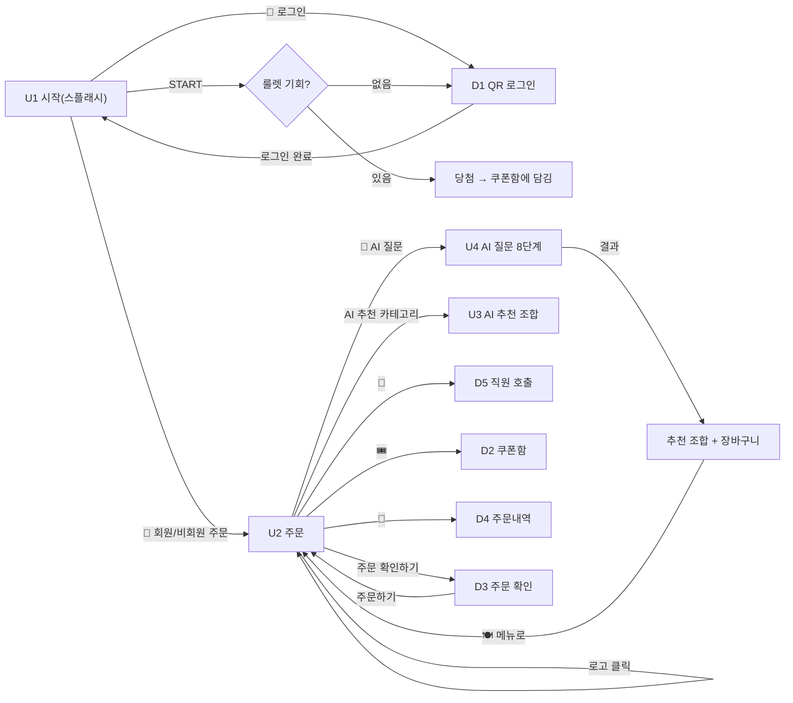
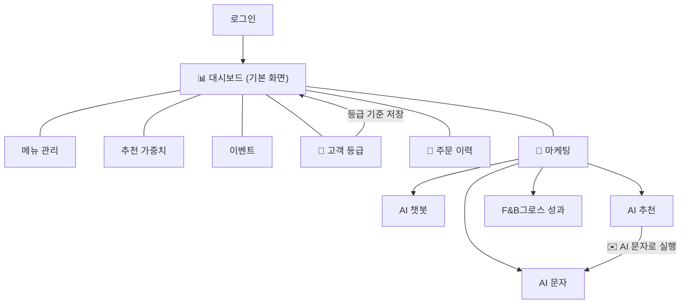

# F&BGrowth 화면 설계

> **문서 목적**: 프로젝트 평가용 화면 설계 최종본입니다. 손님 화면과 관리자 화면의 목록, 화면별 구성·기능, 이동 흐름을 와이어프레임 수준으로 설명합니다.
> **근거**: 2026-10-21 `user/`(손님 Streamlit), `admin/`(관리자 Streamlit) 코드와 시연 GIF(`docs/assets/`). 코드에서 확인하지 못한 내용은 **[확인 필요]** 로 표시했습니다.
> 관련 문서: [DB 설계](DB_설계.md) · [API 설계](API_설계.md)

## 1. 개요

| 항목 | 손님 화면 | 관리자 화면 |
|---|---|---|
| 대상 | 매장 테이블 태블릿을 쓰는 손님 | 사장님(OWNER) PC |
| 실행 | `streamlit run user/app.py --server.port 8501` (`?table=12`로 테이블 지정) | `streamlit run admin/app.py --server.port 8502` |
| 구성 | `app.py`(진입점) → `views/`(화면) · `ui/`(공용 조각·다이얼로그) · `state/`(세션 상태) | `app.py`(로그인·사이드바) → `views/`(화면) · `ui/` |
| 데이터 | 모든 화면이 `user/user_repository.py`만 호출 | 모든 화면이 `admin/admin_repository.py`만 호출 |
| 인증 | 비회원 주문 가능. QR+카카오 로그인 시 회원 | 사장님 이메일/비밀번호 로그인(Supabase) 또는 개발용 토큰 |
| 화면 단위 | 시작(스플래시) / 주문 / AI 질문 + 다이얼로그 5종 | 사이드바 메뉴 7그룹, 하위 탭 포함 |

화면 폴더 이름을 `pages`가 아닌 `views`로 쓰는 이유는 Streamlit이 `pages/`를 자동 멀티페이지로 인식하기 때문입니다.

## 2. 손님 화면

### 2.1 화면 목록

| # | 화면 | 파일 | 한 줄 설명 |
|---|---|---|---|
| U1 | 시작(스플래시) | `views/splash.py` | 룰렛, 로그인 진입, 주문 시작 |
| U2 | 주문 | `views/order.py` + `ui/cart.py` | 카테고리·메뉴 선택과 장바구니 |
| U3 | AI 추천 조합 | `views/ai.py` | 주문 화면의 'AI 추천' 카테고리 |
| U4 | AI 질문 | `views/ai.py` | 8개 질문에 답하고 추천 조합 받기 |
| D1 | 로그인 팝업 | `ui/login.py` | QR 로그인 |
| D2 | 쿠폰함 팝업 | `ui/coupons.py` | 쿠폰 사용/취소 |
| D3 | 주문 확인 팝업 | `ui/dialogs.py` | 주문 내용 확인 후 주문 |
| D4 | 주문내역 팝업 | `ui/dialogs.py` | 테이블 누적 주문 |
| D5 | 직원 호출 팝업 | `ui/dialogs.py` | 필요 항목 선택 후 호출 |
| D6 | 로그인한 회원 팝업 | `views/splash.py` | 이 태블릿 로그인 기록 |

### 2.2 이동 흐름



### 2.3 U1 시작(스플래시)

```
┌──────────────────────────────────────────────┐
│ [테마/미니 버튼]                              │
│        🍺 역전할머니맥주  홍대점               │
│   ┌───────── 행운의 룰렛 ─────────┐          │
│   │   (확률에 비례한 칸 크기)      │ [START] │
│   └────────────────────────────────┘          │
│   🎟️ 룰렛 기회 N회 남았어요 / 힌트 문구       │
│ ┌ QR 카드 ──────────────┐ ┌─ 시작 버튼 ─────┐ │
│ │ 회원이신가요?          │ │ 🍴 비회원 주문 ›│ │
│ │ [📱 로그인]            │ │ (로그인하면      │ │
│ └────────────────────────┘ │  🍴 회원 주문 ›)│ │
│ [👥 로그인한 회원 N명 보기]                   │
└──────────────────────────────────────────────┘
```

- 배경은 맥주·안주·펍 사진 슬라이드.
- 룰렛: 칸 색·라벨은 `roulette_prizes`(관리자가 설정)에서 읽고, 칸 크기는 확률에 비례. START를 누르면 서버가 가중치로 칸을 정함. 기회가 없으면 로그인 팝업을 띄움.
- 로그인한 뒤에는 카드에 `OO님 · 회원 로그인 완료! · 남은 룰렛 기회 N회`가 표시되고 버튼이 `➕ 다른 회원 로그인`으로 바뀜(한 태블릿에 여러 명 로그인 가능).
- `DEV_TEST_BUTTON=1`일 때만 `🧪 DB 테스트` 버튼이 보임(개발 전용).
- 시연: 

### 2.4 D1 QR 로그인 팝업

```
┌ 📱 휴대폰으로 로그인 ─────────────┐
│  (안내 문구: 룰렛/다른 회원)       │
│        ┌──────────┐               │
│        │   QR     │               │
│        └──────────┘               │
│  ① QR 스캔 → ② 카카오 로그인 → ③ 완료 │
│  상태 문구 / 남은 시간 4:59         │
│  [🔄 QR 재생성]                    │
└───────────────────────────────────┘
```

- 2초마다 상태를 확인하고(서버는 WebSocket도 지원) 완료되면 팝업이 닫히고 화면을 갱신.
- 상태별 문구: 대기 / 스캔 완료 / 만료됨 / 이미 로그인한 회원(거부).
- 서버에 연결할 수 없으면 "로그인을 사용할 수 없어요, 로그인하지 않아도 주문은 가능해요" 안내.
- 휴대폰에서는 광고 문자 수신 동의(선택) 체크 후 카카오 로그인.
- 시연: 

### 2.5 U2 주문

```
┌ 헤더: 🍺 매장명·지점·회원/비회원 | TABLE 12 | [🔔 직원호출][🎟️ 쿠폰함(n)][🧾 주문내역(n)] ┐
├───────────┬──────────────────────────────┬───────────────┤
│ 카테고리   │ 섹션 제목 (아이콘 이름 N)      │ 🛒 장바구니 N │
│ [💬 AI 질문]│ ┌────┐┌────┐┌────┐          │ 메뉴 − 수량 + 🗑│
│ 🔥 인기메뉴 │ │사진 ││사진 ││사진 │ 메뉴 카드 │ 할인 문구      │
│ 🍗 치킨 ... │ │이름 ││    ││    │          │ 총 주문금액    │
│ 🤖 AI 추천  │ │가격 ││    ││    │          │ [주문 확인하기]│
│            │ │[담기]│└────┘└────┘          │               │
└───────────┴──────────────────────────────┴───────────────┘
```

- 카테고리는 `categories` 테이블 기준(관리자가 편집). 가상 카테고리 `best`(인기메뉴, BEST 태그)와 `ai`(AI 추천 조합)는 메뉴를 직접 갖지 않음.
- 메뉴 카드: 사진·이름·설명·가격·`담기`(품절이면 `품절` 비활성). 같은 메뉴의 매운맛 단계는 한 카드에서 선택 버튼으로 고름.
- 장바구니: 수량 −/+, 삭제, AI 조합 할인·쿠폰 할인 표시, 총 주문금액, `주문 확인하기`.
- 로고를 누르면 인기메뉴로 이동.
- 시연: 

### 2.6 U3 AI 추천 조합 / U4 AI 질문

- **U3**: 기본 조건(2명·4만원·맵기 상관없음·맥주)으로 추천 조합 카드를 보여 줌. 카드에는 순위, 구성 메뉴(사진·수량), 추천 이유, 가격(회원은 정가 취소선 + 회원 할인가, 비회원은 로그인 안내), `N위 조합 담기`. `🔄 새로 추천받기` 제공. 제미나이 추천이 실패하면 규칙 기반 추천으로 대체하고 하단 문구로 알림.
- **U4**: 8개 질문(배고픔·스트레스·인원·성별·음식 종류·맵기·방문 목적·예산)을 한 장씩 보여 주고 선택하면 다음으로 이동. 상단에 진행바(답한 칸은 눌러 수정), `←` 이전, `🍽️ 메뉴로 돌아가기`. 시간대·날씨는 자동 반영. 마지막에 결과 화면(답변 요약 버튼, 추천 조합 카드, 오른쪽 장바구니, `처음부터 다시 질문`, `메뉴 보러가기`).
- 추천 노출은 서버에 기록되고, 추천 조합을 담아 주문하면 주문에 연결되어 관리자의 AI 추천 적중률로 집계됨.
- 시연: 

### 2.7 팝업 화면

| 팝업 | 구성 | 동작 |
|---|---|---|
| D2 쿠폰함 | 쿠폰 목록(이모지·혜택·`OO님`·상태: 사용 가능/적용 중/사용 완료), `사용`/`취소` 버튼 | 로그인 전에는 안내 문구. 사용을 누르면 장바구니에 적용, 주문하면 사용 처리 |
| D3 주문 확인 | 주문 줄·할인 내역·총 주문금액, `돌아가기`/`주문하기` | 주문하기 → 서버 저장, 성공 토스트(주문번호), 장바구니 비움. 쿠폰이 유효하지 않으면 주문 실패 안내 |
| D4 주문내역 | 주문별 줄·소계, 하단 누적 주문금액 | 로그인 시각 이후 이 테이블의 주문만 합산 |
| D5 직원 호출 | 항목 복수 선택(물·수저 등), `호출하기` | 호출 기록 저장, 토스트 |
| D6 로그인한 회원 | 순번·닉네임·로그인 시각·룰렛 상태 | 회원이 많아도 시작 화면이 길어지지 않도록 팝업 |

## 3. 관리자 화면

### 3.1 화면 목록

사이드바(`MENU`)는 아래 7개 그룹이고, 선택은 주소(`?page=&tab=`)에 저장되어 새로고침해도 유지됩니다.

| 사이드바 메뉴 | 하위 탭 | 파일 | 한 줄 설명 |
|---|---|---|---|
| (로그인) | - | `views/login.py` | 사장님 로그인 |
| 📊 대시보드 | 한눈에 보기 / 오늘·매출 / 매출 추이 / 고객 분석 / 메뉴 | `views/dashboard.py` | 매출·고객·메뉴 통계 |
| 메뉴 관리 | - | `views/menu.py` | 카테고리·메뉴 등록·수정·삭제 |
| 추천 가중치 | - | `views/weights.py` | 메뉴별 AI 추천 가중치 |
| 이벤트 | - | `views/events.py` | 룰렛 칸 구성·확률 |
| 👥 고객 등급 | 고객 목록 / 등급 분류 기준 | `views/customers.py` | 고객 등급과 기준 |
| 🧾 주문 이력 | 전체 주문 / 고객별 주문 | `views/orders.py` | 주문 조회·필터 |
| 💬 마케팅 | AI 챗봇 / AI 추천 / AI 문자 / F&B그로스 성과 | `views/marketing.py`, `views/growth_performance.py` | AI 마케팅 도구 |

### 3.2 이동 흐름



### 3.3 로그인

```
        🍺 F&B Growth 관리자
   ┌──────────────────────────┐
   │ 이메일                    │
   │ 비밀번호                  │
   │ [사장님 로그인]           │
   └──────────────────────────┘
   사장님으로 등록된 계정만 들어올 수 있어요
```

- Supabase 설정이 있으면 이메일/비밀번호 로그인, 없으면 `관리자 토큰` 입력(개발용).
- 로그인 토큰은 쿠키에 1시간 저장되어 새로고침해도 유지, 만료되면 로그인 화면으로 돌아옴.
- `APP_ENV=dev`에서는 토큰 입력을 생략하고 자동 입장(끄려면 `ADMIN_SKIP_TOKEN=0`).
- 공통 레이아웃: 왼쪽 사이드바(브랜드, 메뉴, 매장 `OWNER` 표시, 서버/더미 데이터 표시, 로그아웃).

### 3.4 대시보드

- 상단 KPI 카드 + 패널(막대 그래프) 구성. `🔄 최신 주문 반영` 버튼으로 다시 계산.
- 한눈에 보기: 오늘 주문·평균 주문금액·오늘/마지막 영업일 매출·최근 7·30일 매출·테이블 회전율·평균 객단가, 시간대별·요일별·일별(14일) 매출, 주문 금액대 분포.
- 고객 분석: 오늘 신규/재방문 고객, 재방문 비율, 회원 매출 비중, 고객 등급별 주문 고객, 주문 테이블 TOP 5, 연령대, 성별.
- 메뉴: 인기 메뉴 TOP 10(음식·주류 패널 분리 가능), 품절 메뉴·품절된 인기 메뉴.
- 시연: 

### 3.5 메뉴 관리 / 추천 가중치 / 이벤트

```
┌ 카테고리 목록 ┬ 선택한 카테고리 ──────────────────────┐
│ 🍗 치킨 (n)    │ [등록된 메뉴] [＋ '치킨'에 메뉴 등록]    │
│ ...            │ 표 편집(이름·가격·설명·매운맛·품절·이벤트 등)│
│ ＋ 카테고리 추가│ 삭제할 행 체크 → 저장                   │
│ ✏️ 수정·삭제   │                                        │
└────────────────┴────────────────────────────────────────┘
```

- **메뉴 관리**: 왼쪽 카테고리(추가·수정·삭제, 메뉴가 있으면 삭제 불가 안내), 오른쪽 메뉴 표 편집·삭제와 새 메뉴 등록 폼(이름·설명·이미지 URL 등). 선택한 카테고리는 주소 `?cat=`에 저장.
- **추천 가중치**: 같은 구성. 표의 '추천 가중치'(0~100, 기본 50)를 고쳐 저장. 높을수록 AI 추천 조합에 우선 반영.
- **이벤트**: 룰렛 설정. 칸 색을 이은 원 미리보기와 칸별 확률 목록, 칸 편집(종류: 할인/서비스 메뉴, 할인율, 서비스 메뉴 선택, 확률), `＋ 룰렛 칸 추가`, `저장하기`. 칸은 2~8개, 확률은 정수이고 합계 100%.

### 3.6 고객 등급 / 주문 이력

- **고객 목록**: 등급 필터(신규·재방문·단골·휴면)와 표(닉네임·성별·연령대·방문 횟수·마지막 방문·마케팅 동의·수신거부·등급), 등급별 인원 집계.
- **등급 분류 기준**: 재방문·단골 방문 횟수와 휴면 일수 입력 → 조건표 미리보기 → `기준 저장`(저장 전에는 집계가 바뀌지 않음), `↩ 기본값으로 되돌리기`. 판정은 휴면 → 단골 → 재방문 → 신규 순.
- **주문 이력**: 전체 주문 / 고객별 주문. 기간·조건 필터와 주문 표, 고객별은 고객 선택 후 누적 주문 금액 표시.

### 3.7 마케팅

| 탭 | 구성 |
|---|---|
| AI 챗봇 | 대화방 선택 상자, `🆕 새 대화`, 질문 입력 → 제미나이 답변(매출·휴면 손님·인기 메뉴 등). 시연:  |
| AI 추천 | `✨ AI 추천 받기` → 1. AI 문자 추천 카드(`✉️ AI 문자로 실행`), 2. 기타 AI 추천 카드, `🔄 재추천`. 하단에 손님 응대 제안: 테이블 배치도(새 제안 테이블 강조)와 제안 카드(`확인`/`미확인으로 되돌리기`), 새 로그인·주문 알림 토스트(10초 주기 확인). 시연:  |
| AI 문자 | 상단 KPI(이번 달 SMS/LMS 사용량, 솔라피 잔액, 발송 가능 고객, 수신거부). 하위 탭 `문자 작성`(대상 등급·수신자 체크 목록·본문·휴대폰 미리보기·SMS/LMS 바이트 표시·예약, AI 문자 후보), `발송 내역`(상태 태그·예약 취소), `수신거부 · 안내`. 시연:  |
| F&B그로스 성과 | AI 도입 전후 월환산 비교 차트, 최근 30일 AI 주문 성과, 성과 수수료율 입력, `🔄 최신 데이터 반영` |

## 4. 화면 공통 규칙

### 4.1 데이터·제품 규칙

- 손님·관리자 모두 데이터는 repository를 통해서만 접근하며, `DATA_SOURCE=dummy|api|auto`로 더미/서버를 전환(관리자 사이드바에 `🟢 서버 데이터`/`🧪 더미 데이터` 표시).
- 제품 규칙: 주문 상태(접수/조리중) 화면은 없음, 룰렛은 회원당 하루 1회, 쿠폰은 쿠폰함에서 사용/취소.
- 서버를 쓸 수 없을 때 손님 화면은 안내 문구를 보여 주고(로그인 불가, 규칙 기반 추천 대체), 로그인 없이 주문은 계속 가능.

### 4.2 화면 유형별 분류

| 유형 | 손님 | 관리자 |
|---|---|---|
| 메인 | U1 시작(스플래시), U2 주문 | 📊 대시보드 |
| 상세·목록 | D4 주문내역, D6 로그인한 회원, U3 추천 조합 | 🧾 주문 이력, 고객 목록, 발송 내역, 챗봇 대화 |
| 입력 | D1 QR 로그인(휴대폰 동의 체크), D5 직원 호출(항목 선택), U4 AI 질문 8단계 | 사장님 로그인, 메뉴 등록 폼, 문자 작성, 챗봇 질문 입력 |
| 설정 | - | 추천 가중치, 이벤트(룰렛 칸·확률), 고객 등급 분류 기준 |
| 확인 | D3 주문 확인, D2 쿠폰함 | 메뉴 삭제 확인 창 |
| 오류·예외 | QR 만료·중복 로그인 거부, 서버 연결 불가 안내, 쿠폰 사용 불가 | 로그인 실패, 저장된 로그인 만료, 서버 오류 안내 |

### 4.3 공통 디자인 기준

색상·글꼴·여백은 CSS와 Streamlit 설정 파일의 값입니다.

| 항목 | 손님 화면 (`user/app.css`, `user/.streamlit/config.toml`) | 관리자 화면 (`admin/admin.css`, `admin/.streamlit/config.toml`) |
|---|---|---|
| 테마 | 다크(기본). `?theme=light`이면 `app_light.css`를 덧씌움 | 라이트 |
| 배경 | `#121214`, 보조 배경 `#1e1e22` | `#f6f5f2`, 카드 `#ffffff` |
| 글자색 | `#f5f5f5` | 본문 `#1d1b19`, 보조 `#57534e`, 흐린 글씨 `#8a857e` |
| 주색(강조) | 앰버 `#ffb703` (호버 `#ffc933`) | 오렌지 `#e8590c` (진한 `#c2410c`, 연한 배경 `#fff1e8`) |
| 의미 색 | 성공 `#37b36b`, 경고 `#ffc933`, 오류 `#f1566f`, 정보 `#5b8def`, 보조 `#9b6bd6` | 성공 `#15803d`/`#e7f6ec`, 경고 `#b45309`/`#fef3c7`, 오류 `#b91c1c`/`#fee2e2` |
| 글꼴 | Streamlit 기본 sans-serif (별도 지정 없음) | Pretendard → 시스템 한글 글꼴(Apple SD Gothic Neo, Noto Sans KR, 맑은 고딕) → sans-serif |
| 글자 크기 | 본문 15~16px, 보조 12~13px, 카드 제목 20px(굵게 800) | 본문 13.5~14px, 보조 12~13px, 패널 제목 16px(800), KPI 값 30px(800) |
| 버튼 | 높이 44px 이상, 모서리 12px. 주 버튼은 앰버 바탕·어두운 글씨, 보조 버튼은 `#26262b` 바탕·`#34343b` 테두리. 비활성은 `#303036` | Streamlit 기본 버튼(주 버튼 `#e8590c`), 표 안 체크박스로 선택 |
| 카드·패널 | 모서리 16px, 테두리 `#39323f`, 안쪽 여백 18~20px | 모서리 14px, 테두리 `#e7e4de`, 안쪽 여백 18~22px, 얕은 그림자 |
| 간격 | 화면 바깥 여백 24px, 요소 간격 8~12px | KPI 카드 사이 16px, 막대 행 사이 11px |
| 표·차트 | 장바구니·주문 줄은 목록형 | 표(편집 가능한 데이터 표), 막대 그래프(주황 그라데이션 `#ffa94d → #e8590c`, 값은 오른쪽 정렬·숫자 고정폭) |
| 입력 폼 | 선택 버튼형(퀴즈), 체크박스(동의) | 텍스트·숫자 입력, 비밀번호는 마스킹, 입력 도움말은 `st.caption` |
| 포커스 | 키보드 포커스 시 `#ffcf54` 3px 윤곽선 | Streamlit 기본 |
| 증감 표시 | - | 증가 빨강 `#dc2626`, 감소 파랑 `#2563eb` (전주 대비) |

### 4.4 사용자 액션과 반응

피드백 방식: **토스트**(`st.toast`, 몇 초 뒤 사라짐: 성공 ✅·경고 ⚠️), **알림 박스**(`st.error`/`warning`/`info`/`success`, 화면에 남음), **스피너**(`st.spinner` 문구), **자리표시 문구**(`cart-empty`/`empty` 빈 상태).

#### 손님 화면

| 액션 | 상태 변화 | API 호출 | 로딩 | 성공 | 실패·예외 |
|---|---|---|---|---|---|
| 시작 화면 열기(`?table=12`) | 테이블 번호 설정, 매장·룰렛·메뉴 불러오기 | `GET /api/store`, `/api/v1/roulette/prizes`, `/api/menus` 등 | 첫 요청은 서버가 잠들어 있으면 최대 40초 대기 | 시작 화면 표시 | 서버 연결 불가 → 더미/안내 문구로 대체 |
| `📱 로그인` 클릭 | 로그인 팝업(D1) 열림, QR 표시 | `POST /api/auth/qr` | QR 준비 중 | QR·남은 시간 표시 | 서버 불가 → "로그인을 사용할 수 없어요. 로그인하지 않아도 주문은 가능해요" |
| 휴대폰에서 QR 스캔·카카오 로그인 | 팝업 상태가 대기 → 스캔 완료 → 완료 | `GET /api/auth/qr/{secret}` 2초마다 폴링 | 단계 표시줄(①②③)과 남은 시간 | 팝업 닫힘, 회원 로그인 표시, 룰렛 기회 갱신, URL에 토큰 저장 | 만료(`expired`)→ "QR이 만료되었어요" + `🔄 QR 재생성`, 중복 로그인(`rejected`)→ "이미 이 태블릿에서 로그인한 회원이에요" |
| `START`(룰렛) 클릭 | 룰렛이 돌고 당첨 칸에서 멈춤, 쿠폰함에 쿠폰 추가 | `POST /api/v1/roulette/plays` | 회전 애니메이션 | 당첨 안내 + 쿠폰 개수 갱신 | 기회 없음 → 로그인 팝업, 오늘 이미 참여(409)·서버 오류 → ⚠️ 토스트 |
| 메뉴 `담기` 클릭 | 장바구니 수량 +1, 합계 갱신 | 없음(화면 상태) | 없음 | 장바구니에 줄 추가 | 품절 메뉴는 버튼 비활성, 품절된 조합은 🙏 토스트 |
| 장바구니 −/＋/🗑 | 수량 변경·삭제, 합계·할인 재계산 | 없음 | 없음 | 즉시 반영 | 빈 장바구니면 "메뉴를 담아주세요" 🍻 |
| `🎟️ 쿠폰함` → `사용`/`취소` | 쿠폰이 "적용 중"으로 바뀌고 장바구니에 할인 반영 | `GET /api/tables/{n}/coupons` (열 때) | - | 할인 문구와 합계 갱신 | 로그인 전에는 "로그인하고 룰렛을 돌리면 쿠폰이 여기에 담겨요", 쿠폰 없으면 "아직 받은 쿠폰이 없어요" |
| `주문 확인하기` → `주문하기` | 주문 줄 저장, 장바구니 비움, 주문내역에 추가 | `POST /api/orders` (쿠폰 사용 포함) | 서버 응답 대기 | ✅ 토스트 "주문이 접수되었습니다 (주문번호 #n)" | 쿠폰 사용 불가(409) → 주문 접수 안 함, 쿠폰함 새로고침, ⚠️ 토스트 "쿠폰을 사용할 수 없어 주문하지 못했어요" |
| `🧾 주문내역` 클릭 | 팝업 열림, 누적 금액 표시 | `GET /api/v1/tables/{n}/orders` | - | 주문별 줄·소계·누적 금액 | 주문이 없으면 "아직 주문 내역이 없어요" |
| `🔔 직원 호출` → `호출하기` | 호출 저장 | `GET /api/v1/staff-call-items`, `POST /api/calls` | - | 🔔 토스트 "직원이 곧 도착합니다" | [확인 필요] 서버 불가 시 안내 문구 |
| `💬 AI 질문` 답변 선택 | 다음 질문으로 이동, 진행바 갱신 | 마지막에 `POST /api/v1/ai/recommendations/generate` | 결과 계산 중 | 추천 조합 카드 표시 | 제미나이 실패·키 없음(503) → 규칙 기반 추천으로 대체하고 하단에 안내 |
| `조합 담기` 클릭 | 조합이 장바구니에 담김 | 없음 | - | 🛒 토스트 "할인된 가격으로 조합을 담았어요"(회원) / "조합을 담았어요"(비회원) | 조건에 맞는 조합이 없으면 "선택한 조건에 맞는 조합이 없어요. 예산이나 인원을 바꿔서 다시 골라 보세요" |
| 로고 클릭 | 인기메뉴로 이동 | 없음 | - | 인기메뉴 섹션 | - |

#### 관리자 화면

| 액션 | 상태 변화 | API 호출 | 로딩 | 성공 | 실패·예외 |
|---|---|---|---|---|---|
| `사장님 로그인` / 토큰 `로그인` | 세션에 토큰 저장, 쿠키 1시간 저장, 대시보드 진입 | `POST /api/auth/owner/login` (토큰 방식은 보호 API 호출로 확인) | - | 대시보드 표시 | `st.error`로 사유 표시(이메일·비밀번호 불일치 401, 미등록 계정 403, Supabase 미설정 503). 저장된 로그인이 만료되면 "저장된 로그인으로 입장하지 못했어요: …" 경고 |
| 사이드바 메뉴/탭 클릭 | 선택한 화면으로 이동, 주소 `?page=&tab=` 갱신 | 화면별 조회 API | 화면 전환 시 다시 그림 | 해당 화면 | 서버 불가 → "서버를 켜고 `DATA_SOURCE=api`로 실행하세요" 안내 |
| 대시보드 `🔄 최신 주문 반영` | 통계를 다시 계산 | `GET /admin/api/stats…` | - | 숫자·그래프 갱신 | 주문이 없으면 "아직 주문이 없어요." 빈 상태 |
| 메뉴 표 편집 → `저장` | 변경한 행이 저장됨 | `PUT /admin/api/menus/{id}` (일괄) | - | ✅ 토스트 "저장했습니다. (수정 n개, 삭제 m개)" | `st.error` "저장하지 못했습니다: …"(422 입력 오류 등), `↩ 되돌리기`는 저장하지 않은 변경 취소 |
| 메뉴 삭제 체크 → `🗑 선택 삭제` | 확인 창이 열림 → 확인하면 삭제 | `PUT /admin/api/menus/{id}` (`delete`) | - | 🗑️ 토스트 "선택한 메뉴 n개를 삭제했어요" | `st.error` "삭제하지 못했습니다: …" |
| 카테고리 추가·수정·삭제 | 목록 갱신 | `POST·PATCH·DELETE /admin/api/categories` | - | ✅ 토스트 | 메뉴가 남은 카테고리 삭제(409), 이름 누락(422) → `st.error`에 서버 문구 |
| 이벤트 `저장하기` | 룰렛 칸 전체 교체 | `PUT /admin/api/owner/roulette/prizes` | - | 저장 안내 | 칸 2~8개·확률 합계 100% 위반(422) → 오류 문구 |
| 고객 등급 `기준 저장` | 저장 후 목록·통계 재계산 | `PUT /admin/api/customers/grades/rules` | - | 기준 저장 안내 | 단골 ≤ 재방문(422) → 서버 문구 표시. 저장 전에는 미리보기만 바뀜 |
| 문자 `미리보기` / `발송` | 대상 수·비용·문제 목록 표시, 발송 시 기록 | `POST /admin/api/marketing/sms/preview`, `/send` | 버튼 처리 중 | `{n}명 발송 처리했습니다.` / `예약했습니다.` 토스트 | 대상 없음·한도 초과 등 `problems`를 줄별 경고로 표시. 발송 실패는 `st.error("발송하지 못했습니다: …")` |
| 챗봇 질문 입력 | 질문이 대화에 추가되고 답변이 이어짐 | `POST …/chat/sessions/{id}/messages` | 스피너 "답변을 만드는 중이에요..." | 답변 말풍선 | ⚠️ 토스트 "답변을 받지 못했어요: …"(제미나이 502), 서버 미연결이면 규칙 기반 모의 응답 안내 |
| `✨ AI 추천 받기` | 문자·기타 추천 카드 생성 | `GET /admin/api/marketing/opportunities` | 생성 중 | 카드 표시 | `st.error` "DB 기반 마케팅 추천을 불러오지 못했어요: …", 추천이 없으면 안내 문구 |
| 응대 제안 `확인` | 카드가 확인됨으로 이동 | `PUT /admin/api/marketing/tip-checks` | - | 카드 이동 | ⚠️ 토스트 "확인 상태를 저장하지 못했어요. 잠시 후 다시 시도해 주세요." |

#### 입력 방식별 반응

| 방식 | 반응 |
|---|---|
| 클릭 | 버튼·카드·탭은 위 표대로 동작. 클릭 직후 화면을 다시 그려(`st.rerun`) 상태를 반영 |
| 호버 | 손님 보조 버튼은 테두리와 글자가 앰버로, 주 버튼은 밝은 앰버로 바뀜. 관리자 화면의 호버 색은 [확인 필요]. 터치 태블릿에서는 호버가 없음 |
| 드래그 | 별도 드래그 동작은 제공하지 않음. 룰렛은 `START` 클릭으로 돌림 |
| 스크롤 | 메뉴 목록·표·팝업 본문은 세로 스크롤. 손님 시작 화면은 길어지지 않도록 로그인 회원 목록을 팝업(D6)으로 분리 |
| 필터 | 고객 목록(등급), 주문 이력(기간·조건·고객), 대시보드 탭. 선택하면 조회 API를 다시 부르고 표가 바뀜. 결과가 없으면 빈 결과 문구 |
| 새로고침 | 손님: 주소의 `?table=`·로그인 토큰으로 로그인 복원. 관리자: 주소 `?page=&tab=&cat=`와 쿠키 토큰으로 화면·로그인 복원 |
| 자동 갱신 | 손님 QR 팝업 2초마다 로그인 상태 확인, 관리자 마케팅 응대 제안 10초마다 새 로그인·주문 확인(새 항목은 토스트) |

### 4.5 상태별 화면 (로딩·빈·실패)

| 상태 | 손님 화면 | 관리자 화면 |
|---|---|---|
| 로딩 | 서버 응답 대기(최대 40초, 연결 자체가 안 되면 5초 후 실패). QR 대기는 단계 표시줄과 남은 시간 | 스피너 문구(예: "답변을 만드는 중이에요..."), 화면 전환 시 다시 그림 |
| 빈 결과 | "메뉴를 담아주세요"(장바구니), "아직 받은 쿠폰이 없어요", "아직 주문 내역이 없어요", "지금 추천할 수 있는 조합이 없어요" | "아직 주문이 없어요.", "아직 등록된 메뉴가 없어요", "아직 발송 내역이 없어요.", "오늘은 응대 제안이 있는 테이블이 없어요." |
| 요청 실패(4xx) | 서버가 준 `detail`을 토스트로 안내(쿠폰 사용 불가, 룰렛 이미 참여 등) | 같은 `detail`을 `st.error`/토스트로 표시하고 입력은 유지해 고쳐서 다시 시도 |
| 서버 오류·연결 불가(5xx) | "로그인을 사용할 수 없어요", 규칙 기반 추천으로 대체, 로그인 없이 주문 가능 | "서버에서 정보를 가져오지 못했습니다: …" 등 오류 박스와 `DATA_SOURCE` 안내 |
| 인증 실패 | QR 만료·중복 로그인 문구와 `🔄 QR 재생성` | 로그인 화면으로 복귀, `st.error`로 사유 표시 |
| 다시 시도 방법 | `🔄 QR 재생성`, 팝업 닫고 다시 열기, 주문 실패 시 쿠폰함 확인 후 다시 주문 | 같은 버튼을 다시 누르기, `🔄 최신 주문 반영`, 로그아웃 후 재로그인 |

오류 응답의 형식과 상태 코드별 의미는 [API 설계 10. 오류 응답 규칙](API_설계.md#10-오류-응답-규칙)에 있습니다.

## 5. 확인 필요

- 위 ASCII 와이어프레임은 코드 구조를 기반으로 한 개략도이며, 정확한 시각 디자인은 `user/app.css`, `admin/admin.css`와 시연 GIF로 확인해야 합니다.
- 4.3의 글자 크기·여백은 CSS에서 자주 쓰는 값을 정리한 것이며, 모든 요소가 이 값을 따르지는 않습니다. 화면 폭에 따른 레이아웃 변경(`@media`)은 손님 화면의 AI 결과·시작 화면에 있고 모든 화면에 반응형이 적용된 것은 아닙니다.
- 4.4의 호버·스크롤 설명은 CSS와 Streamlit 기본 동작 기준이며, 터치 태블릿에서는 호버가 없습니다.
- 4.4의 `로딩` 칸은 코드에 스피너/대기가 있는 경우만 적었습니다. 그 외에는 Streamlit 기본 실행 표시(우상단 "Running")만 나타납니다.
- 관리자 대시보드의 일부 패널(예: 음식·주류 인기 메뉴 분리)은 서버가 구분 값을 줄 때만 나뉩니다.
- 스크린샷 대신 GIF(`docs/assets/`)만 저장소에 있습니다. 평가용 정지 이미지가 필요하면 별도로 캡처해야 합니다.
